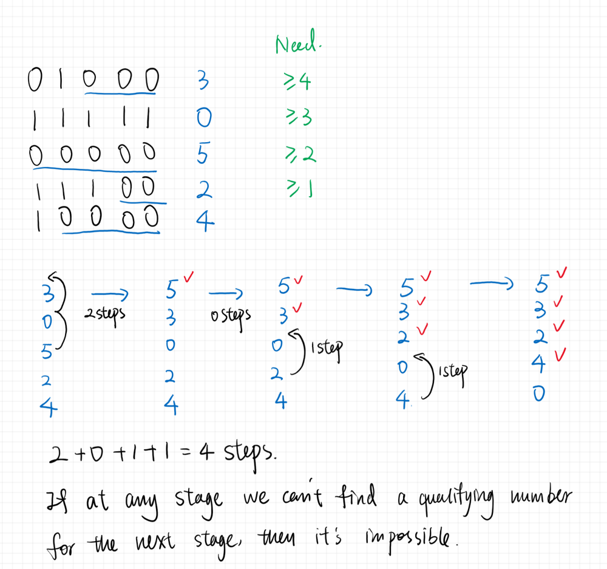

# Java Count Trailing Zeros Greedy Solution with Visualization

**Author:** YuqiZ2020
**Votes:** 23
**Link:** [https://leetcode.com/problems/minimum-swaps-to-arrange-a-binary-grid/solutions/769090/](https://leetcode.com/problems/minimum-swaps-to-arrange-a-binary-grid/solutions/769090/)

---

Since we want all zeros above the diagonal lines, We only care about the trailing zeros of each row. So the matrix can be simplified into a 1D array containing the trailing zeros of each row. 

Then we want to satisfy the trailing zero requirements for each row to make all zeros above diagonal. For example if it was a 4 * 4 Matrix we want 
```
trailing zeros >= 3 for row 1
trailing zeros >= 2 for row 2
trailing zeros >= 1 for row 3
no requirement for row 4
```


The greedy approach is here: For each row from top to bottom we want to go down to subsequent rows to find the closest row that satisfy the requirement for this row and perform the swaps. Notice that since we want minimum number of swaps we don't necessarily want the biggest trailing zero number, since it might be too far away and cost more steps. We simply want the closest one that meet the requirement. 

Here is an example: 

We can see that for the first row we directly use the row with 5 zeros because it was two steps away. For the second row since it is already satisfied, we don't need to pull the row with 4 trailing zeros up. Then the 1D array is not completly sorted in the end but we meet all the requirements. 

If at any stage we can't find any more qualifying numbers, then we return -1. 

Here is my code: 
```Java
class Solution {
    public int minSwaps(int[][] grid) {
        int n = grid.length;
        int[] conseq0 = new int[n]; // Count trailing zeros for all rows
        for (int i = 0; i < n; ++i)
        {
            int counter = 0;
            for (int j = n - 1; j >= 0; --j)
            {
                if (grid[i][j] != 0)
                    break;
                counter++;
            }
            conseq0[i] = counter;
        }
        int numNeeded = n - 1;
        int ans = 0;
        while (numNeeded > 0)
        {
            boolean flag = false;
            for (int i = n - numNeeded - 1; i < n; ++i)
            {
                if (conseq0[i] >= numNeeded)
                {
                    //Perform the swaps
                    int temp = conseq0[i];
                    for (int k = i; k > n - numNeeded - 1; --k)
                        conseq0[k] = conseq0[k - 1];
                    conseq0[n - numNeeded - 1] = temp;
                    flag = true;
                    //Calculate the number of swaps
                    ans += i - (n - numNeeded - 1);
                    break;
                }
            }
            if (!flag)
                return -1;
            numNeeded--;
        }
        return ans;
    }
}
```
