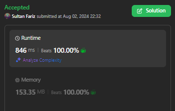

# [Elixir | Go] Two Pointers Approach | Beats 100%

**Author:** sultanfariz
**Votes:** 0
**Link:** [https://leetcode.com/problems/get-the-maximum-score/solutions/5574795/](https://leetcode.com/problems/get-the-maximum-score/solutions/5574795/)

---



# Approach
The main idea is to retrieve the common elements (checkpoints) first. Then we could calculate the sum of every elements that exist before each checkpoint. Then after the last checkpoint, we could just sum the remained elements and compare them.


# Complexity
- Time complexity:
$$O(n)$$

- Space complexity:
$$O(1)$$

# Code
```Elixir []
defmodule Solution do
  @spec max_sum(nums1 :: [integer], nums2 :: [integer], sum1 :: integer, sum2 :: integer) :: integer
  defp max_sum([], [], sum1, sum2) when sum1 > sum2, do: sum1
  defp max_sum([], [], sum1, sum2), do: sum2
  defp max_sum([a | b], [], sum1, sum2), do: max_sum(b, [], sum1+a, sum2)
  defp max_sum([], [c | d], sum1, sum2), do: max_sum([], d, sum1, sum2+c)
  defp max_sum([a | b], [c | d], sum1, sum2) when a < c, do: max_sum(b, [c | d], sum1+a, sum2)
  defp max_sum([a | b], [a | d], sum1, sum2) do
    max = if sum1 > sum2, do: sum1, else: sum2
    max + a + max_sum(b, d, 0, 0)
  end
  defp max_sum([a | b], [c | d], sum1, sum2), do: max_sum([a | b], d, sum1, sum2+c)

  @spec max_sum(nums1 :: [integer], nums2 :: [integer]) :: integer
  def max_sum(nums1, nums2), do: max_sum(nums1, nums2, 0, 0) |> rem(1000000007)
end
```
```Go []
func maxSum(first []int, second []int) (res int) {
	// do loop to retrieve the same element / checkpoints
	firstMap := make(map[int]bool)
	for _, el := range first {
		firstMap[el] = true
	}
	checkpoints := []int{}
	for _, el := range second {
		if firstMap[el] {
			checkpoints = append(checkpoints, el)
		}
	}

	// do loop for two arrays to sum elements that exist before checkpoints
	firstSum, secondSum := 0, 0
	i, j := 0, 0
	for i < len(first) || j < len(second) {
		if len(checkpoints) == 0 {
      if i < len(first) {
        firstSum += first[i]
        i++
      }
      if j < len(second) {
        secondSum += second[j]
        j++
      }
      continue
		}


		if i < len(first) && first[i] < checkpoints[0] {
			firstSum += first[i]
			i++
		}
		if j < len(second) && second[j] < checkpoints[0] {
			secondSum += second[j] 
			j++
		}

		// check if already reached checkpoint
		if first[i] == second[j] && first[i] == checkpoints[0] {
			res += checkpoints[0] + max(firstSum, secondSum)

			firstSum, secondSum = 0, 0
			checkpoints = checkpoints[1:] // remove the past checkpoint 
      i, j = i+1, j+1
		}
	}

	res += max(firstSum, secondSum)

	return res % 1000000007
}

func max(a, b int) int {
  if a > b { return a }
  return b
}
```