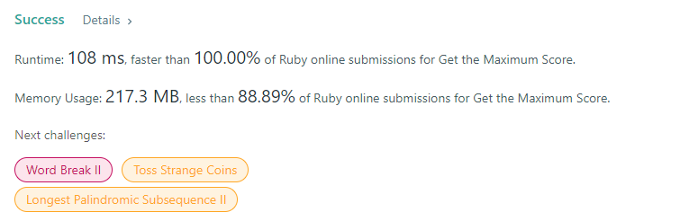

# C艹 (92ms 93.35% faster)/ Ruby(100% faster)

**Author:** Vucius
**Votes:** 0
**Link:** [https://leetcode.com/problems/get-the-maximum-score/solutions/1195913/](https://leetcode.com/problems/get-the-maximum-score/solutions/1195913/)

---

# C\u8279
```
int la, lb, i, j;
        long int res, tmpa, tmpb;
        la = nums1.size();
        lb = nums2.size();
        for (i = j = 0, res = tmpa = tmpb = 0; i < la && j < lb; ){
            if (nums1[i] < nums2[j]){
                tmpa += nums1[i++];
                //tmpa %= 1000000007;
            }
            else if (nums1[i] == nums2[j]){
                res += max(tmpa, tmpb) + nums1[i];
                //res %= 1000000007;
                tmpa = tmpb = 0;
                i++;
                j++;
            }
            else {
                tmpb += nums2[j++];
                //tmpb %= 1000000007;
            }
        }
        while (i < la) {
            tmpa += nums1[i++];
        }
        while (j < lb){
            tmpb += nums2[j++];
        }
        res += max(tmpa, tmpb);
        
        return res % 1000000007;
```
# Rbuy
```
def max_sum(nums1, nums2)
    res = tmpa = tmpb = 0
    i = j = 0
    while i < nums1.length && j < nums2.length
        if nums1[i] < nums2[j]
            tmpa += nums1[i]
            i += 1
        elsif nums1[i] == nums2[j]
            # tmpa %= 1000000007
            # tmpb %= 1000000007
            res += [tmpa, tmpb].max + nums1[i]
            i += 1
            j +=1
            tmpa = tmpb = 0
        else
            tmpb += nums2[j]
            j += 1
        end
    end
    while i < nums1.length
        tmpa += nums1[i]
        i += 1
    end
    while j < nums2.length
        tmpb += nums2[j]
        j += 1
    end
    # tmpa %= 1000000007
    # tmpb %= 1000000007
    res += [tmpa, tmpb].max
    res %= 1000000007
    
end
```
hh
