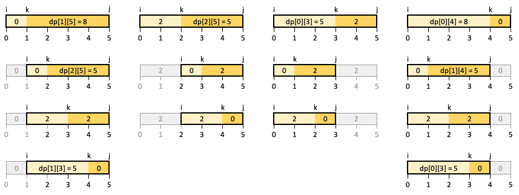

# DP with picture (Burst Balloons)

**Author:** votrubac
**Votes:** 303
**Link:** [https://leetcode.com/problems/minimum-cost-to-cut-a-stick/solutions/780880/](https://leetcode.com/problems/minimum-cost-to-cut-a-stick/solutions/780880/)

---

#### Intuition
Similar problems:
- [312. Burst Balloons](https://leetcode.com/problems/burst-balloons/)
- [1000. Minimum Cost to Merge Stones](https://leetcode.com/problems/minimum-cost-to-merge-stones/)
- [1039. Minimum Score Triangulation of Polygon](https://leetcode.com/problems/minimum-score-triangulation-of-polygon/)
	- Check out ["with picture" solution](https://leetcode.com/problems/minimum-score-triangulation-of-polygon/discuss/286753/C%2B%2B-with-picture), and also - how the heck that problem is "Medium"??

To make it simpler, we add two sentinel values to `cuts` - left and right edges of the stick. Then, we sort the cuts so we can easily identify all cuts between two points. DFS can help us find the most efficient sequence of cuts. To avoid recomputation, we memoise the best answer for stick between `cuts[i]` and `cuts[j]` in `dp[i][j]`.

In the following example, you can see the first cut at points `1` (or `4`) results in total cost of `13` (`5 + 0 + 8`). If we first cut at point `2` (or `3`), the cost will be `12` (`5 + 2 + 5`).


#### Top-Down DP
**C++**
```cpp
int dp[102][102] = {};
int dfs(vector<int>& cuts, int i, int j) {
    if (j - i <= 1)
        return 0;
    if (!dp[i][j]) {
        dp[i][j] = INT_MAX;
        for (auto k = i + 1; k < j; ++k)
            dp[i][j] = min(dp[i][j], 
                cuts[j] - cuts[i] + dfs(cuts, i, k) + dfs(cuts, k, j));
    }
    return dp[i][j];
}
int minCost(int n, vector<int>& cuts) {
    cuts.push_back(0);
    cuts.push_back(n);
    sort(begin(cuts), end(cuts));
    return dfs(cuts, 0, cuts.size() - 1);
}
```

#### Bottom-Up DP
After you figure out top-down DP, it's easy to convert it to bottom-up solution.  The only trick here is to move `i` backward. This ensures that smaller cuts are processed before calculating min cost for the larger ones. It happens this way naturally in the recursive solution.

**Java**
```java
public int minCost(int n, int[] cuts) {
    var c = new ArrayList<Integer>();
    for (int cut : cuts)
        c.add(cut);
    c.addAll(Arrays.asList(0, n));
    Collections.sort(c);
    int[][] dp = new int[c.size()][c.size()];
    for (int i = c.size() - 1; i >= 0; --i)
        for (int j = i + 1; j < c.size(); ++j) {
            for (int k = i + 1; k < j; ++k)
                dp[i][j] = Math.min(dp[i][j] == 0 ? Integer.MAX_VALUE : dp[i][j],
                    c.get(j) - c.get(i) + dp[i][k] + dp[k][j]);
        }
    return dp[0][c.size() - 1];    
}
```

**Complexity Analysis**
- Time: O(n ^ 3), where n is the number of cuts. It takes O(n) to calculate each case, and we have O(n ^ 2) distinct cases. 
- Memory: O(n ^ 2) for memoisation/tabulation.