# Image Explanation🏆- [Recursion -> Memo(4 states - 2 states) -> Bottom Up] - C++/Java/Python

**Author:** aryan_0077
**Votes:** 75
**Link:** [https://leetcode.com/problems/minimum-cost-to-cut-a-stick/solutions/3570562/](https://leetcode.com/problems/minimum-cost-to-cut-a-stick/solutions/3570562/)

---


# Video Solution (`Aryan Mittal`) - Link in LeetCode Profile
`Minimum Cost to Cut a Stick` by `Aryan Mittal`


# Approach & Intution
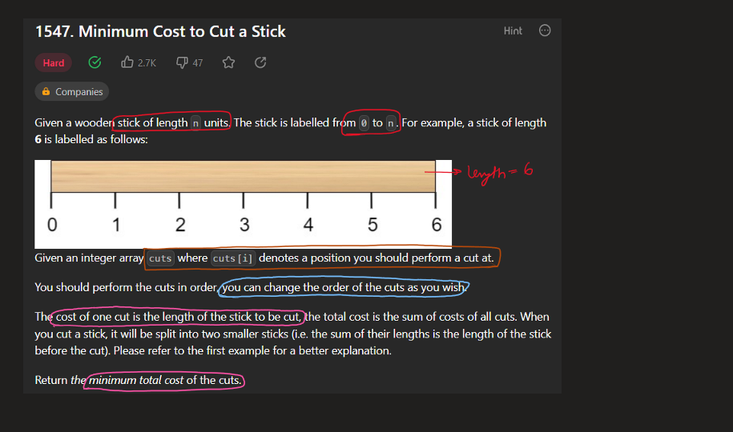
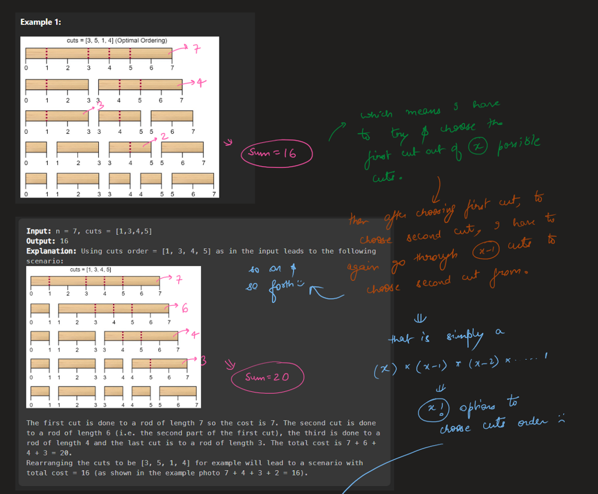
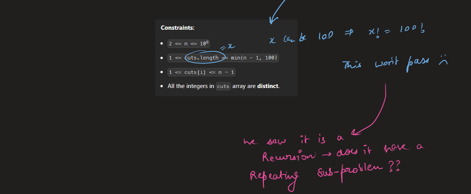
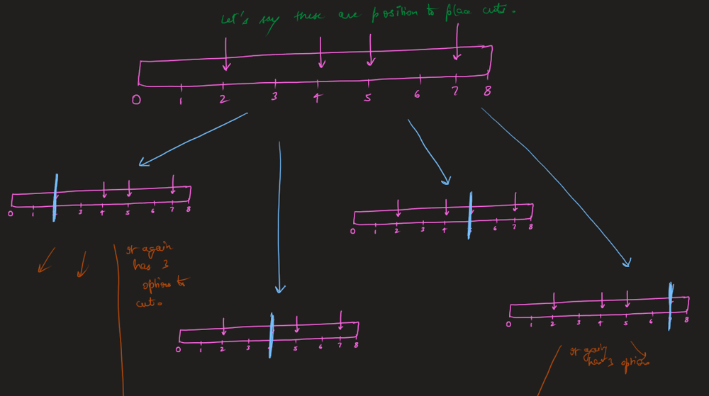
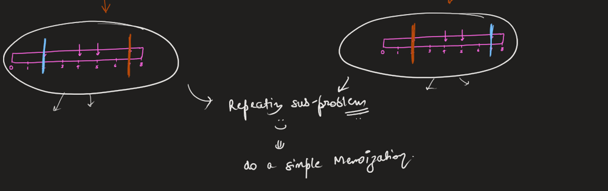
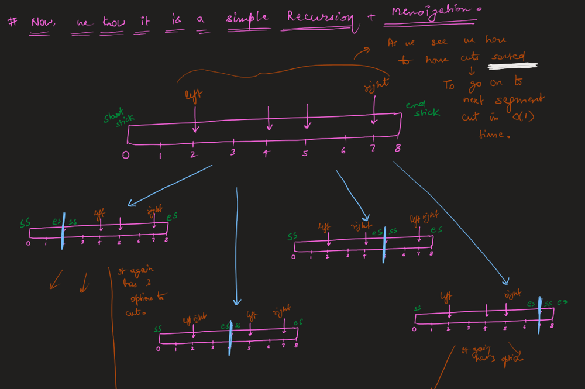
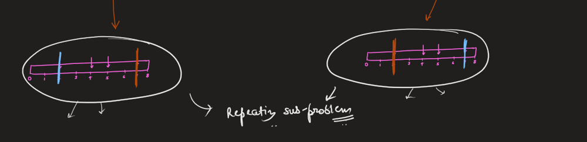
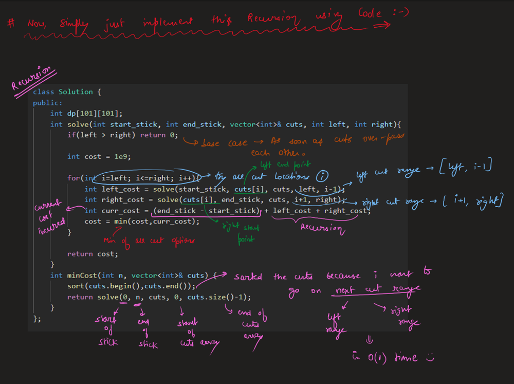
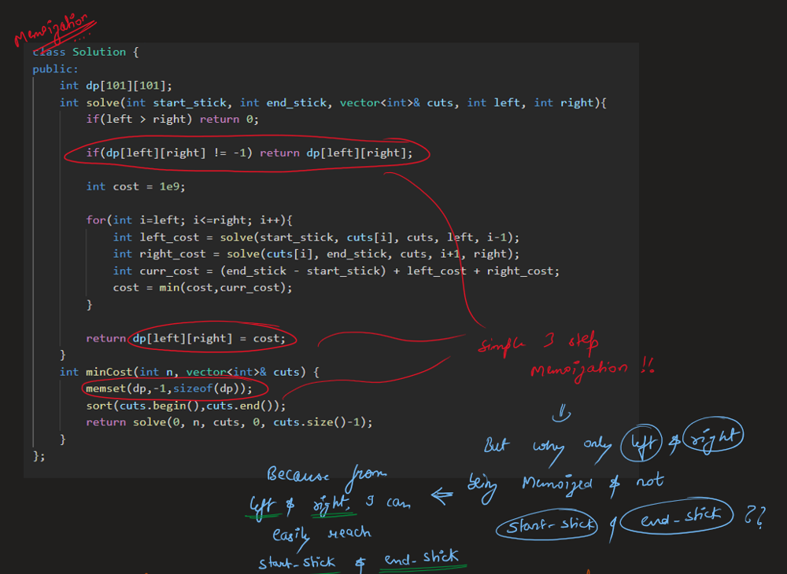
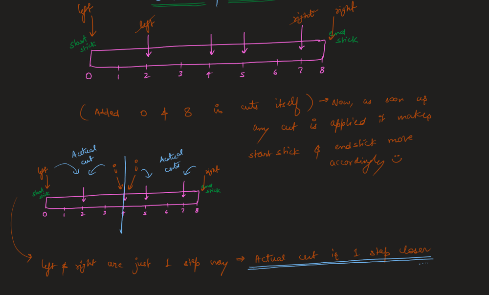
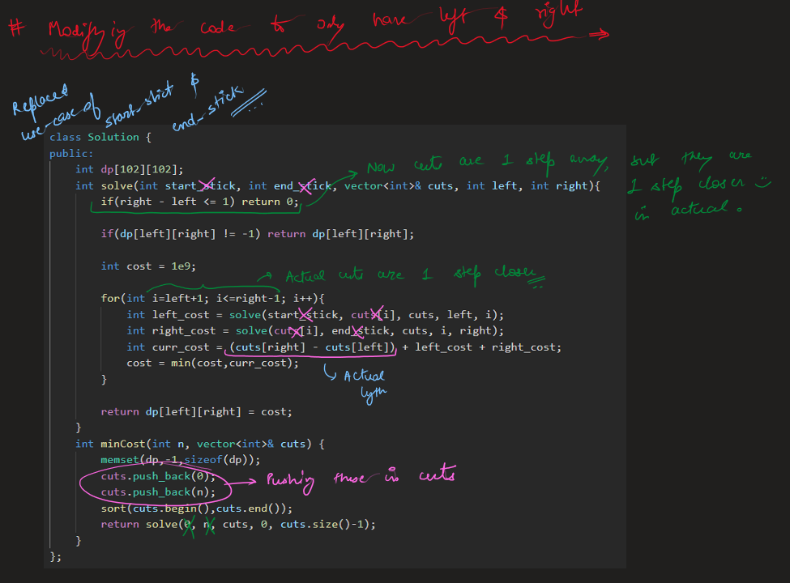
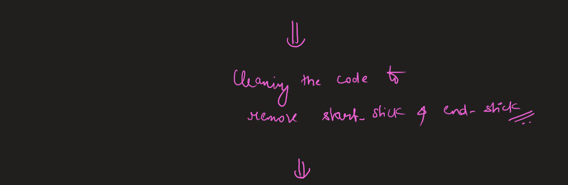
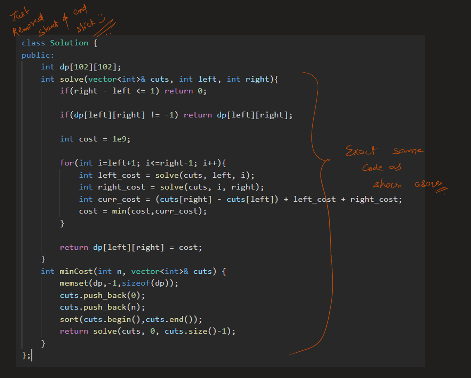
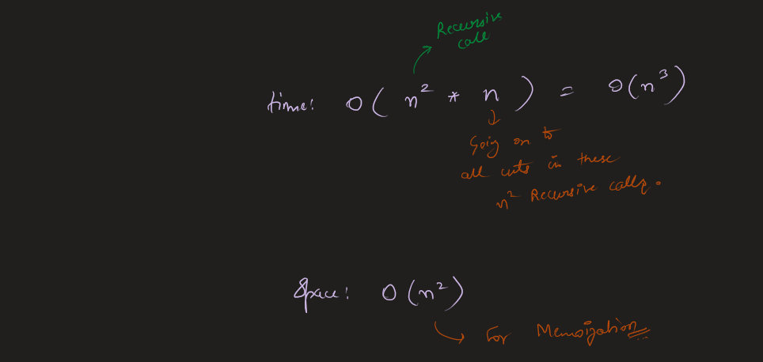
Here the above n - represents the cuts.size(), you can also take it as m^3 also for time & m^2 for space.

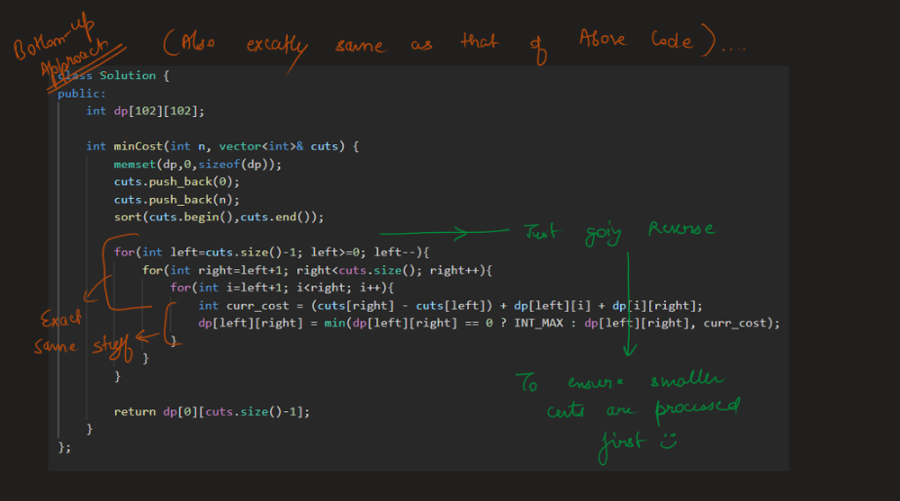
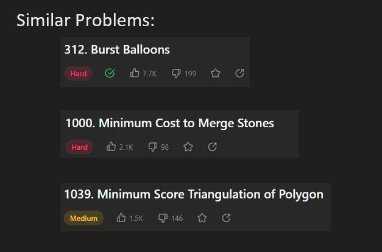


# Code
```C++ []
class Solution {
public:
    int dp[101][101];
    int solve(int start_stick, int end_stick, vector<int>& cuts, int left, int right){
        if(left > right) return 0;
        
        if(dp[left][right] != -1) return dp[left][right];
        
        int cost = 1e9;
        
        for(int i=left; i<=right; i++){
            int left_cost = solve(start_stick, cuts[i], cuts, left, i-1);
            int right_cost = solve(cuts[i], end_stick, cuts, i+1, right);
            int curr_cost = (end_stick - start_stick) + left_cost + right_cost;
            cost = min(cost,curr_cost);
        }
        
        return dp[left][right] = cost;
    }
    int minCost(int n, vector<int>& cuts) {
        memset(dp,-1,sizeof(dp));
        sort(cuts.begin(),cuts.end());
        return solve(0, n, cuts, 0, cuts.size()-1);
    }
};
```
```Java []
class Solution {
    int[][] dp;
    
    int solve(int start_stick, int end_stick, int[] cuts, int left, int right) {
        if (left > right) return 0;

        if (dp[left][right] != -1) return dp[left][right];

        int cost = Integer.MAX_VALUE;

        for (int i = left; i <= right; i++) {
            int left_cost = solve(start_stick, cuts[i], cuts, left, i - 1);
            int right_cost = solve(cuts[i], end_stick, cuts, i + 1, right);
            int curr_cost = (end_stick - start_stick) + left_cost + right_cost;
            cost = Math.min(cost, curr_cost);
        }

        return dp[left][right] = cost;
    }
    
    int minCost(int n, int[] cuts) {
        dp = new int[cuts.length][cuts.length];
        for (int[] row : dp) {
            Arrays.fill(row, -1);
        }
        
        Arrays.sort(cuts);
        return solve(0, n, cuts, 0, cuts.length - 1);
    }
}
```
```Python []
class Solution:
    def solve(self, start_stick, end_stick, cuts, left, right, dp):
        if left > right:
            return 0

        if dp[left][right] != -1:
            return dp[left][right]

        cost = float('inf')

        for i in range(left, right + 1):
            left_cost = self.solve(start_stick, cuts[i], cuts, left, i - 1, dp)
            right_cost = self.solve(cuts[i], end_stick, cuts, i + 1, right, dp)
            curr_cost = (end_stick - start_stick) + left_cost + right_cost
            cost = min(cost, curr_cost)

        dp[left][right] = cost
        return cost

    def minCost(self, n, cuts):
        dp = [[-1] * len(cuts) for _ in range(len(cuts))]
        cuts.sort()
        return self.solve(0, n, cuts, 0, len(cuts) - 1, dp)
```