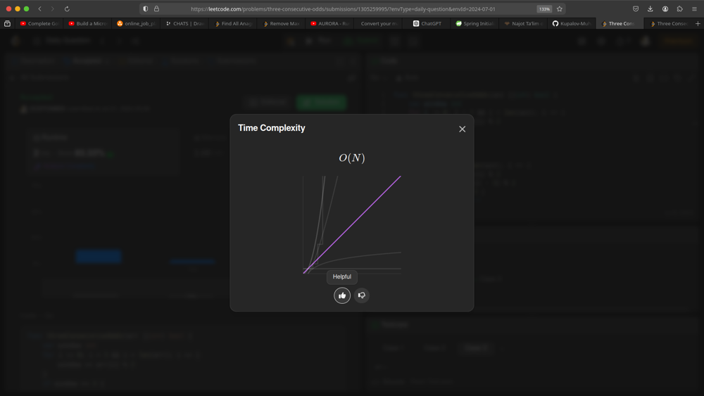
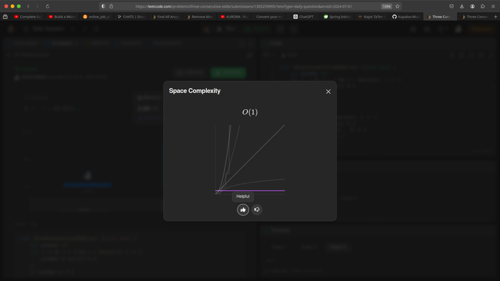

# 🔥 SLiDiNG WiNDOW || SPACE -> O(1); TiME -> O(N) || ANY LANGUAGE 🔥 by PRODONiK ✅✅✅

**Author:** prodonik
**Votes:** 32
**Link:** [https://leetcode.com/problems/three-consecutive-odds/solutions/5393409/](https://leetcode.com/problems/three-consecutive-odds/solutions/5393409/)

---



<----------------------------------------------------------------------------------------------------------------------->




# Intuition
When I first approached this problem, I thought about using a sliding window technique to check for three consecutive odd numbers in the array. The idea is to maintain a window of three elements and check if all three are odd. By sliding this window across the array, we can efficiently determine if there are three consecutive odds.

# Approach
My approach involves using a sliding window of size three. First, I initialize the window with the first three elements of the array and count how many of them are odd. If the count reaches three, it means the first three elements are all odd, and we return `true`.

If the initial window does not have three odd numbers, I slide the window one element at a time across the array. For each new element added to the window, I update the count by adding the new element's odd status and subtracting the old element's odd status that is no longer in the window. If at any point the count reaches three, we return `true`. If we traverse the entire array without finding three consecutive odd numbers, we return `false`.

# Complexity
- Time complexity:
  The time complexity of this approach is $$O(n)$$, where $$n$$ is the length of the array. This is because we traverse the array once to check each element.

- Space complexity:
  The space complexity is $$O(1)$$ because we only use a constant amount of extra space for the sliding window and counter.

# Code
```Java []
public class ThreeConsecutiveOdds {
    public boolean threeConsecutiveOdds(int[] arr) {
        int window = 0;
        for (int i = 0; i < 3 && i < arr.length; i++) {
            window += arr[i] % 2;
        }
        if (window == 3) {
            return true;
        }
        for (int i = 3; i < arr.length; i++) {
            window += arr[i] % 2;
            window -= arr[i - 3] % 2;
            if (window == 3) {
                return true;
            }
        }
        return false;
    }
}
```
```Go []
func threeConsecutiveOdds(arr []int) bool {
    var window int
    for i := 0; i < 3 && i < len(arr); i++ {
        window += arr[i] % 2
    }
    if window == 3 {
        return true
    }
    for i := 3; i < len(arr); i++ {
        window += arr[i] % 2
        window -= arr[i-3] % 2
        if window == 3 {
            return true
        }
    }
    return false
}
```
```C++ []
class Solution {
public:
    bool threeConsecutiveOdds(vector<int>& arr) {
        int window = 0;
        for (int i = 0; i < 3 && i < arr.size(); i++) {
            window += arr[i] % 2;
        }
        if (window == 3) {
            return true;
        }
        for (int i = 3; i < arr.size(); i++) {
            window += arr[i] % 2;
            window -= arr[i - 3] % 2;
            if (window == 3) {
                return true;
            }
        }
        return false;
    }
};
```
```Python []
def three_consecutive_odds(arr):
    window = 0
    for i in range(min(3, len(arr))):
        window += arr[i] % 2
    if window == 3:
        return True
    for i in range(3, len(arr)):
        window += arr[i] % 2
        window -= arr[i - 3] % 2
        if window == 3:
            return True
    return False
```
```C# []
public class Solution {
    public bool ThreeConsecutiveOdds(int[] arr) {
        int window = 0;
        for (int i = 0; i < 3 && i < arr.Length; i++) {
            window += arr[i] % 2;
        }
        if (window == 3) {
            return true;
        }
        for (int i = 3; i < arr.Length; i++) {
            window += arr[i] % 2;
            window -= arr[i - 3] % 2;
            if (window == 3) {
                return true;
            }
        }
        return false;
    }
}
```
```Rust []
impl Solution {
    pub fn three_consecutive_odds(arr: Vec<i32>) -> bool {
        let mut window = 0;
        for i in 0..3.min(arr.len()) {
            window += arr[i] % 2;
        }
        if window == 3 {
            return true;
        }
        for i in 3..arr.len() {
            window += arr[i] % 2;
            window -= arr[i - 3] % 2;
            if window == 3 {
                return true;
            }
        }
        false
    }
}
```
```PRODONiK []
#Would you please UPVOTE ?
```


