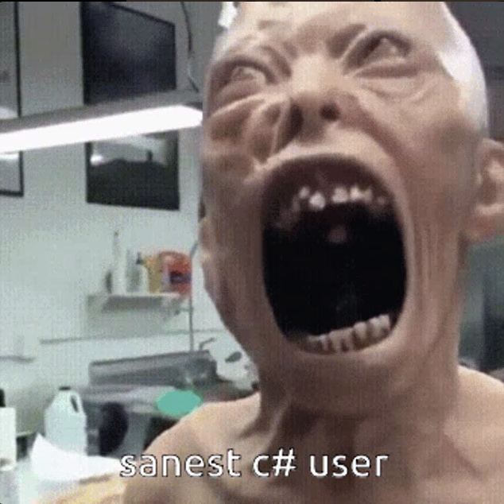

# An ultra mega hard problem explained step by step with a literal fact at the end

**Author:** WD_master
**Votes:** 1
**Link:** [https://leetcode.com/problems/three-consecutive-odds/solutions/5398993/](https://leetcode.com/problems/three-consecutive-odds/solutions/5398993/)

---

# Intuition
1. We need the array's length to be at least three in order for it to have three consecutive odd numbers.
2. After checking the array's length, we will be iterating through it and search for three consecutive odd numbers.
3. If there isn't any sets of three consecutive odd numbers in the array after the iteration, the output will be false.

---


# Approach
1. We check if the array's length is less than three using an if statement, if the statement is correct, return false;
2. The iteration starts with the creation of the iterator `i` and a boolean expression for the loop to end at the end of the iteration.
3. inside the loop we check if the current index and the two indices after are all odd using an if statement, if the statement is correct, return true.                                                          After the first if statement we use another if statement in order to check if the index two columns after the current index is odd, if it is not, there is no point in iterating through the next column in the array.
4. if the for loop ended, it means that there isn't a set of three consecutive odd numbers in the array, therefor return false.


---


# Complexity
- **Time complexity:**
The time complexity is `O(n)` because we iterate through the array only once which the number of iterations be constant.

- **Space complexity:**
The space complexity is `O(1)`,constant. There aren't any variables created besides the pointer of the for loop: `i`.

---


```C# []
public class Solution {
    public bool ThreeConsecutiveOdds(int[] arr) {
        //If the size of the array is less than 3, there are no 3 consecutive numbers,
        //therefor, return false;
        if(arr.Length < 3)
            return false;
        for(int i = 0; i < arr.Length - 2; i++){
            //Check if the current index and the two after it are odd
            if(arr[i] % 2 == 1 && arr[i + 1] % 2 == 1 && arr[i + 2] % 2 == 1)
                return true;
        }

        //If there are no 3 consecutive odd numbers in the array, return false
        return false;
    }
}
```
```C++ []
class Solution {
public:
    bool threeConsecutiveOdds(vector<int>& arr) {
        //If the size of the array is less than 3, there are no 3 consecutive numbers,
        //therefor, return false;
        if(arr.size() < 3)
            return false;
        for(int i = 0; i < arr.size() - 2; i++){
            //Check if the current index and the two after it are odd
            if(arr[i] % 2 == 1 && arr[i + 1] % 2 == 1 && arr[i + 2] % 2 == 1)
                return true;
        }

        //If there are no 3 consecutive odd numbers in the array, return false
        return false;
    }
};
```
```Java []
class Solution {
    public boolean threeConsecutiveOdds(int[] arr) {
        //If the size of the array is less than 3, there are no 3 consecutive numbers,
        //therefor, return false;
        if(arr.length < 3)
            return false;
        for(int i = 0; i < arr.length - 2; i++){
            //Check if the current index and the two after it are odd
            if(arr[i] % 2 == 1 && arr[i + 1] % 2 == 1 && arr[i + 2] % 2 == 1)
                return true;
        }

        //If there are no 3 consecutive odd numbers in the array, return false
        return false;
    }
}
```
```javascript []
/**
 * @param {number[]} arr
 * @return {boolean}
 */
var threeConsecutiveOdds = function(arr) {
    //If the size of the array is less than 3, there are no 3 consecutive numbers,
        //therefor, return false;
        if(arr.length < 3)
            return false;
        for(let i = 0; i < arr.length - 2; i++){
            //Check if the current index and the two after it are odd
            if(arr[i] % 2 == 1 && arr[i + 1] % 2 == 1 && arr[i + 2] % 2 == 1)
                return true;
        }

        //If there are no 3 consecutive odd numbers in the array, return false
        return false;
};
```
```Python []
class Solution(object):
    def threeConsecutiveOdds(self, arr):
        """
        :type arr: List[int]
        :rtype: bool

        If the size of the array is less than 3, there are no 3 consecutive numbers,
        therefor, return false;
        """
        if len(arr) < 3:
            return False
        for i in range(len(arr) - 2):
            "Check if the current index and the two after it are odd"
            if arr[i] % 2 == 1 and arr[i + 1] % 2 == 1 and arr[i + 2] % 2 == 1:
                return True

        "If there are no 3 consecutive odd numbers in the array, return false"
        return False
        
```
```Python3 []
class Solution:
    def threeConsecutiveOdds(self, arr: List[int]) -> bool:
        """
        If the size of the array is less than 3, there are no 3 consecutive numbers,
        therefor, return false.
        """
        if len(arr) < 3:
            return False
        for i in range(len(arr) - 2):
            "Check if the current index and the two after it are odd"
            if arr[i] % 2 == 1 and arr[i + 1] % 2 == 1 and arr[i + 2] % 2 == 1:
                return True

        "If there are no 3 consecutive odd numbers in the array, return false"
        return False
```
```C []
bool threeConsecutiveOdds(int* arr, int arrSize) {
    //If the size of the array is less than 3, there are no 3 consecutive numbers,
        //therefor, return false;
        if(arrSize < 3)
            return false;
        for(int i = 0; i < arrSize - 2; i++){
            //Check if the current index and the two after it are odd
            if(arr[i] % 2 == 1 && arr[i + 1] % 2 == 1 && arr[i + 2] % 2 == 1)
                return true;
        }

        //If there are no 3 consecutive odd numbers in the array, return false
        return false;
}
```
```TypeScript []
function threeConsecutiveOdds(arr: number[]): boolean {
    //If the size of the array is less than 3, there are no 3 consecutive numbers,
        //therefor, return false;
        if(arr.length < 3)
            return false;
        for(let i = 0; i < arr.length - 2; i++){
            //Check if the current index and the two after it are odd
            if(arr[i] % 2 == 1 && arr[i + 1] % 2 == 1 && arr[i + 2] % 2 == 1)
                return true;
        }

        //If there are no 3 consecutive odd numbers in the array, return false
        return false;
};
```
```ruby []
# @param {Integer[]} arr
# @return {Boolean}
def three_consecutive_odds(arr)
    #If the size of the array is less than 3, there are no 3 consecutive numbers,
    #therefor, return false;
    return false if arr.length < 3
    
    i = 0
    while i <= arr.length - 3
        #Check if the current index and the two after it are odd
        if arr[i] % 2 == 1 && arr[i + 1] % 2 == 1 && arr[i + 2] % 2 == 1
            return true
        else
            i += 1
        end
    end
    #If there are no 3 consecutive odd numbers in the array, return false
    return false
end

```
# Hope this solution made you fully understand this problem!



