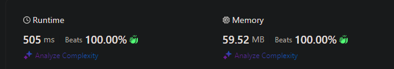

# Best solution in Kotlin | Beat 100%

**Author:** Malaia
**Votes:** 2
**Link:** [https://leetcode.com/problems/magnetic-force-between-two-balls/solutions/5340230/](https://leetcode.com/problems/magnetic-force-between-two-balls/solutions/5340230/)

---

# Intuition
This solution efficiently finds the maximum minimum distance using binary search combined with a greedy placement strategy, ensuring an optimal solution with a time complexity of O(nlog(max_distance)).

# Approach
Here is the detailed plan:

1. Sort the Positions: First, sort the array of positions. This allows us to place the balls in an ordered manner and makes it easier to calculate distances.
2. Binary Search Setup:
    - The lower bound (left) of our binary search is 1 because the minimum possible distance between any two positions is 1.
    - The upper bound (right) is the difference between the maximum and minimum positions because the maximum possible distance is between the two furthest apart positions.
3. Feasibility Check:
    - For a given candidate distance mid (midpoint in binary search), we check if it is possible to place all m balls such that the minimum distance between any two balls is at least mid.
    - Start by placing the first ball in the first position. Then, iteratively place each subsequent ball in the next position that is at least mid distance away from the last placed ball.
4. Binary Search Execution:
    - If it is possible to place all m balls with at least mid distance, then mid is feasible and we might be able to find a larger distance. Thus, move the lower bound up.
    - If it is not possible, move the upper bound down.
The result of this binary search will be the maximum possible minimum distance.

# Complexity



# Code
```
class Solution {
    fun maxDistance(position: IntArray, m: Int): Int {
        position.sort()

        var left = 1
        var right = position.last() - position.first()

        fun canPlaceBalls(minDist: Int): Boolean {
            var count = 1
            var lastPlaced = position[0]

            for (i in 1 until position.size) {
                if (position[i] - lastPlaced >= minDist) {
                    count++
                    lastPlaced = position[i]
                    if (count == m) {
                        return true
                    }
                }
            }
            return false
        }

        var result = 0
        while (left <= right) {
            val mid = left + (right - left) / 2
            if (canPlaceBalls(mid)) {
                result = mid
                left = mid + 1
            } else {
                right = mid - 1
            }
        }

        return result
    }
}
```