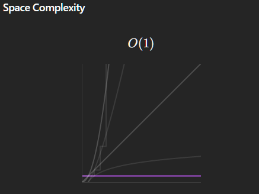

# ✅✅Fastest 💯💯 Efficient 💎💎Simplest Explanation🔍🔍Binary Search 🏃‍♂️🏃‍♂️DryRun

**Author:** TheCodeAlpha
**Votes:** 28
**Link:** [https://leetcode.com/problems/magnetic-force-between-two-balls/solutions/5341193/](https://leetcode.com/problems/magnetic-force-between-two-balls/solutions/5341193/)

---

#### Thanks for checking out my solution. 
#### This post has been made with \u2764 by [Alok Khansali](https://leetcode.com/u/TheCodeAlpha/)
### Do Upvote if this helped \uD83D\uDC4D

# \uD83C\uDFAFApproach : Binary Search\uD83D\uDD0D


<!-- Describe your approach to solving the problem. -->
# Intuition \uD83D\uDD2E
<!-- Describe your first thoughts on how to solve this problem. -->

- Ab kyuki week hi binary search ka chal raha hai toh tum itna toh question dekhne se pehle hi samaj gaye honge ki lagana kya hai. Par binary search \uD83D\uDD0D ko utni respect kabhi mili nahi jitni vo deserve karti hai.
- Aisa lagta hai ki bas ek right or left pointer lagayenge, mid nikalenge and or fir kaam hua toh ek side reduce kardenge; nahi hua toh dusri side reduce kar denge. Ab isme funny part ye hai ki karna bhi actually aisa hi hota hai.
- Sawal hai kab or kese, iss shakti ko apne anusaar istemmal kar paana.

##### Binary Search \uD83D\uDD0D wale question ki ek pehchaan toh ye hoti hai, ki isme ye poocha jaata hai ki konsa sabse chota/bada number humari di hui inn sharton par khada utarega....

##### Aur aaj ke diye huye sawal ka lajawaab description mai bhi aisa hi kaha gaya hai. Ab ho sakta hai tum ye bolo ki description thoda confusing hai, jo ki definitely hai, par mai ek koshish karta hu tumhe samjhaane ki.


### Ab agar `minimum magnetic force between any two balls is maximum.` iss line mai dikkat hai toh ye samajne ka try karo

- `1,2,3,4,5,6,7,8,9,10` ek array hai, balls hai `m = 4`, ab optimally to setup dikhega aisa
- `x _ _ x _ _ x _ _ x`, x ka matlab waha par ball hai.
- iss example se humne ye samaj liya ki barabar gap deke kese batwaara hota hai, aur isme maximum_even gap hi sahi jawab hai.

### Ab ghoor ke dekhna agla example
- `1,2,3,4,5,6,7,8,9,10,11` ek array hai, balls hai `m = 4`, ab set upar jesa banayenge toh ek gap bachega last ball ke baad
- `x _ _ x _ _ x _ _ _ x`,
- Ab isme force hain 3,3,4 respectively har gap mai, aur minimum hai inka 3, humko bs set aise karne hain ki ye minimum jo hai, ye sabse badi value le paaye, 
- Ab minimum gap toh 3 hi hai, par kyuki ek jagah mauka tha ek extra gap ka toh vo humne last mai daal diya. 
- Isse hum ye keh sakte hain ki sabse badia `minimum gap` vo hai jo m balls ko place karte time, kisi bhi do balls ke gap ko barabar tareeke se baatein, aisa na ho ki kisi do balls ke beech bhot jyada space ho, aur kisi do ball ke beech bilkul khatam si.


###### Magar ab ghapla ye hai, ki saare dubbe humko diye nahi hai, kahi kahi par dabbe hain hi nahi. "Aur jis prakhar bina skill ke job milti nahi, ussi prakar se bina dabbe ki usme ball dalti nahi.
- Toh hum bin dekhe upar ke gaps wala logic nahi laga sakte, bs ab aati hai baat iss sawal ke sittare Binary Search ki. Humko pata hai ki `minimum_even_gap hoga` `largest element / (number of balls  - 1)`, ye verify karlena upar diye hue example se
- Ab humara jawab 1 se leke `minimum_even_gap`, tak ho sakta hai.
- Ab inhi `left` or `right` se `mid` nikal kar hum mid naam ke `gap` ke liye hum Array mai ghumenge, jab jab kisi do values ka difference humare diye huye gap ke barabar ya uss se jyada hoga, toh hum maan lenge ki waha ball place ho sakti hai.
- Agar ye `gap` laya ja sakta hai toh hum `left` ko `gap + 1`, aur  `answer` ko sabse bad `gap` de denge,  varna `right` ko `gap - 1` kardenge


#### Aur anth mai answer mai jo gap hoga usko return kardenge, yadi koi gap nahi mila toh answer mai -1 hoga, varna koi value jo ki 0 se badi hogi.

- Sirf ek hi condition mai answer -1 hoga jab dabbe kam honge balls se, varna kamse kam 1 ka gap toh laya hi ja sakta hai.
- `position.size() < m`   ---> `-1`

____
# Algorithm\uD83D\uDCDC
### 1. Helper Function: canPlaceBalls
- ### Function Purpose: Check karna ki kya m balls ko kam se kam 'gap' distance ke sath place kar sakte hain.
- ### Parameters:
  - `gap`: Minimum distance between two balls.
  - `positions`: Sorted list of positions jahan balls place kar sakte hain.
  - `m`: Total number of balls jo place karni hain.

- #### Steps:
  1. `lastPosition` initialize karo pehli ball ki position se.
  2. `ballsRemaining` initialize karo m - 1 (kyunki pehli ball place ho chuki hai).
  3. Loop chalao positions pe aur check karo ki kya current position `lastPosition` se kam se kam 'gap' door hai:
     - Agar hai, to ball place karo aur `ballsRemaining` decrement karo.
     - `lastPosition` update karo current position pe.
  4. Return true agar saari balls successfully place ho jaati hain.

### 2. Main Function: maxDistance
- **Function Purpose:** Find karna maximum minimum distance between any two balls.
- **Parameters:**
  - `positions`: List of positions jahan balls place kar sakte hain.
  - `m`: Total number of balls jo place karni hain.

#### Steps
  1. `positions` ko sort karo.
  2. Binary search range initialize karo:
     - `left` as 1 (minimum possible gap).
     - `right` as last position minus first position (maximum possible gap).
  3. Binary search perform karo:
     - `mid` calculate karo.
     - `canPlaceBalls` ko call karo `mid` distance ke sath:
       - Agar return true kare, to `maxMinDistance` update karo aur left ko `mid + 1` set karo (larger gap try karne ke liye).
       - Agar false return kare, to right ko `mid - 1` set karo (smaller gap try karne ke liye).
  4. Return `maxMinDistance`.

<details>
<summary> In English </summary> 

## `canPlaceBalls` Function:

**Purpose:** 
Checks if it is possible to place m balls in positions such that the minimum distance between any two balls is at least `gap`.

## Logic:
- Starts with the first position and tries to place the remaining balls such that each subsequent ball is placed at least `gap` distance apart from the last placed ball.
- If all balls are placed successfully, returns `true`; otherwise, returns `false`.

## `maxDistance` Function:

**Purpose:** 
Finds the maximum possible minimum distance between any two balls when m balls are placed in positions.

## Logic
- Uses binary search to find the maximum minimum distance.
- Sorts the `positions` array to facilitate the placement check.
- Initializes the search range (`left` to `right`).
- Uses the `canPlaceBalls` function to check feasibility at each mid-point of the current search range.
- Adjusts the search range based on the feasibility result and updates the maximum minimum distance accordingly.

## Efficiency:
- The approach uses sorting (O(n log n)) and binary search (O(log d) where d is the difference between the largest and smallest position), making it efficient for large inputs.

</details>

____


____

# Aao DRYRUN Dekhein\uD83C\uDFC3\u200D\u2642\uFE0F\uD83C\uDFC3\u200D\u2642\uFE0F

<details>
<summary> DRYRUN </summary> 

## Let's perform a dry run of the maxDistance function with positions = [1,2,3,4,5,6,7,8,9,10] and m = 4.
### Initial Setup

    positions = [1,2,3,4,5,6,7,8,9,10]
    m = 4

### Step-by-Step Dry Run

    Sort the positions (already sorted in this case):

```sort(positions.begin(), positions.end()); // [1,2,3,4,5,6,7,8,9,10]```

### Initialize the binary search range:

```
int left = 1; // Minimum possible gap
int right = positions[n - 1] - positions[0]; // Maximum possible gap = 10 - 1 = 9
int maxMinDistance = -1;
```

#### First Iteration of Binary Search:

```
int mid = (left + right) / 2; // mid = (1 + 9) / 2 = 5
if (canPlaceBalls(mid, positions, m))
```

### Inside canPlaceBalls:

    gap = 5
    positions = [1,2,3,4,5,6,7,8,9,10]
    m = 4
    lastPosition = 1
    ballsRemaining = 3
    
### Iterate over positions:

    i = 1, positions[i] - lastPosition = 1 (Not >= 5)
    i = 2, positions[i] - lastPosition = 2 (Not >= 5)
    i = 3, positions[i] - lastPosition = 3 (Not >= 5)
    i = 4, positions[i] - lastPosition = 4 (Not >= 5)
    i = 5, positions[i] - lastPosition = 5 (>= 5) 
    -> Place ball, ballsRemaining = 2, lastPosition = 6
    i = 6, positions[i] - lastPosition = 1 (Not >= 5)
    i = 7, positions[i] - lastPosition = 2 (Not >= 5)
    i = 8, positions[i] - lastPosition = 3 (Not >= 5)
    i = 9, positions[i] - lastPosition = 4 (Not >= 5)
    i = 10, positions[i] - lastPosition = 5 (>= 5) 
    -> Place ball, ballsRemaining = 1, lastPosition = 10

### Result:

    canPlaceBalls(5, positions, m) 
    -> Returns false because ballsRemaining != 0.

```
right = mid - 1; // right = 4
```

### Second Iteration of Binary Search:

```
int mid = (left + right) / 2; // mid = (1 + 4) / 2 = 2
if (canPlaceBalls(mid, positions, m))
```

### Inside canPlaceBalls:

    gap = 2
    lastPosition = 1
    ballsRemaining = 3

#### Iterate over positions:

    i = 1, positions[i] - lastPosition = 1 (Not >= 2)
    i = 2, positions[i] - lastPosition = 2 (>= 2) 
    -> Place ball, ballsRemaining = 2, lastPosition = 3
    i = 3, positions[i] - lastPosition = 1 (Not >= 2)
    i = 4, positions[i] - lastPosition = 2 (>= 2) 
    -> Place ball, ballsRemaining = 1, lastPosition = 5
    i = 5, positions[i] - lastPosition = 1 (Not >= 2)
    i = 6, positions[i] - lastPosition = 2 (>= 2) 
    -> Place ball, ballsRemaining = 0, lastPosition = 7

### Result:

    canPlaceBalls(2, positions, m) 
    -> Returns true because ballsRemaining == 0.
```
maxMinDistance = mid; // maxMinDistance = 2
left = mid + 1; // left = 3
```
### Third Iteration of Binary Search:

```
int mid = (left + right) / 2; // mid = (3 + 4) / 2 = 3
if (canPlaceBalls(mid, positions, m))
```

### Inside canPlaceBalls:

    gap = 3
    lastPosition = 1
    ballsRemaining = 3

#### Iterate over positions:

    i = 1, positions[i] - lastPosition = 1 (Not >= 3)
    i = 2, positions[i] - lastPosition = 2 (Not >= 3)
    i = 3, positions[i] - lastPosition = 3 (>= 3) 
    -> Place ball, ballsRemaining = 2, lastPosition = 4
    i = 4, positions[i] - lastPosition = 1 (Not >= 3)
    i = 5, positions[i] - lastPosition = 2 (Not >= 3)
    i = 6, positions[i] - lastPosition = 3 (>= 3) 
    -> Place ball, ballsRemaining = 1, lastPosition = 7
    i = 7, positions[i] - lastPosition = 1 (Not >= 3)
    i = 8, positions[i] - lastPosition = 2 (Not >= 3)
    i = 9, positions[i] - lastPosition = 3 (>= 3) 
    -> Place ball, ballsRemaining = 0, lastPosition = 10

### Result:

    canPlaceBalls(3, positions, m) 
    -> Returns true because ballsRemaining == 0.
```
maxMinDistance = mid; // maxMinDistance = 3
left = mid + 1; // left = 4
```

### Fourth Iteration of Binary Search:
```
int mid = (left + right) / 2; // mid = (4 + 4) / 2 = 4
if (canPlaceBalls(mid, positions, m))
```
### Inside canPlaceBalls:

    gap = 4
    lastPosition = 1
    ballsRemaining = 3

#### Iterate over positions:

    i = 1, positions[i] - lastPosition = 1 (Not >= 4)
    i = 2, positions[i] - lastPosition = 2 (Not >= 4)
    i = 3, positions[i] - lastPosition = 3 (Not >= 4)
    i = 4, positions[i] - lastPosition = 4 (>= 4) 
    -> Place ball, ballsRemaining = 2, lastPosition = 5
    i = 5, positions[i] - lastPosition = 1 (Not >= 4)
    i = 6, positions[i] - lastPosition = 2 (Not >= 4)
    i = 7, positions[i] - lastPosition = 3 (Not >= 4)
    i = 8, positions[i] - lastPosition = 4 (>= 4) 
    -> Place ball, ballsRemaining = 1, lastPosition = 9
    i = 9, positions[i] - lastPosition = 1 (Not >= 4)
    i = 10, positions[i] - lastPosition = 2 (Not >= 4)

### Result:

    canPlaceBalls(4, positions, m) 
    -> Returns false because ballsRemaining != 0.
```
    right = mid - 1; // right = 3
```

## Final Result

    The maximum minimum distance is 3 after the binary search completes.

### Summary of Iterations

- mid = 5, cannot place all balls, adjust right.
- mid = 2, can place all balls, adjust left and update maxMinDistance.
- mid = 3, can place all balls, adjust left and update maxMinDistance.
- mid = 4, cannot place all balls, adjust right.

### The final maximum minimum distance for placing 4 balls in the positions [1,2,3,4,5,6,7,8,9,10] is 3.

</details>

____
# Code\uD83D\uDC69\u200D\uD83D\uDCBB\uD83D\uDC69\u200D\uD83D\uDCBB
```cpp []
class Solution
{
public:
    // Helper function to check if it's possible to place m balls with at least 'gap' distance apart
    bool canPlaceBalls(int gap, vector<int> &positions, int m)
    {
        int lastPosition = positions[0]; // Position of the last placed ball
        // Assuming that one ball is already placed, 
        // we keep remaining balls as m - 1
        int ballsRemaining = m - 1;      // Number of balls left to place
        // Iterate over the positions to try placing the remaining balls
        for (int i = 1; i < positions.size() && ballsRemaining > 0; i++)
        {
            // Check if the current position is at least 'gap' distance from the last placed ball
            if (positions[i] - lastPosition >= gap)
            {
                ballsRemaining--;            // Place the ball
                lastPosition = positions[i]; // Update the position of the last placed ball
            }
        }
        return ballsRemaining == 0; // Return true if all balls are placed successfully
    }
    // Function to find the maximum minimum distance between any two balls
    int maxDistance(vector<int> &positions, int m)
    {
        ios_base::sync_with_stdio(0); // Speed up I/O operations
        // Sort the positions to facilitate binary search
        sort(positions.begin(), positions.end());
        int n = positions.size();
        // Initialize the binary search range
        int left = 1;                                // Minimum possible gap
        int right = positions[n - 1] - positions[0]; // Maximum possible gap
        int maxMinDistance = -1;
        // Perform binary search
        while (left <= right)
        {
            int mid = (left + right) / 2;

            // Check if it's possible to place all balls with at least 'mid' distance apart
            if (canPlaceBalls(mid, positions, m))
            {
                maxMinDistance = mid; // Update the result
                left = mid + 1;       // Try for a larger gap
            }
            else
                right = mid - 1; // Try for a smaller gap
        }
        return maxMinDistance; // Return the maximum minimum distance
    }
};
```
```java []
class Solution {
    // Helper function to check if it's possible to place 'm' balls with at least 'gap' distance apart
    private boolean canPlaceBalls(int gap, int[] positions, int m) {
        int lastPosition = positions[0]; // Position of the last placed ball
        // Assuming that one ball is already placed, 
        // we keep remaining balls as m - 1
        int ballsRemaining = m - 1;      // Number of balls left to place

        // Iterate over the positions to try placing the remaining balls
        for (int i = 1; i < positions.length && ballsRemaining > 0; i++) {
            // Check if the current position is at least 'gap' distance from the last placed ball
            if (positions[i] - lastPosition >= gap) {
                ballsRemaining--;            // Place the ball
                lastPosition = positions[i]; // Update the position of the last placed ball
            }
        }
        return ballsRemaining == 0; // Return true if all balls are placed successfully
    }

    // Function to find the maximum minimum distance between any two balls
    public int maxDistance(int[] positions, int m) {
        Arrays.sort(positions); // Sort the positions to facilitate binary search
        int n = positions.length;

        // Initialize the binary search range
        int left = 1; // Minimum possible gap
        int right = positions[n - 1] - positions[0]; // Maximum possible gap
        int maxMinDistance = -1;

        // Perform binary search
        while (left <= right) {
            int mid = (left + right) / 2;

            // Check if it's possible to place all balls with at least 'mid' distance apart
            if (canPlaceBalls(mid, positions, m)) {
                maxMinDistance = mid; // Update the result
                left = mid + 1;       // Try for a larger gap
            } else {
                right = mid - 1;      // Try for a smaller gap
            }
        }
        return maxMinDistance; // Return the maximum minimum distance
    }
}
```
```python3 []
class Solution:
    def canPlaceBalls(self, gap: int, positions: List[int], m: int) -> bool:
        last_position = positions[0] # Position of the last placed ball
        # Assuming that one ball is already placed, 
        # we keep remaining balls as m - 1
        balls_remaining = m - 1      # Number of balls left to place

        # Iterate over the positions to try placing the remaining balls
        for i in range(1, len(positions)):
            # Check if the current position is at least 'gap' distance from the last placed ball
            if positions[i] - last_position >= gap:
                balls_remaining -= 1           # Place the ball
                last_position = positions[i]   # Update the position of the last placed ball
                if balls_remaining == 0:
                    return True
        return balls_remaining == 0 # Return true if all balls are placed successfully

    def maxDistance(self, positions: List[int], m: int) -> int:
        positions.sort() # Sort the positions to facilitate binary search

        # Initialize the binary search range
        left = 1 # Minimum possible gap
        right = positions[-1] - positions[0] # Maximum possible gap
        max_min_distance = -1

        # Perform binary search
        while left <= right:
            mid = (left + right) // 2

            # Check if it's possible to place all balls with at least 'mid' distance apart
            if self.canPlaceBalls(mid, positions, m):
                max_min_distance = mid # Update the result
                left = mid + 1         # Try for a larger gap
            else:
                right = mid - 1        # Try for a smaller gap

        return max_min_distance # Return the maximum minimum distance
```
____
# Complexity \uD83D\uDCA1



____

