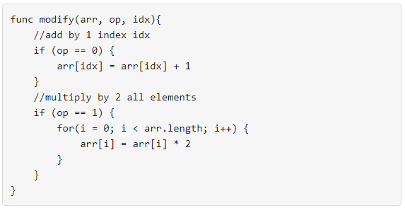

# [1558. Minimum Numbers of Function Calls to Make Target Array](https://leetcode.com/problems/minimum-numbers-of-function-calls-to-make-target-array/)

| Category | Difficulty | Likes | Dislikes |
| :------: | :--------: | :---: | :------: |
| Algorithms | Medium | 643 | 38 |

**Tags:** [`array`](https://leetcode.com/tag/array), [`greedy`](https://leetcode.com/tag/greedy), [`bit-manipulation`](https://leetcode.com/tag/bit-manipulation)

**Companies:** `amazon`

## Description

You are given an integer array `nums`. You have an integer array `arr` of the same length with all values set to `0` initially. You also have the following `modify` function:



You want to use the modify function to convert `arr` to `nums` using the minimum number of calls.

Return *the minimum number of function calls to make *`nums`* from *`arr`.

The test cases are generated so that the answer fits in a **32-bit** signed integer.

 

**Example 1:**

```

Input: nums = [1,5]
Output: 5
Explanation: Increment by 1 (second element): [0, 0] to get [0, 1] (1 operation).
Double all the elements: [0, 1] -&gt; [0, 2] -&gt; [0, 4] (2 operations).
Increment by 1 (both elements)  [0, 4] -&gt; [1, 4] -&gt; [1, 5] (2 operations).
Total of operations: 1 + 2 + 2 = 5.

```

**Example 2:**

```

Input: nums = [2,2]
Output: 3
Explanation: Increment by 1 (both elements) [0, 0] -&gt; [0, 1] -&gt; [1, 1] (2 operations).
Double all the elements: [1, 1] -&gt; [2, 2] (1 operation).
Total of operations: 2 + 1 = 3.

```

**Example 3:**

```

Input: nums = [4,2,5]
Output: 6
Explanation: (initial)[0,0,0] -&gt; [1,0,0] -&gt; [1,0,1] -&gt; [2,0,2] -&gt; [2,1,2] -&gt; [4,2,4] -&gt; [4,2,5](nums).

```

 

**Constraints:**

	- `1 <= nums.length <= 10^5`

	- `0 <= nums[i] <= 10^9`

---

**Links:** [Submissions](https://leetcode.com/problems/minimum-numbers-of-function-calls-to-make-target-array/) | [Solutions](https://leetcode.com/problems/minimum-numbers-of-function-calls-to-make-target-array/)
