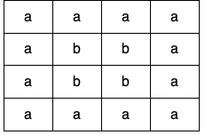
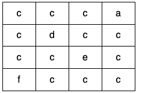

# [1559. Detect Cycles in 2D Grid](https://leetcode.com/problems/detect-cycles-in-2d-grid/)

| Category | Difficulty | Likes | Dislikes |
| :------: | :--------: | :---: | :------: |
| Algorithms | Medium | 1306 | 30 |

**Tags:** [`array`](https://leetcode.com/tag/array), [`depth-first-search`](https://leetcode.com/tag/depth-first-search), [`breadth-first-search`](https://leetcode.com/tag/breadth-first-search), [`union-find`](https://leetcode.com/tag/union-find), [`matrix`](https://leetcode.com/tag/matrix)

**Companies:** `facebook`, `google`, `nutanix`

## Description

Given a 2D array of characters `grid` of size `m x n`, you need to find if there exists any cycle consisting of the **same value** in `grid`.

A cycle is a path of **length 4 or more** in the grid that starts and ends at the same cell. From a given cell, you can move to one of the cells adjacent to it - in one of the four directions (up, down, left, or right), if it has the **same value** of the current cell.

Also, you cannot move to the cell that you visited in your last move. For example, the cycle `(1, 1) -> (1, 2) -> (1, 1)` is invalid because from `(1, 2)` we visited `(1, 1)` which was the last visited cell.

Return `true` if any cycle of the same value exists in `grid`, otherwise, return `false`.

 

**Example 1:**

****

```

Input: grid = [[&quot;a&quot;,&quot;a&quot;,&quot;a&quot;,&quot;a&quot;],[&quot;a&quot;,&quot;b&quot;,&quot;b&quot;,&quot;a&quot;],[&quot;a&quot;,&quot;b&quot;,&quot;b&quot;,&quot;a&quot;],[&quot;a&quot;,&quot;a&quot;,&quot;a&quot;,&quot;a&quot;]]
Output: true
Explanation: There are two valid cycles shown in different colors in the image below:


```

**Example 2:**

****

```

Input: grid = [[&quot;c&quot;,&quot;c&quot;,&quot;c&quot;,&quot;a&quot;],[&quot;c&quot;,&quot;d&quot;,&quot;c&quot;,&quot;c&quot;],[&quot;c&quot;,&quot;c&quot;,&quot;e&quot;,&quot;c&quot;],[&quot;f&quot;,&quot;c&quot;,&quot;c&quot;,&quot;c&quot;]]
Output: true
Explanation: There is only one valid cycle highlighted in the image below:


```

**Example 3:**

****

```

Input: grid = [[&quot;a&quot;,&quot;b&quot;,&quot;b&quot;],[&quot;b&quot;,&quot;z&quot;,&quot;b&quot;],[&quot;b&quot;,&quot;b&quot;,&quot;a&quot;]]
Output: false

```

 

**Constraints:**

	- `m == grid.length`

	- `n == grid[i].length`

	- `1 <= m, n <= 500`

	- `grid` consists only of lowercase English letters.

---

**Links:** [Submissions](https://leetcode.com/problems/detect-cycles-in-2d-grid/) | [Solutions](https://leetcode.com/problems/detect-cycles-in-2d-grid/)
