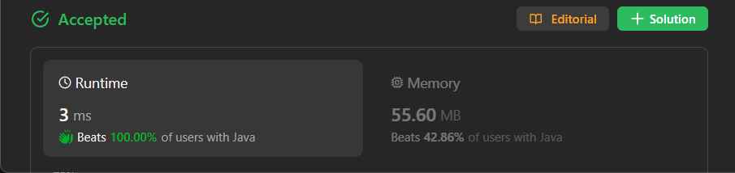

# ✅ Beats 100% - Explained with [ Video ] - Modified Counting Sort - Visualized Too

**Author:** lancertech6
**Votes:** 57
**Link:** [https://leetcode.com/problems/maximum-number-of-coins-you-can-get/solutions/4322618/](https://leetcode.com/problems/maximum-number-of-coins-you-can-get/solutions/4322618/)

---



# YouTube Video Explanation:

[https://youtu.be/SNHWDGCLLVA](https://youtu.be/SNHWDGCLLVA)

**\uD83D\uDD25 Please like, share, and subscribe to support our channel's mission of making complex concepts easy to understand.**

Subscribe Link: https://www.youtube.com/@leetlogics/?sub_confirmation=1

*Subscribe Goal: 400 Subscribers*
*Current Subscribers: 392*

---

<!-- # Example Explanation
Below is an explanation of the provided logic using tables. I've simplified the `freq` array for demonstration purposes:

### Explanation:

#### Input:
Suppose we have the input `piles = [2, 4, 1, 2, 7, 8]`.


#### Step 1: Find the Maximum Value
We find the maximum value in the `piles` array, which is 8.

#### Step 2: Frequency Array (`freq`)

Suppose the simplified `freq` array looks like this:

| Index | 0 | 1 | 2 | 3 | 4 | 5 | 6 | 7 | 8 |
|-------|---|---|---|---|---|---|---|---|---|
| Freq  | 0 | 1 | 2 | 0 | 1 | 0 | 0 | 1 | 1 |

It represents the frequency of each number in the `piles` array.

#### Step 3: Choose Piles
We start choosing piles based on the rules. In each step, we choose three piles.

1. First triplet: (8, 7, 2)
   - Alice picks the maximum: 8
   - You pick the next maximum: 7
   - Bob picks the last one: 2
   - Total coins: 8 + 7 = 15

2. Second triplet: (4, 1, 2)
   - Alice picks the maximum: 4
   - You pick the next maximum: 2
   - Bob picks the last one: 1
   - Total coins: 4 + 2 = 6


#### Result:
The maximum number of coins you can have is 7+2 = 9.

I hope this helps in understanding the logic!

--- -->
# Intuition
<!-- Describe your first thoughts on how to solve this problem. -->
The goal is to maximize the total number of coins you can have based on a specific selection process. You can choose any 3 piles of coins in each step, and Alice, you, and Bob will pick one pile each in a specific order. The strategy is to select piles that maximize your total number of coins.

# Approach
<!-- Describe your approach to solving the problem. -->
1. Find the maximum number of coins in any pile (`max`).
2. Create an array `freq` to store the frequency of each number of coins.
3. Iterate through the `piles` array and populate the `freq` array.
4. Initialize variables: `coins` to store the total number of coins you have, `chance` to keep track of the remaining opportunities to choose piles, `turn` to determine whose turn it is to choose, and `i` to iterate from the maximum number of coins.
5. While you still have chances to choose piles (`chance != 0`):
   - If it's your turn (`turn == 1`) and there are piles with the current number of coins (`freq[i] > 0`):
     - Deduct one chance.
     - Switch the turn to the next person.
     - Add the current number of coins to your total.
     - Decrease the frequency of the chosen pile.
   - If it's not your turn or there are no piles with the current number of coins:
     - Move to the next lower number of coins.
6. Return the total number of coins you have.

# Complexity
- The time complexity is O(n), where n is the length of the `piles` array.
- The space complexity is O(max), where max is the maximum number of coins in any pile.

# Code
## Java
```
class Solution {
    public int maxCoins(int[] piles) {
        int max = 0;
        int n = piles.length;

        for(int i : piles)
        {
            if(max < i) max = i;
        }

        int[] freq = new int[max+1];

        for(int i : piles)
        {
            freq[i]++;
        }
        
        int coins = 0;
        int chance = n / 3;

        int turn = 1;
        int i = max;

        while(chance != 0){
            if(freq[i] > 0){
                if(turn == 1) turn = 0;
                else {
                    chance--;
                    turn = 1;
                    coins += i;
                }
                freq[i]--;
            }else{
                i--;
            }
        }

        return coins;
    }
}
```
## C++
```
class Solution {
public:
    int maxCoins(vector<int>& piles) {
        int max = 0;
        int n = piles.size();

        for (int i : piles) {
            if (max < i) max = i;
        }
        vector<int> freq(max + 1, 0);

        for (int i : piles) {
            freq[i]++;
        }

        int coins = 0;
        int chance = n / 3;

        int turn = 1;
        int i = max;

        while (chance != 0) {
            if (freq[i] > 0) {
                if (turn == 1) turn = 0;
                else {
                    chance--;
                    turn = 1;
                    coins += i;
                }
                freq[i]--;
            } else {
                i--;
            }
        }

        return coins;
    }
};
```
## Python
```
class Solution(object):
    def maxCoins(self, piles):
        max_val = max(piles)
        freq = [0] * (max_val + 1)

        for i in piles:
            freq[i] += 1

        coins = 0
        chance = len(piles) // 3
        turn = 1
        i = max_val

        while chance != 0:
            if freq[i] > 0:
                if turn == 1:
                    turn = 0
                else:
                    chance -= 1
                    turn = 1
                    coins += i
                freq[i] -= 1
            else:
                i -= 1

        return coins
```
## JavaScript
```
var maxCoins = function(piles) {
    let max = 0;
    let n = piles.length;

    for (let i of piles) {
        if (max < i) max = i;
    }

    let freq = new Array(max + 1).fill(0);

    for (let i of piles) {
        freq[i]++;
    }

    let coins = 0;
    let chance = Math.floor(n / 3);
    let turn = 1;
    let i = max;

    while (chance !== 0) {
        if (freq[i] > 0) {
            if (turn === 1) turn = 0;
            else {
                chance--;
                turn = 1;
                coins += i;
            }
            freq[i]--;
        } else {
            i--;
        }
    }

    return coins;
};
```

