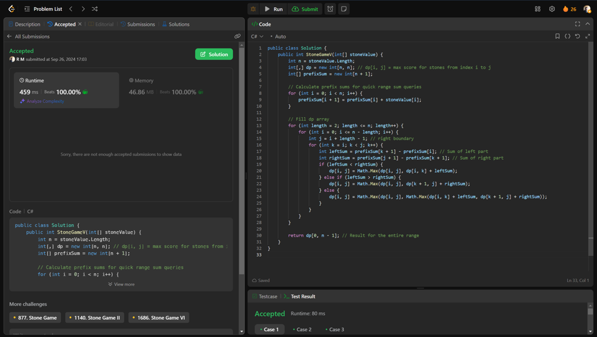

# 💥💥Beats 100% on runtime and memory [EXPLAINED]

**Author:** r9n
**Votes:** 0
**Link:** [https://leetcode.com/problems/stone-game-v/solutions/5837875/](https://leetcode.com/problems/stone-game-v/solutions/5837875/)

---




# Intuition
The goal is to maximize Alice's score by strategically splitting the stones into two non-empty parts, ensuring she always benefits from the remaining stones after Bob discards the higher-value part.

# Approach
Evaluate all possible splits of the stones, calculating the scores recursively while storing results to avoid redundant calculations.

# Complexity
- Time complexity:
O(n\xB3) due to nested loops iterating through all possible pairs and splits.

- Space complexity:
O(n\xB2) for storing the maximum scores of subarrays in a 2D array.

# Code
```csharp []
public class Solution {
    public int StoneGameV(int[] stoneValue) {
        int n = stoneValue.Length;
        int[,] dp = new int[n, n]; // dp[i, j] = max score for stones from index i to j
        int[] prefixSum = new int[n + 1];

        // Calculate prefix sums for quick range sum queries
        for (int i = 0; i < n; i++) {
            prefixSum[i + 1] = prefixSum[i] + stoneValue[i];
        }

        // Fill dp array
        for (int length = 2; length <= n; length++) {
            for (int i = 0; i <= n - length; i++) {
                int j = i + length - 1; // right boundary
                for (int k = i; k < j; k++) {
                    int leftSum = prefixSum[k + 1] - prefixSum[i]; // Sum of left part
                    int rightSum = prefixSum[j + 1] - prefixSum[k + 1]; // Sum of right part
                    if (leftSum < rightSum) {
                        dp[i, j] = Math.Max(dp[i, j], dp[i, k] + leftSum);
                    } else if (leftSum > rightSum) {
                        dp[i, j] = Math.Max(dp[i, j], dp[k + 1, j] + rightSum);
                    } else {
                        dp[i, j] = Math.Max(dp[i, j], Math.Max(dp[i, k] + leftSum, dp[k + 1, j] + rightSum));
                    }
                }
            }
        }

        return dp[0, n - 1]; // Result for the entire range
    }
}

```