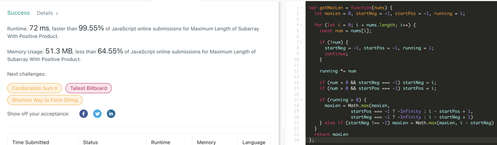

# JavaScript | Simple, Clean O(n) Solution w/ Explanation | 100%

**Author:** casmith1987
**Votes:** 4
**Link:** [https://leetcode.com/problems/maximum-length-of-subarray-with-positive-product/solutions/1850067/](https://leetcode.com/problems/maximum-length-of-subarray-with-positive-product/solutions/1850067/)

---



Code w/o Explanation:  (See Below for commented version)

```
var getMaxLen = function(nums) {
  let maxLen = 0, startNeg = -1, startPos = -1, running = 1;
  
  for (let i = 0; i < nums.length; i++) {
    const num = nums[i];
    
    if (!num) {
      startNeg = -1, startPos = -1, running = 1;
      continue;
    }
    
    running *= num
    
    if (num < 0 && startNeg === -1) startNeg = i;
    if (num > 0 && startPos === -1) startPos = i;
    
    if (running > 0) {
      maxLen = Math.max(maxLen, 
                startPos === -1 ? -Infinity : i - startPos + 1, 
                startNeg === -1 ? -Infinity : i - startNeg + 1)
    } else if (startNeg !== -1) maxLen = Math.max(maxLen, i - startNeg)
  }
  return maxLen
};
```

W/ Explanation:
```
var getMaxLen = function(nums) {
  //We need to track the index of the first negative value we encounter, the first positive value
  //and our running product.
  let maxLen = 0, startNeg = -1, startPos = -1, running = 1;
  
  for (let i = 0; i < nums.length; i++) {
    const num = nums[i];
    
	//If number encountered is a 0, we cannot have it in our subarray and still be positive. 
	//Reset back to base conditions.
    if (!num) {
      startNeg = -1, startPos = -1, running = 1;
      continue;
    }
    
	//Multiply running product by num.
    running *= num
    
	//If startNeg or startPos === -1, we have not yet encountered a negative or a positive in this run.
	//Capture first indexes for these.
    if (num < 0 && startNeg === -1) startNeg = i;
    if (num > 0 && startPos === -1) startPos = i;
    
	//If our running total is Ever positive, that means our maxLen is previous max, or difference between i
	//and startPos or startNeg (whichever was first).
    if (running > 0) {
      maxLen = Math.max(maxLen, 
                startPos === -1 ? -Infinity : i - startPos + 1, 
                startNeg === -1 ? -Infinity : i - startNeg + 1)
				
	// If our running product is negative, we can take the length from after the first negative to where we currently are.  
	// By not doing the + 1 here, we are removing the negative number that was captured, thus making our running
	// product guaranteed positive between these indexes.
    } else if (startNeg !== -1) maxLen = Math.max(maxLen, i - startNeg)
  }
  return maxLen
};
```