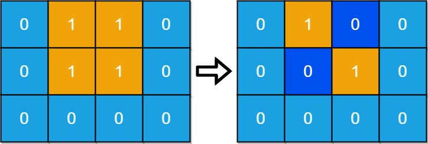
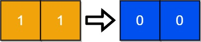

# [1568. Minimum Number of Days to Disconnect Island](https://leetcode.com/problems/minimum-number-of-days-to-disconnect-island/)

| Category | Difficulty | Likes | Dislikes |
| :------: | :--------: | :---: | :------: |
| Algorithms | Hard | 1292 | 224 |

**Tags:** [`array`](https://leetcode.com/tag/array), [`depth-first-search`](https://leetcode.com/tag/depth-first-search), [`breadth-first-search`](https://leetcode.com/tag/breadth-first-search), [`matrix`](https://leetcode.com/tag/matrix), [`strongly-connected-component`](https://leetcode.com/tag/strongly-connected-component)

**Companies:** `amazon`

## Description

You are given an `m x n` binary grid `grid` where `1` represents land and `0` represents water. An **island** is a maximal **4-directionally** (horizontal or vertical) connected group of `1`'s.

The grid is said to be **connected** if we have **exactly one island**, otherwise is said **disconnected**.

In one day, we are allowed to change **any **single land cell `(1)` into a water cell `(0)`.

Return *the minimum number of days to disconnect the grid*.

 

**Example 1:**


```

Input: grid = [[0,1,1,0],[0,1,1,0],[0,0,0,0]]

Output: 2
Explanation: We need at least 2 days to get a disconnected grid.
Change land grid[1][1] and grid[0][2] to water and get 2 disconnected island.

```

**Example 2:**


```

Input: grid = [[1,1]]
Output: 2
Explanation: Grid of full water is also disconnected ([[1,1]] -&gt; [[0,0]]), 0 islands.

```

 

**Constraints:**

	- `m == grid.length`

	- `n == grid[i].length`

	- `1 <= m, n <= 30`

	- `grid[i][j]` is either `0` or `1`.

---

**Links:** [Submissions](https://leetcode.com/problems/minimum-number-of-days-to-disconnect-island/) | [Solutions](https://leetcode.com/problems/minimum-number-of-days-to-disconnect-island/)
