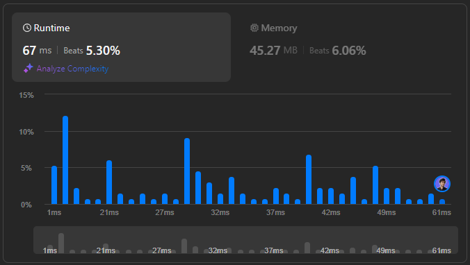

# 🌟 Mastering Island Disconnect in 2 Days with Multi-Language Solutions 🔥💯

**Author:** withaarzoo
**Votes:** 2
**Link:** [https://leetcode.com/problems/minimum-number-of-days-to-disconnect-island/solutions/5619967/](https://leetcode.com/problems/minimum-number-of-days-to-disconnect-island/solutions/5619967/)

---


Explore a collection of solutions to LeetCode problems in multiple programming languages. Each solution includes a detailed explanation and step-by-step approach to solving the problem efficiently. Whether you're a beginner looking to learn or an experienced coder seeking optimized solutions, this repository aims to provide clear and insightful approaches to tackling challenging LeetCode problems.

### **Access daily LeetCode Solutions Repo :** [click here](https://github.com/withaarzoo/LeetCode-Solutions)

---



## Intuition
To disconnect an island in the minimum number of days, the problem can be approached by simulating the disconnection process. Since the island is defined by connected land cells, the goal is to identify the minimum number of land cells that need to be changed to water to split the island into two or more disconnected parts. We start by checking if the grid is already disconnected. If not, we explore changing one or two cells to achieve disconnection, knowing that fewer changes are preferable.

## Approach
1. **Initial Check**: First, determine if the grid is already disconnected. If it is, return `0`.
2. **Single Cell Removal**: Iterate through each cell in the grid. For each land cell, temporarily change it to water and check if this causes the grid to disconnect. If so, return `1`.
3. **Two Cell Removal**: If no single cell disconnection is found, attempt to disconnect the grid by changing any two land cells. If this results in disconnection, return `2`.
4. **BFS/DFS for Connectivity Check**: Use BFS (Breadth-First Search) to explore the island and check if it remains connected after each change.

## Complexity
- **Time Complexity**: 
  - The time complexity is approximately $$O(m \	imes n \	imes (m \	imes n))$$ where \\(m\\) and \\(n\\) are the grid dimensions. This accounts for the BFS/DFS traversal needed to check connectivity after potentially removing every land cell.
  
- **Space Complexity**:
  - The space complexity is $$O(m \	imes n)$$ due to the space needed to store the visited nodes during BFS/DFS traversal.

## Code
```C++ []
class Solution {
public:
    int minDays(vector<vector<int>>& grid) {
        if (isDisconnected(grid)) return 0;

        int m = grid.size();
        int n = grid[0].size();

        // Try removing one cell
        for (int i = 0; i < m; ++i) {
            for (int j = 0; j < n; ++j) {
                if (grid[i][j] == 1) {
                    grid[i][j] = 0;
                    if (isDisconnected(grid)) return 1;
                    grid[i][j] = 1;
                }
            }
        }

        // Try removing two cells
        for (int i = 0; i < m; ++i) {
            for (int j = 0; j < n; ++j) {
                if (grid[i][j] == 1) {
                    grid[i][j] = 0;
                    for (int x = 0; x < m; ++x) {
                        for (int y = 0; y < n; ++y) {
                            if (grid[x][y] == 1) {
                                grid[x][y] = 0;
                                if (isDisconnected(grid)) return 2;
                                grid[x][y] = 1;
                            }
                        }
                    }
                    grid[i][j] = 1;
                }
            }
        }
        return 2;
    }

private:
    bool isDisconnected(vector<vector<int>>& grid) {
        int m = grid.size();
        int n = grid[0].size();
        vector<vector<int>> visited(m, vector<int>(n, 0));

        int landCount = 0;
        for (int i = 0; i < m; ++i) {
            for (int j = 0; j < n; ++j) {
                if (grid[i][j] == 1) {
                    ++landCount;
                    if (!visited[i][j]) {
                        if (landCount > 1) return true;
                        bfs(grid, visited, i, j);
                    }
                }
            }
        }
        return landCount == 0;
    }

    void bfs(vector<vector<int>>& grid, vector<vector<int>>& visited, int i, int j) {
        int m = grid.size();
        int n = grid[0].size();
        queue<pair<int, int>> q;
        q.push({i, j});
        visited[i][j] = 1;

        vector<int> dirX = {-1, 1, 0, 0};
        vector<int> dirY = {0, 0, -1, 1};

        while (!q.empty()) {
            auto [x, y] = q.front();
            q.pop();

            for (int d = 0; d < 4; ++d) {
                int newX = x + dirX[d];
                int newY = y + dirY[d];
                if (newX >= 0 && newX < m && newY >= 0 && newY < n && grid[newX][newY] == 1 && !visited[newX][newY]) {
                    visited[newX][newY] = 1;
                    q.push({newX, newY});
                }
            }
        }
    }
};

```
```Java []
class Solution {
    public int minDays(int[][] grid) {
        if (isDisconnected(grid)) return 0;

        int m = grid.length;
        int n = grid[0].length;

        for (int i = 0; i < m; ++i) {
            for (int j = 0; j < n; ++j) {
                if (grid[i][j] == 1) {
                    grid[i][j] = 0;
                    if (isDisconnected(grid)) return 1;
                    grid[i][j] = 1;
                }
            }
        }

        for (int i = 0; i < m; ++i) {
            for (int j = 0; j < n; ++j) {
                if (grid[i][j] == 1) {
                    grid[i][j] = 0;
                    for (int x = 0; x < m; ++x) {
                        for (int y = 0; y < n; ++y) {
                            if (grid[x][y] == 1) {
                                grid[x][y] = 0;
                                if (isDisconnected(grid)) return 2;
                                grid[x][y] = 1;
                            }
                        }
                    }
                    grid[i][j] = 1;
                }
            }
        }
        return 2;
    }

    private boolean isDisconnected(int[][] grid) {
        int m = grid.length;
        int n = grid[0].length;
        boolean[][] visited = new boolean[m][n];

        int landCount = 0;
        for (int i = 0; i < m; ++i) {
            for (int j = 0; j < n; ++j) {
                if (grid[i][j] == 1) {
                    ++landCount;
                    if (!visited[i][j]) {
                        if (landCount > 1) return true;
                        bfs(grid, visited, i, j);
                    }
                }
            }
        }
        return landCount == 0;
    }

    private void bfs(int[][] grid, boolean[][] visited, int i, int j) {
        int m = grid.length;
        int n = grid[0].length;
        Queue<int[]> q = new LinkedList<>();
        q.offer(new int[]{i, j});
        visited[i][j] = true;

        int[] dirX = {-1, 1, 0, 0};
        int[] dirY = {0, 0, -1, 1};

        while (!q.isEmpty()) {
            int[] current = q.poll();
            int x = current[0];
            int y = current[1];

            for (int d = 0; d < 4; ++d) {
                int newX = x + dirX[d];
                int newY = y + dirY[d];
                if (newX >= 0 && newX < m && newY >= 0 && newY < n && grid[newX][newY] == 1 && !visited[newX][newY]) {
                    visited[newX][newY] = true;
                    q.offer(new int[]{newX, newY});
                }
            }
        }
    }
}

```
```JavaScript []
/**
 * @param {number[][]} grid
 * @return {number}
 */
var minDays = function(grid) {
    if (isDisconnected(grid)) return 0;

    const m = grid.length;
    const n = grid[0].length;

    // Try removing one cell
    for (let i = 0; i < m; ++i) {
        for (let j = 0; j < n; ++j) {
            if (grid[i][j] === 1) {
                grid[i][j] = 0;
                if (isDisconnected(grid)) return 1;
                grid[i][j] = 1;
            }
        }
    }

    // Try removing two cells
    for (let i = 0; i < m; ++i) {
        for (let j = 0; j < n; ++j) {
            if (grid[i][j] === 1) {
                grid[i][j] = 0;
                for (let x = 0; x < m; ++x) {
                    for (let y = 0; y < n; ++y) {
                        if (grid[x][y] === 1) {
                            grid[x][y] = 0;
                            if (isDisconnected(grid)) return 2;
                            grid[x][y] = 1;
                        }
                    }
                }
                grid[i][j] = 1;
            }
        }
    }
    return 2;
};

function isDisconnected(grid) {
    const m = grid.length;
    const n = grid[0].length;
    const visited = Array.from({ length: m }, () => Array(n).fill(false));

    let landCount = 0;
    for (let i = 0; i < m; ++i) {
        for (let j = 0; j < n; ++j) {
            if (grid[i][j] === 1) {
                ++landCount;
                if (!visited[i][j]) {
                    if (landCount > 1) return true;
                    bfs(grid, visited, i, j);
                }
            }
        }
    }
    return landCount === 0;
}

function bfs(grid, visited, i, j) {
    const m = grid.length;
    const n = grid[0].length;
    const queue = [[i, j]];
    visited[i][j] = true;

    const dirX = [-1, 1, 0, 0];
    const dirY = [0, 0, -1, 1];

    while (queue.length > 0) {
        const [x, y] = queue.shift();

        for (let d = 0; d < 4; ++d) {
            const newX = x + dirX[d];
            const newY = y + dirY[d];
            if (newX >= 0 && newX < m && newY >= 0 && newY < n && grid[newX][newY] === 1 && !visited[newX][newY]) {
                visited[newX][newY] = true;
                queue.push([newX, newY]);
            }
        }
    }
}

```
```Python []
from collections import deque
from typing import List

class Solution:
    def minDays(self, grid: List[List[int]]) -> int:
        if self.isDisconnected(grid):
            return 0

        m, n = len(grid), len(grid[0])

        # Try removing one cell
        for i in range(m):
            for j in range(n):
                if grid[i][j] == 1:
                    grid[i][j] = 0
                    if self.isDisconnected(grid):
                        return 1
                    grid[i][j] = 1

        # Try removing two cells
        for i in range(m):
            for j in range(n):
                if grid[i][j] == 1:
                    grid[i][j] = 0
                    for x in range(m):
                        for y in range(n):
                            if grid[x][y] == 1:
                                grid[x][y] = 0
                                if self.isDisconnected(grid):
                                    return 2
                                grid[x][y] = 1
                    grid[i][j] = 1
        return 2

    def isDisconnected(self, grid: List[List[int]]) -> bool:
        m, n = len(grid), len(grid[0])
        visited = [[0] * n for _ in range(m)]

        land_count = 0
        for i in range(m):
            for j in range(n):
                if grid[i][j] == 1:
                    land_count += 1
                    if not visited[i][j]:
                        if land_count > 1:
                            return True
                        self.bfs(grid, visited, i, j)
        return land_count == 0

    def bfs(self, grid: List[List[int]], visited: List[List[int]], i: int, j: int) -> None:
        m, n = len(grid), len(grid[0])
        queue = deque([(i, j)])
        visited[i][j] = 1

        dirX = [-1, 1, 0, 0]
        dirY = [0, 0, -1, 1]

        while queue:
            x, y = queue.popleft()

            for d in range(4):
                newX = x + dirX[d]
                newY = y + dirY[d]
                if 0 <= newX < m and 0 <= newY < n and grid[newX][newY] == 1 and not visited[newX][newY]:
                    visited[newX][newY] = 1
                    queue.append((newX, newY))

```
```Go []
func minDays(grid [][]int) int {
    if isDisconnected(grid) {
        return 0
    }

    m, n := len(grid), len(grid[0])

    for i := 0; i < m; i++ {
        for j := 0; j < n; j++ {
            if grid[i][j] == 1 {
                grid[i][j] = 0
                if isDisconnected(grid) {
                    return 1
                }
                grid[i][j] = 1
            }
        }
    }

    for i := 0; i < m; i++ {
        for j := 0; j < n; j++ {
            if grid[i][j] == 1 {
                grid[i][j] = 0
                for x := 0; x < m; x++ {
                    for y := 0; y < n; y++ {
                        if grid[x][y] == 1 {
                            grid[x][y] = 0
                            if isDisconnected(grid) {
                                return 2
                            }
                            grid[x][y] = 1
                        }
                    }
                }
                grid[i][j] = 1
            }
        }
    }
    return 2
}

func isDisconnected(grid [][]int) bool {
    m, n := len(grid), len(grid[0])
    visited := make([][]bool, m)
    for i := range visited {
        visited[i] = make([]bool, n)
    }

    landCount := 0
    for i := 0; i < m; i++ {
        for j := 0; j < n; j++ {
            if grid[i][j] == 1 {
                landCount++
                if !visited[i][j] {
                    if landCount > 1 {
                        return true
                    }
                    bfs(grid, visited, i, j)
                }
            }
        }
    }
    return landCount == 0
}

func bfs(grid [][]int, visited [][]bool, i, j int) {
    m, n := len(grid), len(grid[0])
    dirX := []int{-1, 1, 0, 0}
    dirY := []int{0, 0, -1, 1}

    queue := [][]int{{i, j}}
    visited[i][j] = true

    for len(queue) > 0 {
        x, y := queue[0][0], queue[0][1]
        queue = queue[1:]

        for d := 0; d < 4; d++ {
            newX, newY := x+dirX[d], y+dirY[d]
            if newX >= 0 && newX < m && newY >= 0 && newY < n && grid[newX][newY] == 1 && !visited[newX][newY] {
                visited[newX][newY] = true
                queue = append(queue, []int{newX, newY})
            }
        }
    }
}

```


## Step-by-Step Detailed Explanation
1. **Initial Check**: The first step in the `minDays` function is to check if the grid is already disconnected using the `isDisconnected` function. This function counts the number of separate connected components of land cells (1's). If there is more than one, it returns `0`, indicating that the grid is already disconnected.

2. **Single Cell Removal**: If the grid is still connected, the next step is to iterate through each cell in the grid. If a cell contains land (`1`), it temporarily changes the cell to water (`0`) and checks if the grid becomes disconnected. If it does, the function returns `1`, indicating that one day is sufficient to disconnect the grid.

3. **Two Cell Removal**: If removing a single cell does not disconnect the grid, the function then tries removing combinations of two cells. It iterates through each cell and, for each cell that contains land, temporarily changes it to water. It then checks the grid again after removing another land cell. If this disconnects the grid, the function returns `2`.

4. **BFS for Connectivity Check**: The `isDisconnected` function uses BFS (Breadth-First Search) to explore the island starting from any land cell. It marks cells as visited and ensures all connected cells are part of the same island. If multiple unconnected land areas are found, the grid is considered disconnected.

---


