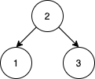
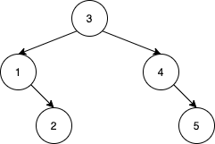
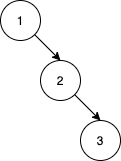

# [1569. Number of Ways to Reorder Array to Get Same BST](https://leetcode.com/problems/number-of-ways-to-reorder-array-to-get-same-bst/)

| Category | Difficulty | Likes | Dislikes |
| :------: | :--------: | :---: | :------: |
| Algorithms | Hard | 1845 | 210 |

**Tags:** [`array`](https://leetcode.com/tag/array), [`math`](https://leetcode.com/tag/math), [`divide-and-conquer`](https://leetcode.com/tag/divide-and-conquer), [`dynamic-programming`](https://leetcode.com/tag/dynamic-programming), [`tree`](https://leetcode.com/tag/tree), [`union-find`](https://leetcode.com/tag/union-find), [`binary-search-tree`](https://leetcode.com/tag/binary-search-tree), [`memoization`](https://leetcode.com/tag/memoization), [`combinatorics`](https://leetcode.com/tag/combinatorics), [`binary-tree`](https://leetcode.com/tag/binary-tree)

**Companies:** `de-shaw`, `google`

## Description

Given an array `nums` that represents a permutation of integers from `1` to `n`. We are going to construct a binary search tree (BST) by inserting the elements of `nums` in order into an initially empty BST. Find the number of different ways to reorder `nums` so that the constructed BST is identical to that formed from the original array `nums`.

	- For example, given `nums = [2,1,3]`, we will have 2 as the root, 1 as a left child, and 3 as a right child. The array `[2,3,1]` also yields the same BST but `[3,2,1]` yields a different BST.

Return *the number of ways to reorder* `nums` *such that the BST formed is identical to the original BST formed from* `nums`.

Since the answer may be very large, **return it modulo **`10^9 + 7`.

 

**Example 1:**


```

Input: nums = [2,1,3]
Output: 1
Explanation: We can reorder nums to be [2,3,1] which will yield the same BST. There are no other ways to reorder nums which will yield the same BST.

```

**Example 2:**


```

Input: nums = [3,4,5,1,2]
Output: 5
Explanation: The following 5 arrays will yield the same BST: 
[3,1,2,4,5]
[3,1,4,2,5]
[3,1,4,5,2]
[3,4,1,2,5]
[3,4,1,5,2]

```

**Example 3:**


```

Input: nums = [1,2,3]
Output: 0
Explanation: There are no other orderings of nums that will yield the same BST.

```

 

**Constraints:**

	- `1 <= nums.length <= 1000`

	- `1 <= nums[i] <= nums.length`

	- All integers in `nums` are **distinct**.

---

**Links:** [Submissions](https://leetcode.com/problems/number-of-ways-to-reorder-array-to-get-same-bst/) | [Solutions](https://leetcode.com/problems/number-of-ways-to-reorder-array-to-get-same-bst/)
