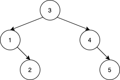
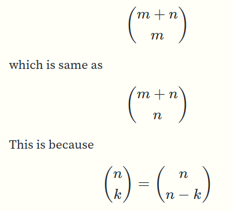

# C++/Python. Question explained. Then detailed solution. Short. Fast. Readable.

**Author:** axat-priy
**Votes:** 53
**Link:** [https://leetcode.com/problems/number-of-ways-to-reorder-array-to-get-same-bst/solutions/819858/](https://leetcode.com/problems/number-of-ways-to-reorder-array-to-get-same-bst/solutions/819858/)

---

Question can seem confusing. Note that we are inserting the numbers in the binary search tree in *exactly the same order as they occur in the input array*. 

This is a good time to recall a fact which may seem very obvious but is crucial to understand the question: *For a fixed sequence of insertion, the number of binary search trees generated is exactly one.*

### Approach

Key insight:  as long as the root of the binary search tree is inserted first (and recursively, other parents are inserted before their subtrees), any permutation of other elements will generate the same BST. This may feel a bit mouthful, so let's understand with an example.

For BST given in example, as long as 3 comes before others, 4 comes before 5, 1 comes before 2, we can generate the same BST.


This is true for all of the following arrays:
```python
[3,1,2,4,5]
[3,1,4,2,5]
[3,1,4,5,2]
[3,4,1,2,5]
[3,4,1,5,2]
```
Let's see an example of [3, 4, 1, 5, 2]

First to insert is 3. Tree is just a single node 3.

Then we insert 4. Has to go on right of 3. Tree is
```
    3
	 \\
	  4
```

Then we insert 1. (Again note that we have to insert in the same order as input array. I'll repeat this several times :D)

```
      3
	 / \\
	1  4
```

Then 5
```
       3
	  / \\
	1   4
	      \\
		   5
```

Then 2

```
       3
	  / \\
	1   4
  	 \\     \\
	  2	   5
```

Try other arrays listed above and convince yourself that it will generate identical BST.

So, for this BST, 

- choose 3 as root (the element which is first in insertion order)
- `[1,2]` will be in the `left` subtree. Maintaining order is important to ensure that we generate the same BST.  Let `m = left.size()`
- `[4,5]` in `right` subtree. Let `n = right.size()`
- find ways to interleave them.
The number of ways are just interleavings of left and right.  Similar to https://leetcode.com/problems/interleaving-string/
How many ways are there to interleave left and right?

There are `m + n` total positions. If we put `m` elements from `left` in randomly chosen `m` positions (but, in order), we can put the rest in other (right ;-)) positions. (Equivalently, we could also have chosen to fill `n` arbitrary positions from `right` and fill remaining from whatever positions are left.)

That\u2019s just:



So algorithm would be

- Fix the root (first element of the input)
- Find smaller and larger elements than root. These would be left and right subtrees (meh)
- Combine, which is an interleaving as explained above.

Follow up: If you actually want to [generate all the arrays](https://stackoverflow.com/questions/21211701/given-a-bst-and-its-root-print-all-sequences-of-nodes-which-give-rise-to-the-sa/24398114#24398114)

### Python
```python
class Solution:

    def numOfWays(self, numbers):
        mod = 10 ** 9 + 7

        def ways_to_interleave(sequence_1, sequence_2):
            """
            Number of ways to interleave two sequences (i.e. maintaining the order)
            """
            total_things = len(sequence_1) + len(sequence_2)
            things_to_choose = len(sequence_1)  # or len(sequence_2), doesn't matter.
            return math.comb(total_things, things_to_choose)

        def helper(subsequence):
            if not subsequence:
                return 1
            root_value = subsequence[0]
            left = [number for number in subsequence if number < root_value]
            right = [number for number in subsequence if number > root_value]
            ways_to_arrange_left = helper(left)
            ways_to_arrange_right = helper(right)
            return ways_to_arrange_left * ways_to_arrange_right * ways_to_interleave(left, right)
        return (helper(numbers) - 1) % mod

```
This surprisingly beats all other python solutions so far (but speed is not the aim of this code, it's readability)

### C++

People who build numerical libraries have my huge respect. Getting [`combinations` method (ommitted) without overflow is tricky for a C++ noob like me. I've lifted the version from here](https://stackoverflow.com/questions/11809502/which-is-better-way-to-calculate-ncr?noredirect=1&lq=1). Others have used pascal triangle methods, which are easiest to implement in interview and worth a look.

```cpp
#include <vector>
#include <cmath>
#include <algorithm>

class Solution {
public:
    int numOfWays(std::vector<int>& numbers) {
			return (helper(numbers) - 1) % mod;
    }

private:
		int mod = std::pow(10, 9) + 7;

		int ways_to_interleave(int sequence_1_length, int sequence_2_length) {
			return combinations(sequence_1_length + sequence_2_length, sequence_2_length, mod); // combinations function is omitted as it's not really relevant to core issue of the question.
		}

		long helper(const std::vector<int>& numbers) {
			if (numbers.empty()) {
				return 1;
			}
			int root_value = numbers[0];
			std::vector<int> left, right;
			std::copy_if(numbers.begin(), numbers.end(), std::back_inserter(left), [root_value](int number){return number < root_value;});
			std::copy_if(numbers.begin(), numbers.end(), std::back_inserter(right), [root_value](int number){return number > root_value;});
			long  ways_to_arrange_left = helper(left) % mod;
			long ways_to_arrange_right = helper(right) % mod;
            long duck_this = (ways_to_arrange_left * ways_to_arrange_right) % mod;
			long duck_this_too = (duck_this * ways_to_interleave(left.size(), right.size())) % mod;
            return duck_this_too;
					}
};
```