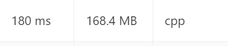

# [C++] | Brute -> Optimal | HashMap & Pair-Indexing

**Author:** dexter_2000
**Votes:** 7
**Link:** [https://leetcode.com/problems/dot-product-of-two-sparse-vectors/solutions/1697337/](https://leetcode.com/problems/dot-product-of-two-sparse-vectors/solutions/1697337/)

---

## 1) Brute 
```
class SparseVector {
public:
    SparseVector(vector<int> &nums) {
        this->sparse = nums;
    }
    
    // Return the dotProduct of two sparse vectors
    int dotProduct(SparseVector& vec) {
        int DotProd=0;
        for(int i=0;i<sparse.size();i++){
            DotProd += vec.sparse[i]*sparse[i];
        }
        return DotProd;
    }
private:
        vector<int>sparse;
};
```

**TC:  O(N)       SC : O(1)**


## 2) Unordered Map to hash non zero elements of vector
```
class SparseVector {
public:
    SparseVector(vector<int> &nums) {
        for(int i=0;i<nums.size();i++){
            if(nums[i]!=0)
                m[i]=nums[i];
        }
    }
    
    // Return the dotProduct of two sparse vectors
    int dotProduct(SparseVector& vec) {
        int DotProd=0;
        for(auto i: this->m){
            if(vec.m.find(i.first)!= vec.m.end()){
                DotProd += this->m[i.first] * vec.m[i.first];
            }
        }
        return DotProd;
    }
private:
        unordered_map<int,int>m;
};
```
**TC:  O(n) for creating the Hash Map; O(L) for calculating the dot product.** 
**SC :O(L) for creating the Hash Map**


## 3) Value Pair Indexing :
```
class SparseVector {
public:
    vector<pair<int,int>>val;
    SparseVector(vector<int> &nums) {
        for(int i=0;i<nums.size();++i){
            if(nums[i]!=0){
                val.push_back({i,nums[i]});
            }
        }
    }
    
    // Return the dotProduct of two sparse vectors
    int dotProduct(SparseVector& vec) {
        int i=0,j=0;
        int Dot=0;
        while(i<val.size() && j<vec.val.size()){
            if(val[i].first== vec.val[j].first){
                Dot += val[i].second * vec.val[j].second;
                ++i;
                ++j;
            }
            else if (val[i].first > vec.val[j].first){
                j++;
            }
            else
                i++;
        }
        return Dot;
    }
};
```
**TC:  O(n) for creating the pair; O(L1+L2) for calculating the dot product.** 
**SC :O(L) for calculating the dot product.**


### Do Upvote if you find it helpful ! :)
