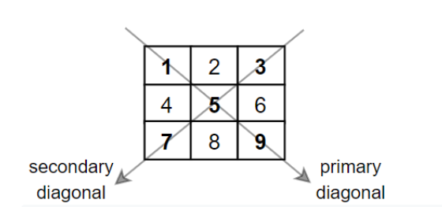

# Python/JS/Java/Go/C++ O(n) by iteration [w/ Comment]

**Author:** brianchiang_tw
**Votes:** 104
**Link:** [https://leetcode.com/problems/matrix-diagonal-sum/solutions/837795/](https://leetcode.com/problems/matrix-diagonal-sum/solutions/837795/)

---

O(n) by iteration

[\u4E2D\u6587\u8A73\u89E3 \u89E3\u984C\u6587\u7AE0](https://vocus.cc/article/6559d622fd89780001a1f96c)

[Tutorial video in Chinese \u4E2D\u6587\u89E3\u984C\u5F71\u7247](https://youtu.be/tTfkdaB4_hM)



---

**Implementation**:

**Python**:

```
class Solution:
    def diagonalSum(self, mat: List[List[int]]) -> int:
        
        n = len(mat)
        
        mid = n // 2
        
        summation = 0
        
        for i in range(n):
            
            # primary diagonal
            summation += mat[i][i]
            
            # secondary diagonal
            summation += mat[n-1-i][i]
            
            
        if n % 2 == 1:
            # remove center element (repeated) on odd side-length case
            summation -= mat[mid][mid]
            
            
        return summation
```

---

**Java**:

```
class Solution {
    public int diagonalSum(int[][] mat) {
        
        // side length
        int n = mat.length;
        
        // mid point index
        int mid = n / 2;
        
        // summation of diagonal element
        int summation = 0;
        
        for( int i = 0 ; i < n ; i++ ){
            
            // primary diagonal
            summation += mat[i][i];
            
            // secondary diagonal
            summation += mat[n-1-i][i];
        }
        
        
        if( n % 2 == 1 ){
            
            // remove center element (repeated) on odd side-length case
            summation -= mat[mid][mid];
        }
        
        return summation;
    }
}
```

---

**Javascript**:

```
var diagonalSum = function(mat) {
    
    // side length
    let n = mat.length;
    
    // mid point index
    let mid = Math.floor( n / 2 );
    
    // summation of diagonal element
    let summation = 0;
    
    for( let i = 0 ; i < n ; i++ ){
        
        // primary diagonal
        summation += mat[i][i];
        
        // secondary diagonal
        summation += mat[n-1-i][i];
    }
    
    if( n % 2 == 1 ){
        
        // remoive center element (repeated) on odd side-length case
        summation -= mat[mid][mid];
    }
    
    return summation;
};
```

---

**Golang**:

```
func diagonalSum(mat [][]int) int {
    
    // side-length
    n := len(mat)
    
    // mid point index
    mid := n / 2
    
    // summation of diagonal element
    summation := 0
    
    for i := 0 ; i < n ; i++{
        
        // primary diagonal
        summation += mat[i][i]
        
        // secondary diagonal
        summation += mat[n-1-i][i]
        
    }
    
    if n % 2 == 1 {
        
        // remove center element (repeated) on odd side-length case
        summation -= mat[mid][mid]
    }
    
    
    return summation
}
```

---

**C++**:

```
class Solution {
public:
    int diagonalSum(vector<vector<int>>& mat) {
        
        // side length
        int n = mat.size();
        
        // mid point index
        int mid = n / 2;
        
        // summation of diagonal element
        int summation = 0;
        
        for( int i = 0 ; i < n ; i++ ){
            
            // primary diagonal
            summation += mat[i][i];
            
            // secondary diagonal
            summation += mat[n-1-i][i];
        }
        
        
        if( n % 2 == 1 ){
            
            // remove center element (repeated) on odd side-length case
            summation -= mat[mid][mid];
        }
        
        return summation;
    }
};
```