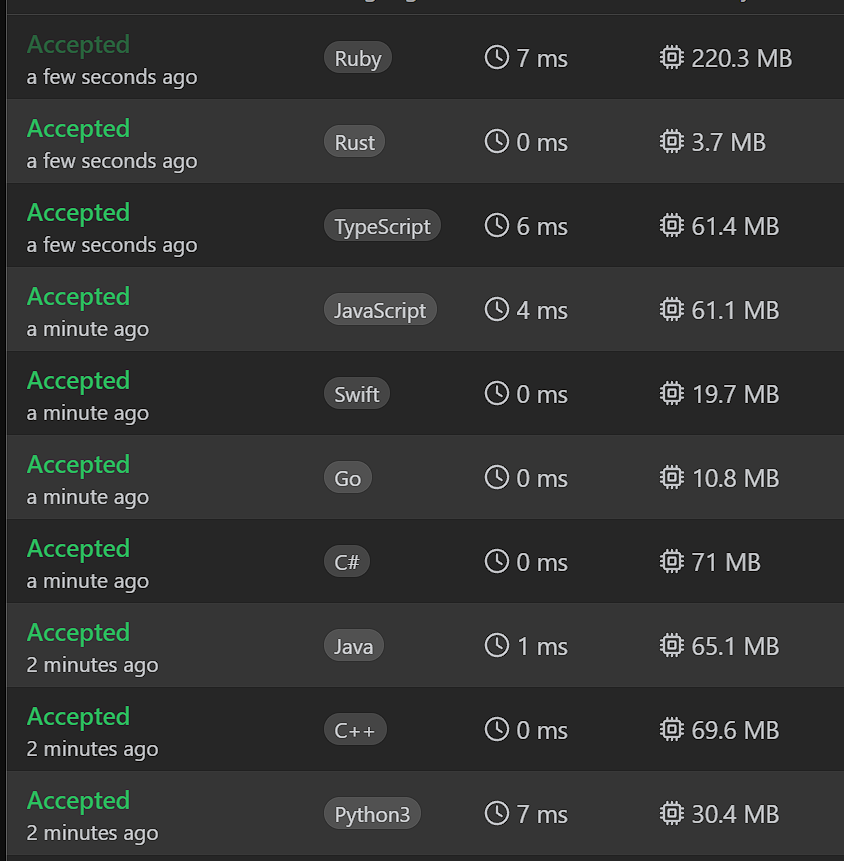

# ✅Beats 100% | Video | Explained Step by Step | 2 Approaches

**Author:** Piotr_Maminski
**Votes:** 20
**Link:** [https://leetcode.com/problems/shortest-subarray-to-be-removed-to-make-array-sorted/solutions/6047100/](https://leetcode.com/problems/shortest-subarray-to-be-removed-to-make-array-sorted/solutions/6047100/)

---

https://youtu.be/eHZLQIH1ruk?si=Z9939JPiMUU2OJFQ


# #1 Two Pointers + Greedy

```python3 []
class Solution:
    def findLengthOfShortestSubarray(self, arr: List[int]) -> int:
        n = len(arr)
        
        # 1. Find the rightmost point where array becomes non-ascending
        right = n - 1
        while right > 0 and arr[right - 1] <= arr[right]:
            right -= 1
            
        # 2. If array is already sorted in ascending order
        if right == 0:
            return 0
            
        # 3. Initial minimum length is from start to right pointer
        min_length = right
        
        # 4. Check each element from left side
        for left in range(n):
            # 4.1 Break if left sequence becomes non-ascending
            if left > 0 and arr[left - 1] > arr[left]:
                break
                
            # 4.2 Find the first element from right that's >= arr[left]
            while right < n and arr[left] > arr[right]:
                right += 1
                
            # 4.3 Update minimum length of subarray to be removed
            current_length = right - left - 1
            min_length = min(min_length, current_length)
            
        return min_length
```
```cpp []
class Solution {
public:
    int findLengthOfShortestSubarray(vector<int>& arr) {
        int n = arr.size();
        
        // 1.Find the rightmost point where array becomes non-ascending
        int right = n - 1;
        while (right > 0 && arr[right - 1] <= arr[right]) {
            right--;
        }
        
        // 2.If array is already sorted in ascending order
        if (right == 0) {
            return 0;
        }
        
        // 3.Initial minimum length is from start to right pointer
        int min_length = right;
        
        // Check each element from left side
        for (int left = 0; left < n; left++) {
            // Break if left sequence becomes non-ascending
            if (left > 0 && arr[left - 1] > arr[left]) {
                break;
            }
            
            // Find the first element from right that's >= arr[left]
            while (right < n && arr[left] > arr[right]) {
                right++;
            }
            
            // Update minimum length of subarray to be removed
            int current_length = right - left - 1;
            min_length = min(min_length, current_length);
        }
        
        return min_length;
    }
};
```
```java []
class Solution {
    public int findLengthOfShortestSubarray(int[] arr) {
        int n = arr.length;
        
        // 1.Find the rightmost point where array becomes non-ascending
        int right = n - 1;
        while (right > 0 && arr[right - 1] <= arr[right]) {
            right--;
        }
        
        // 2.If array is already sorted in ascending order
        if (right == 0) {
            return 0;
        }
        
        // 3.Initial minimum length is from start to right pointer
        int minLength = right;
        
        // Check each element from left side
        for (int left = 0; left < n; left++) {
            // Break if left sequence becomes non-ascending
            if (left > 0 && arr[left - 1] > arr[left]) {
                break;
            }
            
            // Find the first element from right that's >= arr[left]
            while (right < n && arr[left] > arr[right]) {
                right++;
            }
            
            // Update minimum length of subarray to be removed
            int currentLength = right - left - 1;
            minLength = Math.min(minLength, currentLength);
        }
        
        return minLength;
    }
}
```
```csharp []
public class Solution {
    public int FindLengthOfShortestSubarray(int[] arr) {
        int n = arr.Length;
        
        // 1. Find the rightmost point where array becomes non-ascending
        int right = n - 1;
        while (right > 0 && arr[right - 1] <= arr[right]) {
            right--;
        }
        
        // 2. If array is already sorted in ascending order
        if (right == 0) {
            return 0;
        }
        
        // 3. Initial minimum length is from start to right pointer
        int minLength = right;
        
        // Check each element from left side
        for (int left = 0; left < n; left++) {
            // Break if left sequence becomes non-ascending
            if (left > 0 && arr[left - 1] > arr[left]) {
                break;
            }
            
            // Find the first element from right that's >= arr[left]
            while (right < n && arr[left] > arr[right]) {
                right++;
            }
            
            // Update minimum length of subarray to be removed
            int currentLength = right - left - 1;
            minLength = Math.Min(minLength, currentLength);
        }
        
        return minLength;
    }
}
```
```golang []
func findLengthOfShortestSubarray(arr []int) int {
    n := len(arr)
    
    // 1. Find the rightmost point where array becomes non-ascending
    right := n - 1
    for right > 0 && arr[right-1] <= arr[right] {
        right--
    }
    
    // 2. If array is already sorted in ascending order
    if right == 0 {
        return 0
    }
    
    // 3. Initial minimum length is from start to right pointer
    minLength := right
    
    // Check each element from left side
    for left := 0; left < n; left++ {
        // Break if left sequence becomes non-ascending
        if left > 0 && arr[left-1] > arr[left] {
            break
        }
        
        // Find the first element from right that's >= arr[left]
        for right < n && arr[left] > arr[right] {
            right++
        }
        
        // Update minimum length of subarray to be removed
        currentLength := right - left - 1
        minLength = min(minLength, currentLength)
    }
    
    return minLength
}
```
```swift []
class Solution {
    func findLengthOfShortestSubarray(_ arr: [Int]) -> Int {
        let n = arr.count
        
        // 1. Find the rightmost point where array becomes non-ascending
        var right = n - 1
        while right > 0 && arr[right - 1] <= arr[right] {
            right -= 1
        }
        
        // 2. If array is already sorted in ascending order
        if right == 0 {
            return 0
        }
        
        // 3. Initial minimum length is from start to right pointer
        var minLength = right
        
        // Check each element from left side
        for left in 0..<n {
            // Break if left sequence becomes non-ascending
            if left > 0 && arr[left - 1] > arr[left] {
                break
            }
            
            // Find the first element from right that's >= arr[left]
            while right < n && arr[left] > arr[right] {
                right += 1
            }
            
            // Update minimum length of subarray to be removed
            let currentLength = right - left - 1
            minLength = min(minLength, currentLength)
        }
        
        return minLength
    }
}
```
```javascript [JS]
// JavaScript

var findLengthOfShortestSubarray = function(arr) {
    const n = arr.length;
    
    // 1. Find the rightmost point where array becomes non-ascending
    let right = n - 1;
    while (right > 0 && arr[right - 1] <= arr[right]) {
        right--;
    }
    
    // 2. If array is already sorted in ascending order
    if (right === 0) {
        return 0;
    }
    
    // 3. Initial minimum length is from start to right pointer
    let minLength = right;
    
    // Check each element from left side
    for (let left = 0; left < n; left++) {
        // Break if left sequence becomes non-ascending
        if (left > 0 && arr[left - 1] > arr[left]) {
            break;
        }
        
        // Find the first element from right that's >= arr[left]
        while (right < n && arr[left] > arr[right]) {
            right++;
        }
        
        // Update minimum length of subarray to be removed
        const currentLength = right - left - 1;
        minLength = Math.min(minLength, currentLength);
    }
    
    return minLength;
};
```
```typescript [TS]
// TypeScript

function findLengthOfShortestSubarray(arr: number[]): number {
    const n: number = arr.length;
    
    // 1. Find the rightmost point where array becomes non-ascending
    let right: number = n - 1;
    while (right > 0 && arr[right - 1] <= arr[right]) {
        right--;
    }
    
    // 2. If array is already sorted in ascending order
    if (right === 0) {
        return 0;
    }
    
    // 3. Initial minimum length is from start to right pointer
    let minLength: number = right;
    
    // Check each element from left side
    for (let left = 0; left < n; left++) {
        // Break if left sequence becomes non-ascending
        if (left > 0 && arr[left - 1] > arr[left]) {
            break;
        }
        
        // Find the first element from right that's >= arr[left]
        while (right < n && arr[left] > arr[right]) {
            right++;
        }
        
        // Update minimum length of subarray to be removed
        const currentLength: number = right - left - 1;
        minLength = Math.min(minLength, currentLength);
    }
    
    return minLength;
}
```
```rust []
impl Solution {
    pub fn find_length_of_shortest_subarray(arr: Vec<i32>) -> i32 {
        let n = arr.len();
        
        // 1. Find the rightmost point where array becomes non-ascending
        let mut right = n - 1;
        while right > 0 && arr[right - 1] <= arr[right] {
            right -= 1;
        }
        
        // 2. If array is already sorted in ascending order
        if right == 0 {
            return 0;
        }
        
        // 3. Initial minimum length is from start to right pointer
        let mut min_length = right;
        
        // Check each element from left side
        for left in 0..n {
            // Break if left sequence becomes non-ascending
            if left > 0 && arr[left - 1] > arr[left] {
                break;
            }
            
            // Find the first element from right that's >= arr[left]
            while right < n && arr[left] > arr[right] {
                right += 1;
            }
            
            // Update minimum length of subarray to be removed
            let current_length = right - left - 1;
            min_length = min_length.min(current_length);
        }
        
        min_length as i32
    }
}
```
```ruby []
def find_length_of_shortest_subarray(arr)
    n = arr.length
    
    # 1. Find the rightmost point where array becomes non-ascending
    right = n - 1
    while right > 0 && arr[right - 1] <= arr[right]
        right -= 1
    end
    
    # 2. If array is already sorted in ascending order
    return 0 if right == 0
    
    # 3. Initial minimum length is from start to right pointer
    min_length = right
    
    # Check each element from left side
    (0...n).each do |left|
        # Break if left sequence becomes non-ascending
        break if left > 0 && arr[left - 1] > arr[left]
        
        # Find the first element from right that's >= arr[left]
        while right < n && arr[left] > arr[right]
            right += 1
        end
        
        # Update minimum length of subarray to be removed
        current_length = right - left - 1
        min_length = [min_length, current_length].min
    end
    
    min_length
end
```

- Complexy: Time O(n) & Space O(1)

# #2 Two Pointers + Sliding Window (from video but fixed, all beats 100%)


```python3 []
class Solution:
    def findLengthOfShortestSubarray(self, arr: List[int]) -> int:
        n = len(arr)
        if n == 1:
            return 0
            
        # Find the longest non-decreasing prefix
        left = 0
        while left + 1 < n and arr[left] <= arr[left + 1]:
            left += 1
            
        if left == n - 1:  # Array is already non-decreasing
            return 0
            
        # Find the longest non-decreasing suffix
        right = n - 1
        while right > 0 and arr[right - 1] <= arr[right]:
            right -= 1
            
        # Initial result: remove everything between left and right
        result = min(n - left - 1, right)
        
        # Try to merge prefix and suffix
        i, j = 0, right
        while i <= left and j < n:
            if arr[i] <= arr[j]:
                result = min(result, j - i - 1)
                i += 1
            else:
                j += 1
                
        return result

```
```cpp []
class Solution {
public:
    int findLengthOfShortestSubarray(vector<int>& arr) {
        int n = arr.size();
        
        if (n == 1) {
            return 0;
        }
        
        // Find the longest non-decreasing prefix
        int left = 0;
        while (left + 1 < n && arr[left] <= arr[left + 1]) {
            left++;
        }
        
        if (left == n - 1) {  // Array is already non-decreasing
            return 0;
        }
        
        // Find the longest non-decreasing suffix
        int right = n - 1;
        while (right > 0 && arr[right - 1] <= arr[right]) {
            right--;
        }
        
        // Initial result: remove everything between left and right
        int result = min(n - left - 1, right);
        
        // Try to merge prefix and suffix
        int i = 0, j = right;
        while (i <= left && j < n) {
            if (arr[i] <= arr[j]) {
                result = min(result, j - i - 1);
                i++;
            } else {
                j++;
            }
        }
        
        return result;
    }
};
```
```java []
class Solution {
    public int findLengthOfShortestSubarray(int[] arr) {
        int n = arr.length;
        
        if (n == 1) {
            return 0;
        }
        
        // Find the longest non-decreasing prefix
        int left = 0;
        while (left + 1 < n && arr[left] <= arr[left + 1]) {
            left++;
        }
        
        if (left == n - 1) {  // Array is already non-decreasing
            return 0;
        }
        
        // Find the longest non-decreasing suffix
        int right = n - 1;
        while (right > 0 && arr[right - 1] <= arr[right]) {
            right--;
        }
        
        // Initial result: remove everything between left and right
        int result = Math.min(n - left - 1, right);
        
        // Try to merge prefix and suffix
        int i = 0, j = right;
        while (i <= left && j < n) {
            if (arr[i] <= arr[j]) {
                result = Math.min(result, j - i - 1);
                i++;
            } else {
                j++;
            }
        }
        
        return result;
    }
}
```
```csharp []
public class Solution {
    public int FindLengthOfShortestSubarray(int[] arr) {
        int n = arr.Length;
        if (n == 1) return 0;
        
        // Find the longest non-decreasing prefix
        int left = 0;
        while (left + 1 < n && arr[left] <= arr[left + 1]) {
            left++;
        }
        
        if (left == n - 1) return 0;
        
        // Find the longest non-decreasing suffix
        int right = n - 1;
        while (right > 0 && arr[right - 1] <= arr[right]) {
            right--;
        }
        
        // Initial result: remove everything between left and right
        int result = Math.Min(n - left - 1, right);
        
        // Try to merge prefix and suffix
        int i = 0, j = right;
        while (i <= left && j < n) {
            if (arr[i] <= arr[j]) {
                result = Math.Min(result, j - i - 1);
                i++;
            } else {
                j++;
            }
        }
        
        return result;
    }
}
```
```golang []
func findLengthOfShortestSubarray(arr []int) int {
    n := len(arr)
    if n == 1 {
        return 0
    }
    
    // Find the longest non-decreasing prefix
    left := 0
    for left+1 < n && arr[left] <= arr[left+1] {
        left++
    }
    
    if left == n-1 {
        return 0
    }
    
    // Find the longest non-decreasing suffix
    right := n - 1
    for right > 0 && arr[right-1] <= arr[right] {
        right--
    }
    
    // Initial result: remove everything between left and right
    result := min(n-left-1, right)
    
    // Try to merge prefix and suffix
    i, j := 0, right
    for i <= left && j < n {
        if arr[i] <= arr[j] {
            result = min(result, j-i-1)
            i++
        } else {
            j++
        }
    }
    
    return result
}

func min(a, b int) int {
    if a < b {
        return a
    }
    return b
}
```
```swift []
class Solution {
    func findLengthOfShortestSubarray(_ arr: [Int]) -> Int {
        let n = arr.count
        if n == 1 { return 0 }
        
        // Find the longest non-decreasing prefix
        var left = 0
        while left + 1 < n && arr[left] <= arr[left + 1] {
            left += 1
        }
        
        if left == n - 1 { return 0 }
        
        // Find the longest non-decreasing suffix
        var right = n - 1
        while right > 0 && arr[right - 1] <= arr[right] {
            right -= 1
        }
        
        // Initial result: remove everything between left and right
        var result = min(n - left - 1, right)
        
        // Try to merge prefix and suffix
        var i = 0, j = right
        while i <= left && j < n {
            if arr[i] <= arr[j] {
                result = min(result, j - i - 1)
                i += 1
            } else {
                j += 1
            }
        }
        
        return result
    }
}
```
```javascript [JS]
// JavaScript

var findLengthOfShortestSubarray = function(arr) {
    const n = arr.length;
    if (n === 1) return 0;
    
    // Find the longest non-decreasing prefix
    let left = 0;
    while (left + 1 < n && arr[left] <= arr[left + 1]) {
        left++;
    }
    
    if (left === n - 1) return 0;
    
    // Find the longest non-decreasing suffix
    let right = n - 1;
    while (right > 0 && arr[right - 1] <= arr[right]) {
        right--;
    }
    
    // Initial result: remove everything between left and right
    let result = Math.min(n - left - 1, right);
    
    // Try to merge prefix and suffix
    let i = 0, j = right;
    while (i <= left && j < n) {
        if (arr[i] <= arr[j]) {
            result = Math.min(result, j - i - 1);
            i++;
        } else {
            j++;
        }
    }
    
    return result;
};
```
```typescript [TS]
// TypeScript

function findLengthOfShortestSubarray(arr: number[]): number {
    const n: number = arr.length;
    if (n === 1) return 0;
    
    // Find the longest non-decreasing prefix
    let left: number = 0;
    while (left + 1 < n && arr[left] <= arr[left + 1]) {
        left++;
    }
    
    if (left === n - 1) return 0;
    
    // Find the longest non-decreasing suffix
    let right: number = n - 1;
    while (right > 0 && arr[right - 1] <= arr[right]) {
        right--;
    }
    
    // Initial result: remove everything between left and right
    let result: number = Math.min(n - left - 1, right);
    
    // Try to merge prefix and suffix
    let i: number = 0, j: number = right;
    while (i <= left && j < n) {
        if (arr[i] <= arr[j]) {
            result = Math.min(result, j - i - 1);
            i++;
        } else {
            j++;
        }
    }
    
    return result;
}
```
```rust []
impl Solution {
    pub fn find_length_of_shortest_subarray(arr: Vec<i32>) -> i32 {
        let n = arr.len();
        if n == 1 {
            return 0;
        }
        
        // Find the longest non-decreasing prefix
        let mut left = 0;
        while left + 1 < n && arr[left] <= arr[left + 1] {
            left += 1;
        }
        
        if left == n - 1 {
            return 0;
        }
        
        // Find the longest non-decreasing suffix
        let mut right = n - 1;
        while right > 0 && arr[right - 1] <= arr[right] {
            right -= 1;
        }
        
        // Initial result: remove everything between left and right
        let mut result = std::cmp::min(n - left - 1, right);
        
        // Try to merge prefix and suffix
        let mut i = 0;
        let mut j = right;
        while i <= left && j < n {
            if arr[i] <= arr[j] {
                result = std::cmp::min(result, j - i - 1);
                i += 1;
            } else {
                j += 1;
            }
        }
        
        result as i32
    }
}
```
```ruby []
def find_length_of_shortest_subarray(arr)
    n = arr.length
    return 0 if n == 1
    
    # Find the longest non-decreasing prefix
    left = 0
    left += 1 while left + 1 < n && arr[left] <= arr[left + 1]
    
    return 0 if left == n - 1
    
    # Find the longest non-decreasing suffix
    right = n - 1
    right -= 1 while right > 0 && arr[right - 1] <= arr[right]
    
    # Initial result: remove everything between left and right
    result = [n - left - 1, right].min
    
    # Try to merge prefix and suffix
    i, j = 0, right
    while i <= left && j < n
        if arr[i] <= arr[j]
            result = [result, j - i - 1].min
            i += 1
        else
            j += 1
        end
    end
    
    result
end
```


- Complexy: Time O(n) & Space O(1)

# Explanation
---

## Aproach #2 Two Pointers + Sliding Window:

## video above /\\


## Aproach #1 Two Pointers + Greedy


1. First, we find the rightmost point where the array stops being sorted (non-decreasing). We start from the end and move left until we find a point where the order breaks.

```
class Solution:
    def findLengthOfShortestSubarray(self, arr: List[int]) -> int:
        n = len(arr)
        
        # Step 1: Find rightmost point where array becomes non-ascending
        right = n - 1
        while right > 0 and arr[right - 1] <= arr[right]:
            right -= 1
```

2. If right pointer reaches 0, it means the entire array is already sorted, so we return 0 (no removal needed).
```
        # Step 2: Check if array is already sorted
        if right == 0:
            return 0
```
3. Initially, we set the minimum length as 'right' - assuming we remove everything from start to 'right'.

```
        # Step 3: Initialize minimum length
        min_length = right
```
4. Main loop:
    - Iterate through array from left
    - For each valid left point (maintaining ascending order)
    - Find the rightmost point where we can connect left and right parts
    - Calculate current subarray length to remove
    - Update minimum length if curent is smaller

```
        # Step 4: Main loop to find minimum length
        for left in range(n):
            # Break if left sequence becomes non-ascending
            if left > 0 and arr[left - 1] > arr[left]:
                break
                
            # Find first element from right that's >= arr[left]
            while right < n and arr[left] > arr[right]:
                right += 1
                
            # Update minimum length
            current_length = right - left - 1
            min_length = min(min_length, current_length)
```

### Core Logic:

- Finding a sorted suffix from the right
- Finding a sorted prefix from the left
- For each valid prefix, finding the shortest middle part that needs to be removed to connect prefix and suffix while maintaining sorted order

Done.

---


# Most common Array Interview Problems
List based on my research (interviews, reddit, github) Probably not 100% accurate but very close to my recruitments. Leetcode Premium is probably more accurate [I don't have]


**Easy:** [[1. Two Sum]](https://leetcode.com/problems/two-sum/solutions/5999466/beats-100-explained-step-by-step-list-most-common-array-inverview) **(common warm-up)** [[121. Best Time to Buy and Sell Stock]](https://leetcode.com/discuss/topic/6027720/solution/) [[88. Merge Sorted Array]](https://leetcode.com/problems/merge-sorted-array/solutions/6031394/beats-100-explained-step-by-step-list-most-common-string-interview-problems) [[27. Remove Element]](https://leetcode.com/problems/remove-element/solutions/6031528/beats-100-explained-step-by-step-list-most-common-array-interview-problems) [[929. Unique Email Addresses]](https://leetcode.com/problems/unique-email-addresses/solutions/6031687/explained-step-by-step-video-list-most-common-array-interview-problems) 


**Medium/Hard:** [[15. 3Sum]](https://leetcode.com/problems/3sum?envType=problem-list-v2&envId=atbyk0mj) [[42. Trapping Rain Water]](https://leetcode.com/problems/trapping-rain-water?envType=problem-list-v2&envId=atbyk0mj) [[56. Merge Intervals]](https://leetcode.com/problems/merge-intervals?envType=problem-list-v2&envId=atbyk0mj) [[57. Insert Interval]](https://leetcode.com/problems/insert-interval?envType=problem-list-v2&envId=atbyk0mj) [[46. Permutations]](https://leetcode.com/problems/permutations?envType=problem-list-v2&envId=atbyk0mj) [[53. Maximum Subarray]](https://leetcode.com/problems/maximum-subarray?envType=problem-list-v2&envId=atbyk0mj) [[73. Set Matrix Zeroes]](https://leetcode.com/problems/set-matrix-zeroes?envType=problem-list-v2&envId=atbyk0mj) [[284. Peeking Iterator]](https://leetcode.com/problems/peeking-iterator?envType=problem-list-v2&envId=atbyk0mj)

####  [Interview Questions and Answers Repository](https://github.com/RooTinfinite/Interview-questions-and-answers)




