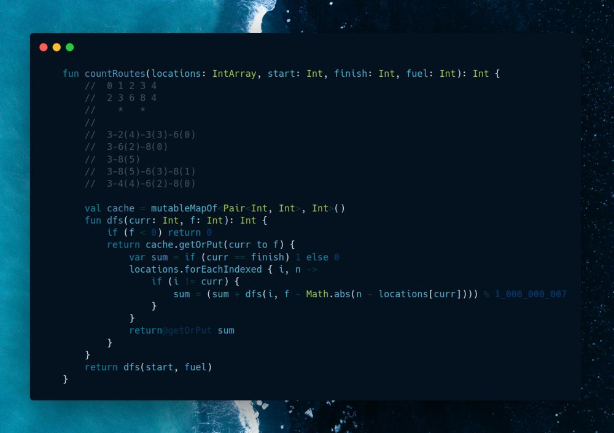

# Kotlin | dfs + memo

**Author:** SamoylenkoDmitry
**Votes:** 1
**Link:** [https://leetcode.com/problems/count-all-possible-routes/solutions/3679289/](https://leetcode.com/problems/count-all-possible-routes/solutions/3679289/)

---



#### Join me on Telegram
https://t.me/leetcode_daily_unstoppable/256
#### Problem TLDR
Count paths from `start` to `finish` using `|locations[i]-locations[j]` of the `fuel` 
#### Intuition
Let's observe the example:
```
        //  0 1 2 3 4
        //  2 3 6 8 4
        //    *   *   
        //
        //  2 3 4 6 8
        //    *     *
        //              
        //  3-2(4)-3(3)-6(0)
        //  3-6(2)-8(0)
        //  3-8(5)
        //  3-8(5)-6(3)-8(1)
        //  3-4(4)-6(2)-8(0)
```
At each position `curr` given the amount of fuel `f` there is a certain number of ways to the `finish`. It is independent of all the other factors, so can be safely cached.
#### Approach
* as there are also paths from `finish` to `finish`, modify the code to search other paths when `finish` is reached
#### Complexity
- Time complexity:
$$O(nf)$$, `f` - is a max fuel
- Space complexity:
$$O(nf)$$
#### Code
```

    fun countRoutes(locations: IntArray, start: Int, finish: Int, fuel: Int): Int {
        //  0 1 2 3 4
        //  2 3 6 8 4
        //    *   *   
        //
        //  2 3 4 6 8
        //    *     *
        //              
        //  3-2(4)-3(3)-6(0)
        //  3-6(2)-8(0)
        //  3-8(5)
        //  3-8(5)-6(3)-8(1)
        //  3-4(4)-6(2)-8(0)

        val cache = mutableMapOf<Pair<Int, Int>, Int>()
        fun dfs(curr: Int, f: Int): Int {
            if (f < 0) return 0
            return cache.getOrPut(curr to f) {
                var sum = if (curr == finish) 1 else 0
                locations.forEachIndexed { i, n ->
                    if (i != curr) {
                        sum = (sum + dfs(i, f - Math.abs(n - locations[curr]))) % 1_000_000_007
                    }
                }
                return@getOrPut sum
            }
        }
        return dfs(start, fuel)
    }

```