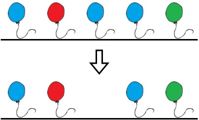
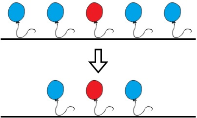

# [1578. Minimum Time to Make Rope Colorful](https://leetcode.com/problems/minimum-time-to-make-rope-colorful/)

| Category | Difficulty | Likes | Dislikes |
| :------: | :--------: | :---: | :------: |
| Algorithms | Medium | 4316 | 154 |

**Tags:** [`array`](https://leetcode.com/tag/array), [`string`](https://leetcode.com/tag/string), [`dynamic-programming`](https://leetcode.com/tag/dynamic-programming), [`greedy`](https://leetcode.com/tag/greedy)

**Companies:** `microsoft`, `amazon`

## Description

Alice has `n` balloons arranged on a rope. You are given a **0-indexed** string `colors` where `colors[i]` is the color of the `i^th` balloon.

Alice wants the rope to be **colorful**. She does not want **two consecutive balloons** to be of the same color, so she asks Bob for help. Bob can remove some balloons from the rope to make it **colorful**. You are given a **0-indexed** integer array `neededTime` where `neededTime[i]` is the time (in seconds) that Bob needs to remove the `i^th` balloon from the rope.

Return *the **minimum time** Bob needs to make the rope **colorful***.

 

**Example 1:**


```

Input: colors = &quot;abaac&quot;, neededTime = [1,2,3,4,5]
Output: 3
Explanation: In the above image, &#39;a&#39; is blue, &#39;b&#39; is red, and &#39;c&#39; is green.
Bob can remove the blue balloon at index 2. This takes 3 seconds.
There are no longer two consecutive balloons of the same color. Total time = 3.
```

**Example 2:**


```

Input: colors = &quot;abc&quot;, neededTime = [1,2,3]
Output: 0
Explanation: The rope is already colorful. Bob does not need to remove any balloons from the rope.

```

**Example 3:**


```

Input: colors = &quot;aabaa&quot;, neededTime = [1,2,3,4,1]
Output: 2
Explanation: Bob will remove the balloons at indices 0 and 4. Each balloons takes 1 second to remove.
There are no longer two consecutive balloons of the same color. Total time = 1 + 1 = 2.

```

 

**Constraints:**

	- `n == colors.length == neededTime.length`

	- `1 <= n <= 10^5`

	- `1 <= neededTime[i] <= 10^4`

	- `colors` contains only lowercase English letters.

---

**Links:** [Submissions](https://leetcode.com/problems/minimum-time-to-make-rope-colorful/) | [Solutions](https://leetcode.com/problems/minimum-time-to-make-rope-colorful/)
