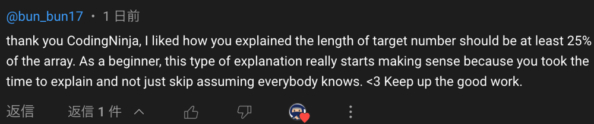

# 【Video】Give me 5 minutes - How we think about a solution

**Author:** niits
**Votes:** 60
**Link:** [https://leetcode.com/problems/special-positions-in-a-binary-matrix/solutions/4397604/](https://leetcode.com/problems/special-positions-in-a-binary-matrix/solutions/4397604/)

---

# Intuition
Check row and column direction.

---

# Solution Video

https://youtu.be/qTAh4HGfUHk

\u25A0 Timeline of the video

`0:05` Explain algorithm of the first step
`1:06` Explain algorithm of the second step
`2:36` Coding
`4:17` Time Complexity and Space Complexity
`4:55` Step by step algorithm of my solution code

### \u2B50\uFE0F\u2B50\uFE0F Don't forget to subscribe to my channel! \u2B50\uFE0F\u2B50\uFE0F

**\u25A0 Subscribe URL**
http://www.youtube.com/channel/UC9RMNwYTL3SXCP6ShLWVFww?sub_confirmation=1

Subscribers: 3,434
My first goal is 10,000 (It's far from done \uD83D\uDE05)
Thank you for your support!

\u25A0 MVC(Most Valuable Comment) for me on youtube for the last 7 days



Thank you for your comment @bun_bun17! What you're saying is the greatest significance for my presence on YouTube.

Thanks everyone who left your comment and thanks everyone who watched videos!


---

# Approach
## How we think about a solution

The phrase "special positions" implies that only one element in each row and each column has the value 1. Therefore, it seems appropriate to check all rows and columns for this condition.

```
Input: mat = [[1,0,0],[0,0,1],[1,0,0]]

[1,0,0]
[0,0,1]
[1,0,0]
```

First of all, let's check row direction.
```
\u2192[1,0,0]
\u2192[0,0,1]
\u2192[1,0,0]
```

Checking each row individually, if the sum of elements in a row is 1, there is a potential for that row to have a special position. This is because if the sum is 0, it means there are no positions with a value of 1, and if the sum is 2, it implies there are two positions with a value of 1, which also does not qualify as a special position.

---

\u2B50\uFE0F Points

Find rows with a sum of 1.

---

In this case, all rows are a sum of 1.

```
\u2192[1,0,0] = 1
\u2192[0,0,1] = 1
\u2192[1,0,0] = 1
```
Next, let's check column direction. First of all, we need to know index of 1 in each row.

```
[1,0,0] = index 0 
[0,0,1] = index 2
[1,0,0] = index 0
```
Then, acutually we do the same thing. Calculate sum of each column.
```
 \u2193   \u2193
[1,0,0] = index 0 
[0,0,1] = index 2
[1,0,0] = index 0
```
If sum of column is 1, that means we find one of special positions because we iterate the matrix in column direction based on index of possible position. In this case, column index 0 and 2.

---

\u2B50\uFE0F Points

Check columns based on index of possible position

---

In the end, we know that only mat[1][2] is special position, because
```
sum of column index 0 is 2
sum of column index 2 is 1
```
```
Output: 1
```

Easy!\uD83D\uDE04
Let's see a real algorithm!

---

# Complexity
- Time complexity: $$O(m * (n + m))$$


- Space complexity: $$O(1)$$
<!-- Add your space complexity here, e.g. $$O(n)$$ -->

```python []
class Solution:
    def numSpecial(self, mat: List[List[int]]) -> int:
        def get_column_sum(col_idx):
            return sum(row[col_idx] for row in mat)

        special = 0
        for row in mat:
            if sum(row) == 1:
                col_idx = row.index(1)
                special += get_column_sum(col_idx) == 1

        return special
```
```javascript []
var numSpecial = function(mat) {
    function getColumnSum(colIdx) {
        return mat.reduce((sum, row) => sum + row[colIdx], 0);
    }

    let special = 0;
    for (let row of mat) {
        if (row.reduce((acc, val) => acc + val, 0) === 1) {
            const colIdx = row.indexOf(1);
            special += getColumnSum(colIdx) === 1;
        }
    }

    return special;    
};
```
```java []
class Solution {
    public int numSpecial(int[][] mat) {
        int special = 0;

        for (int[] row : mat) {
            if (getRowSum(row) == 1) {
                int colIdx = getIndexOfOne(row);
                special += (getColumnSum(mat, colIdx) == 1) ? 1 : 0;
            }
        }

        return special;        
    }

    private int getRowSum(int[] row) {
        int sum = 0;
        for (int num : row) {
            sum += num;
        }
        return sum;
    }

    private int getColumnSum(int[][] mat, int colIdx) {
        int sum = 0;
        for (int[] row : mat) {
            sum += row[colIdx];
        }
        return sum;
    }

    private int getIndexOfOne(int[] row) {
        for (int i = 0; i < row.length; i++) {
            if (row[i] == 1) {
                return i;
            }
        }
        return -1; // If 1 is not found, return -1 or handle accordingly
    }    
}
```
```C++ []
class Solution {
public:
    int numSpecial(vector<vector<int>>& mat) {
        int special = 0;

        for (const auto& row : mat) {
            if (accumulate(row.begin(), row.end(), 0) == 1) {
                int colIdx = distance(row.begin(), find(row.begin(), row.end(), 1));
                special += getColumnSum(mat, colIdx) == 1;
            }
        }

        return special;        
    }

private:
    int getColumnSum(const vector<vector<int>>& mat, int colIdx) {
        int sum = 0;
        for (const auto& row : mat) {
            sum += row[colIdx];
        }
        return sum;
    }
};
```

## Step by step algorithm

1. **Initialize Variables:**
   - `special`: A counter to keep track of the number of special positions.

```python
special = 0
```

2. **Iterate Over Each Row:**
   - Loop through each row in the matrix `mat`.

```python
for row in mat:
```

3. **Check Sum of Current Row:**
   - Check if the sum of elements in the current row is equal to 1.

```python
if sum(row) == 1:
```

4. **Find Column Index with Value 1:**
   - If the sum is 1, find the index of the element with value 1 in the current row. This assumes there is exactly one element with value 1 in the row.

```python
col_idx = row.index(1)
```

5. **Calculate Column Sum:**
   - Use the `get_column_sum` function to calculate the sum of elements in the column with index `col_idx`.

```python
col_sum = get_column_sum(col_idx)
```

   - The `get_column_sum` function iterates through each row and accumulates the value in the specified column.

```python
def get_column_sum(col_idx):
    return sum(row[col_idx] for row in mat)
```

6. **Check if Column Sum is 1:**
   - If the column sum is also equal to 1, it indicates that the element at the intersection of the identified row and column is the only '1' in its row and column. Increment the `special` counter.

```python
special += col_sum == 1
```

7. **Return the Result:**
   - The final result is the count of special positions.

```python
return special
```

In summary, the algorithm iterates through each row, checks if the sum of elements in the row is 1, finds the corresponding column index with a value of 1, calculates the sum of elements in that column, and increments the `special` counter if both row and column sums are equal to 1. The final result is the count of special positions in the matrix.

---

Thank you for reading my post.
\u2B50\uFE0F Please upvote it and don't forget to subscribe to my channel!

\u25A0 Subscribe URL
http://www.youtube.com/channel/UC9RMNwYTL3SXCP6ShLWVFww?sub_confirmation=1

\u25A0 Twitter
https://twitter.com/CodingNinjaAZ

### My next daily coding challenge post and video.

post
https://leetcode.com/problems/difference-between-ones-and-zeros-in-row-and-column/solutions/4401811/video-give-me-5-minutes-how-we-think-about-a-solution/

video
https://youtu.be/swafoNFu99o

\u25A0 Timeline of the video

`0:06` Create number of 1 in each row and column
`1:16` How to calculate numbers at each position 
`4:03` Coding
`6:32` Time Complexity and Space Complexity
`7:02` Explain zip(*grid)
`8:15` Step by step algorithm of my solution code

### My previous daily coding challenge post and video.

post
https://leetcode.com/problems/maximum-product-of-two-elements-in-an-array/solutions/4392747/video-give-me-5-minutes-2-solutions-how-we-think-about-a-solution/

video
https://youtu.be/JV5Kuinx-m0

\u25A0 Timeline of the video

`0:05` Explain algorithm of Solution 1
`3:18` Coding of solution 1
`4:18` Time Complexity and Space Complexity of solution 1
`4:29` Step by step algorithm of solution 1
`4:36` Explain key points of Solution 2
`5:25` Coding of Solution 2
`6:50` Time Complexity and Space Complexity of Solution 2
`7:03` Step by step algorithm with my stack solution code
