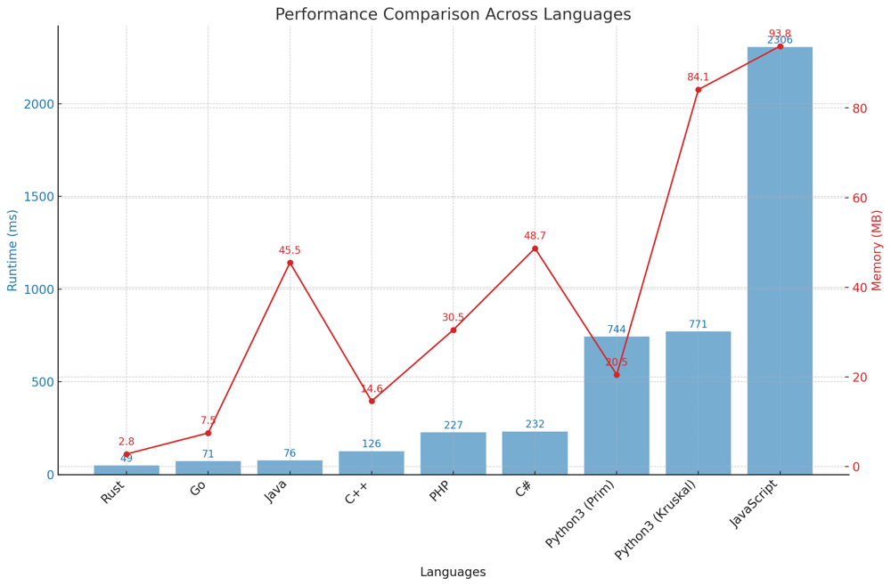

# ✅ 94.85% Prim & Kruskal with Min-Heap

**Author:** vanAmsen
**Votes:** 131
**Link:** [https://leetcode.com/problems/min-cost-to-connect-all-points/solutions/4045874/](https://leetcode.com/problems/min-cost-to-connect-all-points/solutions/4045874/)

---

# Comprehensive Guide to Solving "Min Cost to Connect All Points": Bridging the Gap Efficiently

## Introduction & Problem Statement

Hello, algorithmic explorers! Today, we're diving into a problem that's a fascinating blend of computational geometry and graph theory: "Min Cost to Connect All Points." Imagine you're given a set of points on a 2D plane, and your task is to connect them all with lines. Sounds simple? Well, it's not just about connecting them; you need to do so with the minimum possible cost, where the cost is defined as the Manhattan distance between points. Intriguing, isn't it?

## Key Concepts and Constraints

### What Makes This Problem Unique?

1. **Graph Theory and MST**: 
   This problem can be represented as a graph where each point is a node and the edges are the Manhattan distances between the points. The objective boils down to finding the Minimum Spanning Tree (MST) of this graph.
  
2. **Manhattan Distance**: 
   The edge weight isn't just a simple Euclidean distance; it's the Manhattan distance, which is the sum of the absolute differences in their Cartesian coordinates.

3. **Constraints**: 
   - 1 <= points.length <= 1000
   - $$-10^6 \\leq x_i, y_i \\leq 10^6$$
   - All pairs $$(x_i, y_i)$$ are distinct.

### Strategies to Tackle the Problem

1. **Kruskal's Algorithm**: 
   This approach utilizes a Union-Find data structure to find the MST efficiently.
   
2. **Prim's Algorithm**: 
   This method employs a Priority Queue to select edges with minimum weights iteratively.

---

## Live Coding Prim & Explain
https://youtu.be/7JxI7gt-WEM?si=bCZ7NBlDNRDjUzlw

## Prim's Algorithm Explained

### What is Prim's Algorithm?

Prim's Algorithm is another method for finding the Minimum Spanning Tree. It starts from an arbitrary node and greedily chooses the edge with the smallest weight that connects a visited and an unvisited node.

### The Mechanics of Prim's Algorithm in "Min Cost to Connect All Points"

1. **Initialize Priority Queue**:  
    - Start from an arbitrary point and initialize a minimum priority queue with its edges.

2. **Visited Nodes Tracking**:  
    - Keep track of visited nodes to ensure that each node is visited exactly once.

3. **Iterate and Add to MST**:  
    - Pop the edge with the smallest weight from the priority queue. If the edge leads to an unvisited node, add the edge's weight to the total MST weight, and insert all edges from that node into the priority queue.

4. **Completion Check**:  
    - Continue this process until all nodes have been visited.

### Time and Space Complexity

- **Time Complexity**: $$O(n^2 \\log n)$$, due to priority queue operations.
- **Space Complexity**: $$O(n)$$, for storing the priority queue and visited nodes.

---

# Code Prim
``` Python []
def manhattan_distance(p1: List[int], p2: List[int]) -> int:
    return abs(p1[0] - p2[0]) + abs(p1[1] - p2[1])

class Solution:
    def minCostConnectPoints(self, points: List[List[int]]) -> int:
        n = len(points)
        visited = [False] * n
        heap_dict = {0: 0}  
        min_heap = [(0, 0)]
        
        mst_weight = 0
        
        while min_heap:
            w, u = heappop(min_heap)
            
            if visited[u] or heap_dict.get(u, float('inf')) < w:
                continue
            
            visited[u] = True
            mst_weight += w
            
            for v in range(n):
                if not visited[v]:
                    new_distance = manhattan_distance(points[u], points[v])
      
                    if new_distance < heap_dict.get(v, float('inf')):
                        heap_dict[v] = new_distance
                        heappush(min_heap, (new_distance, v))
        
        return mst_weight
```
``` Go []
type Item struct {
	distance, point int
}

type PriorityQueue []Item

func (pq PriorityQueue) Len() int { return len(pq) }

func (pq PriorityQueue) Less(i, j int) bool {
	return pq[i].distance < pq[j].distance
}

func (pq PriorityQueue) Swap(i, j int) {
	pq[i], pq[j] = pq[j], pq[i]
}

func (pq *PriorityQueue) Push(x interface{}) {
	item := x.(Item)
	*pq = append(*pq, item)
}

func (pq *PriorityQueue) Pop() interface{} {
	old := *pq
	n := len(old)
	item := old[n-1]
	*pq = old[0 : n-1]
	return item
}

func manhattanDistance(p1, p2 []int) int {
	return int(math.Abs(float64(p1[0]-p2[0])) + math.Abs(float64(p1[1]-p2[1])))
}

func minCostConnectPoints(points [][]int) int {
	n := len(points)
	visited := make([]bool, n)
	heapDict := make(map[int]int)
	for i := 0; i < n; i++ {
		heapDict[i] = int(math.MaxInt64) // Initialize all distances to infinity
	}
	heapDict[0] = 0 // Start node

	pq := make(PriorityQueue, 1)
	pq[0] = Item{distance: 0, point: 0}
	heap.Init(&pq)

	mstWeight := 0

	for pq.Len() > 0 {
		item := heap.Pop(&pq).(Item)
		w, u := item.distance, item.point

		if visited[u] || heapDict[u] < w {
			continue
		}

		visited[u] = true
		mstWeight += w

		for v := 0; v < n; v++ {
			if !visited[v] {
				newDistance := manhattanDistance(points[u], points[v])
				if newDistance < heapDict[v] {
					heapDict[v] = newDistance
					heap.Push(&pq, Item{distance: newDistance, point: v})
				}
			}
		}
	}

	return mstWeight
}
```
``` Rust []
use std::collections::{BinaryHeap, HashMap};
use std::cmp::Reverse;

impl Solution {
    fn manhattan_distance(p1: &[i32], p2: &[i32]) -> i32 {
        (p1[0] - p2[0]).abs() + (p1[1] - p2[1]).abs()
    }

    pub fn min_cost_connect_points(points: Vec<Vec<i32>>) -> i32 {
        let n = points.len();
        let mut visited = vec![false; n];
        let mut heap_dict = HashMap::new();
        heap_dict.insert(0, 0);
        let mut min_heap = BinaryHeap::new();
        min_heap.push(Reverse((0, 0)));

        let mut mst_weight = 0;

        while let Some(Reverse((w, u))) = min_heap.pop() {
            if visited[u] || heap_dict[&u] < w {
                continue;
            }

            visited[u] = true;
            mst_weight += w;

            for v in 0..n {
                if !visited[v] {
                    let new_distance = Self::manhattan_distance(&points[u], &points[v]);  // Fix here
                    if new_distance < *heap_dict.get(&v).unwrap_or(&i32::MAX) {
                        heap_dict.insert(v, new_distance);
                        min_heap.push(Reverse((new_distance, v)));
                    }
                }
            }
        }

        mst_weight
    }
}
```
``` C++ []
int manhattan_distance(vector<int>& p1, vector<int>& p2) {
    return abs(p1[0] - p2[0]) + abs(p1[1] - p2[1]);
}

class Solution {
public:
    int minCostConnectPoints(vector<vector<int>>& points) {
        int n = points.size();
        vector<bool> visited(n, false);
        unordered_map<int, int> heap_dict;
        for(int i = 0; i < n; ++i) {
            heap_dict[i] = INT_MAX; // Initialize all distances to infinity
        }
        heap_dict[0] = 0; // Start node
        
        auto cmp = [](pair<int, int> left, pair<int, int> right) { return left.first > right.first; };
        priority_queue<pair<int, int>, vector<pair<int, int>>, decltype(cmp)> min_heap(cmp);
        min_heap.push({0, 0});
        
        int mst_weight = 0;
        
        while (!min_heap.empty()) {
            auto [w, u] = min_heap.top();
            min_heap.pop();
            
            if (visited[u] || heap_dict[u] < w) continue;
            
            visited[u] = true;
            mst_weight += w;
            
            for (int v = 0; v < n; ++v) {
                if (!visited[v]) {
                    int new_distance = manhattan_distance(points[u], points[v]);
                    if (new_distance < heap_dict[v]) {
                        heap_dict[v] = new_distance;
                        min_heap.push({new_distance, v});
                    }
                }
            }
        }
        
        return mst_weight;
    }
};
```
``` Java []
public class Solution {
    public static int manhattan_distance(int[] p1, int[] p2) {
        return Math.abs(p1[0] - p2[0]) + Math.abs(p1[1] - p2[1]);
    }

    public int minCostConnectPoints(int[][] points) {
        int n = points.length;
        boolean[] visited = new boolean[n];
        HashMap<Integer, Integer> heap_dict = new HashMap<>();
        heap_dict.put(0, 0);
        
        PriorityQueue<int[]> min_heap = new PriorityQueue<>((a, b) -> Integer.compare(a[0], b[0]));
        min_heap.add(new int[]{0, 0});
        
        int mst_weight = 0;
        
        while (!min_heap.isEmpty()) {
            int[] top = min_heap.poll();
            int w = top[0], u = top[1];
            
            if (visited[u] || heap_dict.getOrDefault(u, Integer.MAX_VALUE) < w) continue;
            
            visited[u] = true;
            mst_weight += w;
            
            for (int v = 0; v < n; ++v) {
                if (!visited[v]) {
                    int new_distance = manhattan_distance(points[u], points[v]);
                    if (new_distance < heap_dict.getOrDefault(v, Integer.MAX_VALUE)) {
                        heap_dict.put(v, new_distance);
                        min_heap.add(new int[]{new_distance, v});
                    }
                }
            }
        }
        
        return mst_weight;
    }
}
```
``` JavaScript []
def manhattan_distance(p1: List[int], p2: List[int]) -> int:
    return abs(p1[0] - p2[0]) + abs(p1[1] - p2[1])

class Solution:
    def minCostConnectPoints(self, points: List[List[int]]) -> int:
        n = len(points)
        visited = [False] * n
        heap_dict = {0: 0}  
        min_heap = [(0, 0)]
        
        mst_weight = 0
        
        while min_heap:
            w, u = heappop(min_heap)
            
            if visited[u] or heap_dict.get(u, float('inf')) < w:
                continue
            
            visited[u] = True
            mst_weight += w
            
            for v in range(n):
                if not visited[v]:
                    new_distance = manhattan_distance(points[u], points[v])
      
                    if new_distance < heap_dict.get(v, float('inf')):
                        heap_dict[v] = new_distance
                        heappush(min_heap, (new_distance, v))
        
        return mst_weight
```
``` C# []
public class Solution {
    public static int ManhattanDistance(int[] p1, int[] p2) {
        return Math.Abs(p1[0] - p2[0]) + Math.Abs(p1[1] - p2[1]);
    }

    public int MinCostConnectPoints(int[][] points) {
        int n = points.Length;
        bool[] visited = new bool[n];
        Dictionary<int, int> heapDict = new Dictionary<int, int>() { {0, 0} };
        var minHeap = new SortedSet<(int w, int u)>() { (0, 0) };

        int mstWeight = 0;

        while (minHeap.Count > 0) {
            var (w, u) = minHeap.Min;
            minHeap.Remove(minHeap.Min);
            
            if (visited[u] || heapDict[u] < w) continue;

            visited[u] = true;
            mstWeight += w;

            for (int v = 0; v < n; v++) {
                if (!visited[v]) {
                    int newDistance = ManhattanDistance(points[u], points[v]);
                    if (newDistance < heapDict.GetValueOrDefault(v, int.MaxValue)) {
                        heapDict[v] = newDistance;
                        minHeap.Add((newDistance, v));
                    }
                }
            }
        }

        return mstWeight;
    }
}
```
``` PHP []
class Solution {
    function manhattan_distance($p1, $p2) {
        return abs($p1[0] - $p2[0]) + abs($p1[1] - $p2[1]);
    }
    
    function minCostConnectPoints($points) {
        $n = count($points);
        $visited = array_fill(0, $n, false);
        $heap_dict = [0 => 0];
        $min_heap = new SplPriorityQueue();
        $min_heap->insert([0, 0], 0);

        $mst_weight = 0;

        while (!$min_heap->isEmpty()) {
            list($w, $u) = $min_heap->extract();
            if ($visited[$u] || $heap_dict[$u] < $w) continue;

            $visited[$u] = true;
            $mst_weight += $w;

            for ($v = 0; $v < $n; $v++) {
                if (!$visited[$v]) {
                    $new_distance = $this->manhattan_distance($points[$u], $points[$v]);  // Fix here
                    if ($new_distance < ($heap_dict[$v] ?? INF)) {
                        $heap_dict[$v] = $new_distance;
                        $min_heap->insert([$new_distance, $v], -$new_distance);
                    }
                }
            }
        }

        return $mst_weight;
    }
}
```

## Kruskal's Algorithm Explained

### What is Kruskal's Algorithm?

Kruskal's Algorithm is an algorithm to find the Minimum Spanning Tree of a graph. It sorts all the edges by weight and adds them one by one, checking that the addition of each edge doesn't form a cycle.

### The Essence of Kruskal's Algorithm in "Min Cost to Connect All Points"

1. **Initialize Edge List**:  
    - Calculate the Manhattan distance between all pairs of points to form an edge list. Each edge is represented by a tuple `(w, u, v)`, where `w` is the weight (Manhattan distance) and `u` and `v` are the nodes (points).

2. **Sort the Edges**:  
    - Sort all edges by their weights. This helps us ensure that we're considering the smallest weight first, adhering to the "minimum" in Minimum Spanning Tree.

3. **Union-Find for Connectivity**:  
    - Use a Union-Find data structure to keep track of connected components. This is crucial for efficiently checking whether adding a new edge would create a cycle.

4. **Iterate and Add to MST**:  
    - Iterate through the sorted edge list, adding each edge to the Minimum Spanning Tree if it doesn't form a cycle. Keep a counter of the number of edges added, and stop when you've added $$n-1$$ edges, where $$n$$ is the number of nodes.

### Time and Space Complexity

- **Time Complexity**: $$O(n^2 \\log n)$$, mainly due to sorting the edge list.
- **Space Complexity**: $$O(n^2)$$, for storing the edge list and Union-Find data structure.


# Code Kruskal 
``` Python []
def manhattan_distance(p1: List[int], p2: List[int]) -> int:
    return abs(p1[0] - p2[0]) + abs(p1[1] - p2[1])

class UnionFind:
    def __init__(self, n):
        self.parent = [i for i in range(n)]
        self.rank = [0 for _ in range(n)]
        
    def find(self, u):
        if self.parent[u] == u:
            return u
        self.parent[u] = self.find(self.parent[u])
        return self.parent[u]
    
    def union(self, u, v):
        u = self.find(u)
        v = self.find(v)
        
        if u == v:
            return False
        
        if self.rank[u] > self.rank[v]:
            u, v = v, u
            
        self.parent[u] = v
        
        if self.rank[u] == self.rank[v]:
            self.rank[v] += 1
        
        return True

class Solution:
    def minCostConnectPoints(self, points: List[List[int]]) -> int:
        n = len(points)
        uf = UnionFind(n)
        
        edges = []
        
        for i in range(n):
            for j in range(i+1, n):
                distance = manhattan_distance(points[i], points[j])
                heappush(edges, (distance, i, j))
        
        mst_weight = 0
        mst_edges = 0
        
        while edges:
            w, u, v = heappop(edges)
            if uf.union(u, v):
                mst_weight += w
                mst_edges += 1
                if mst_edges == n - 1:
                    break
                    
        return mst_weight
```
``` Go []
type UnionFind struct {
	parent, rank []int
}

func NewUnionFind(n int) *UnionFind {
	parent := make([]int, n)
	rank := make([]int, n)
	for i := range parent {
		parent[i] = i
	}
	return &UnionFind{parent, rank}
}

func (uf *UnionFind) find(u int) int {
	if uf.parent[u] == u {
		return u
	}
	uf.parent[u] = uf.find(uf.parent[u])
	return uf.parent[u]
}

func (uf *UnionFind) union(u, v int) bool {
	u, v = uf.find(u), uf.find(v)
	if u == v {
		return false
	}
	if uf.rank[u] > uf.rank[v] {
		u, v = v, u
	}
	uf.parent[u] = v
	if uf.rank[u] == uf.rank[v] {
		uf.rank[v]++
	}
	return true
}

func manhattanDistance(p1, p2 []int) int {
	return int(math.Abs(float64(p1[0]-p2[0])) + math.Abs(float64(p1[1]-p2[1])))
}

type Edge struct {
	distance, u, v int
}

type MinHeap []Edge

func (h MinHeap) Len() int           { return len(h) }
func (h MinHeap) Less(i, j int) bool { return h[i].distance < h[j].distance }
func (h MinHeap) Swap(i, j int)      { h[i], h[j] = h[j], h[i] }
func (h *MinHeap) Push(x interface{}) { *h = append(*h, x.(Edge)) }
func (h *MinHeap) Pop() interface{} {
	old := *h
	n := len(old)
	item := old[n-1]
	*h = old[0 : n-1]
	return item
}

func minCostConnectPoints(points [][]int) int {
	n := len(points)
	uf := NewUnionFind(n)

	edges := &MinHeap{}
	heap.Init(edges)

	for i := 0; i < n; i++ {
		for j := i + 1; j < n; j++ {
			distance := manhattanDistance(points[i], points[j])
			heap.Push(edges, Edge{distance, i, j})
		}
	}

	mstWeight := 0
	mstEdges := 0

	for edges.Len() > 0 {
		edge := heap.Pop(edges).(Edge)
		if uf.union(edge.u, edge.v) {
			mstWeight += edge.distance
			mstEdges++
			if mstEdges == n-1 {
				break
			}
		}
	}

	return mstWeight
}
```
``` Rust []
use std::collections::BinaryHeap;
use std::cmp::Reverse;

struct UnionFind {
    parent: Vec<usize>,
    rank: Vec<usize>,
}

impl UnionFind {
    fn new(n: usize) -> Self {
        Self {
            parent: (0..n).collect(),
            rank: vec![0; n],
        }
    }
    
    fn find(&mut self, u: usize) -> usize {
        if self.parent[u] == u {
            return u;
        }
        self.parent[u] = self.find(self.parent[u]);
        self.parent[u]
    }

    fn union(&mut self, mut u: usize, mut v: usize) -> bool {
        u = self.find(u);
        v = self.find(v);
        if u == v {
            return false;
        }
        if self.rank[u] > self.rank[v] {
            std::mem::swap(&mut u, &mut v);
        }
        self.parent[u] = v;
        if self.rank[u] == self.rank[v] {
            self.rank[v] += 1;
        }
        true
    }
}

fn manhattan_distance(p1: &[i32], p2: &[i32]) -> i32 {
    (p1[0] - p2[0]).abs() + (p1[1] - p2[1]).abs()
}


impl Solution {
    pub fn min_cost_connect_points(points: Vec<Vec<i32>>) -> i32 {
            let n = points.len();
    let mut uf = UnionFind::new(n);
    let mut edges = BinaryHeap::new();

    for i in 0..n {
        for j in (i + 1)..n {
            let distance = manhattan_distance(&points[i], &points[j]);
            edges.push(Reverse((distance, i, j)));
        }
    }

    let mut mst_weight = 0;
    let mut mst_edges = 0;

    while let Some(Reverse((w, u, v))) = edges.pop() {
        if uf.union(u, v) {
            mst_weight += w;
            mst_edges += 1;
            if mst_edges == n - 1 {
                break;
            }
        }
    }

    mst_weight
    }
}
```
``` C++ []
// todo
```
``` Java []
// todo
```
``` JavaScript []
// todo
```
``` C# []
// todo
```
``` PHP []
// todo
```

## Performance

| Language   | Algorithm | Runtime (ms) | Memory Usage (MB) |
|------------|-----------|--------------|-------------------|
| Rust       | Prim      | 49           | 2.8               |
| Go         | Prim      | 71           | 7.5               |
| Java       | Prim      | 76           | 45.5              |
| C++        | Prim      | 126          | 14.6              |
| PHP        | Prim      | 227          | 30.5              |
| C#         | Prim      | 232          | 48.7              |
| Python3    | Prim      | 744          | 20.5              |
| Python3    | Kruskal   | 771          | 84.1              |
| JavaScript | Prim      | 2306         | 93.8              |



## Live Coding Kruskal & More
https://youtu.be/JgmClRWPMX4?si=2oKw4ZDwb5mmEl3F

## Code Highlights and Best Practices

- Both Kruskal's and Prim's algorithms are efficient for this problem, but Kruskal's algorithm is easier to implement with a Union-Find data structure.
- Prim's algorithm is more intuitive but requires careful handling of the priority queue to ensure optimal performance.

Mastering these techniques will not only help you tackle this problem effectively but will also deepen your understanding of graph algorithms, which are incredibly useful in various fields. So, are you ready to connect some points? Let's get coding!

