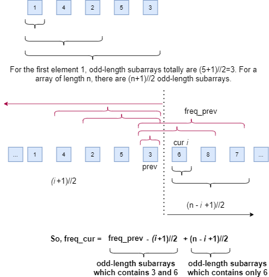
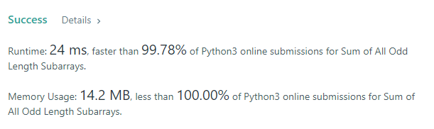

# python 3 99.78% faster and 100% less space

**Author:** Philno
**Votes:** 135
**Link:** [https://leetcode.com/problems/sum-of-all-odd-length-subarrays/solutions/919521/](https://leetcode.com/problems/sum-of-all-odd-length-subarrays/solutions/919521/)

---

The idea is to count the frequency of each element in `arr` appearing in the sub array, then sum up `arr[i]*freq[i]`. The key is how to count the `freq[i]` of each element `arr[i]`. Actually, `freq[i] = freq[i-1]-(i+1)//2+(n-i+1)//2`. `n` is the `arr` length.

for example `arr = [1,4,2,5,3]`, element `arr[0] = 1`. The appearing `freq` of head element `arr[0]` should be how many odd-length sub arrays it can generate. The answer is `(len(arr)+1)//2`. Therefore, the `freq` of element `arr[0] = 1` is `(5+1)//2=3`.

Now let's take element `arr[1] = 4` for example, if we take element `arr[0] = 1` out, then `arr[1] = 4` becomes the new head element, thus the `freq` of `arr[1] = 4` in the new subarray could be calculated as the same way of `arr[0] = 1`. It seems that all we need to do is add the `freq` of previous element arr[0] up then we get the `freq` of `arr[1]`.

No, we also need to minus the subarrays of previous element `arr[0] = 1` when they do not include `arr[1]=4`. In this case, it is `[1]`. This is why `freq[i] = freq[i-1]-(i+1)//2+(n-i+1)//2`.

To sum up, the core idea is to find the relationship between `freq_current_element` and `freq_previous_element`.




```
class Solution:
    def sumOddLengthSubarrays(self, arr: List[int]) -> int:
        # corner case
        
        res = 0; freq = 0; n = len(arr)
        for i in range(n):
            freq = freq-(i+1)//2+(n-i+1)//2
            res += freq*arr[i]
        return res
```


