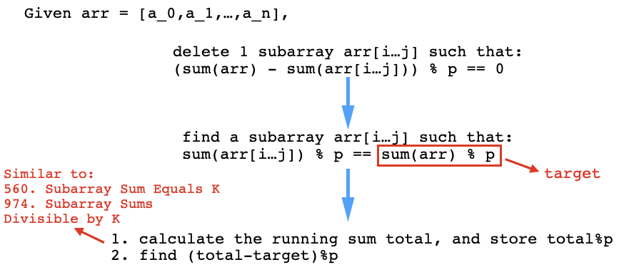

# How to approach this kind of problem - mind map

**Author:** since2020
**Votes:** 163
**Link:** [https://leetcode.com/problems/make-sum-divisible-by-p/solutions/854895/](https://leetcode.com/problems/make-sum-divisible-by-p/solutions/854895/)

---

If you are new to this kind of problems, you would probably get confused. No worries! Here are list of some prior knowledge you may want to go through before touching it.

- [Leetcode 560. Subarray Sum Equals K](https://leetcode.com/problems/subarray-sum-equals-k/)
so that you know how to use prefix sum and hashmap to reduce the time complexity from O(n^2) to O(n)
- [Leetcode 974. Subarray Sums Divisible by K](https://leetcode.com/problems/subarray-sums-divisible-by-k/)
so that you know how to deal with Modulo operation

Logic




The question asks for removing a subarray from ```arr``` such that the sum of the remaining array is divisible by ```p```. As shown above, this question could be converted to another question: find one subarray such that the sum of it equals to the ```sum(arr)%p```.

there are O(n^2) subarrays and to reduce the time complexity to O(n), we have to borrow some space. While we are calculating the running/accumulated sum ```cur==sum(arr[0...j))```, we hope there is some prefix sum ```prev=sum(arr[0...i]))``` such that: ```sum(arr[i...j])==(cur-prev)%p==sum(arr)%p==target```

Therefore, all we need to find is simply ```(cur-target)%p```.

Code

```Python
class Solution:
    def minSubarray(self, nums: List[int], p: int) -> int:
        if sum(nums)%p==0:
            return 0
        target = sum(nums) % p
        dic,n = {0:-1},len(nums)
        cur,ret = 0,n
        for i,num in enumerate(nums):
            cur = (cur+num)%p
            if dic.get((cur-target)%p) is not None:
                ret = min(ret,i-dic.get((cur-target)%p))
            dic[cur] = i
        return ret if ret < n else -1
```

