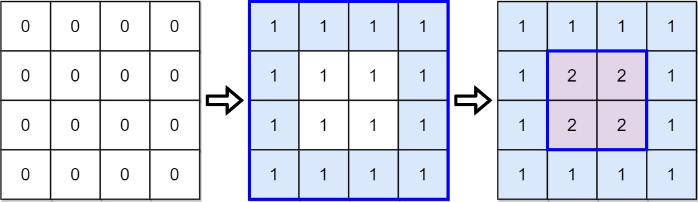
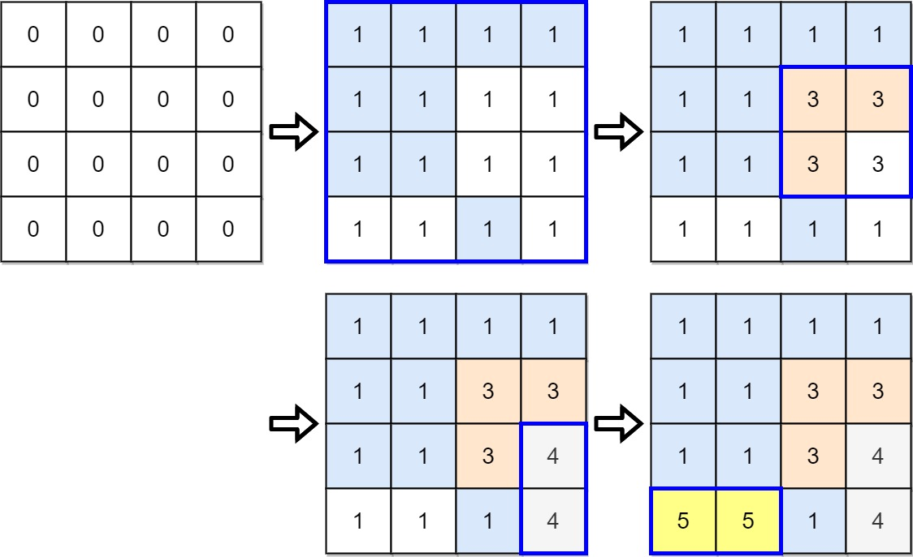

# [1591. Strange Printer II](https://leetcode.com/problems/strange-printer-ii/)

| Category | Difficulty | Likes | Dislikes |
| :------: | :--------: | :---: | :------: |
| Algorithms | Hard | 687 | 23 |

**Tags:** [`array`](https://leetcode.com/tag/array), [`graph`](https://leetcode.com/tag/graph), [`topological-sort`](https://leetcode.com/tag/topological-sort), [`matrix`](https://leetcode.com/tag/matrix)

**Companies:** `google`

## Description

There is a strange printer with the following two special requirements:

	- On each turn, the printer will print a solid rectangular pattern of a single color on the grid. This will cover up the existing colors in the rectangle.

	- Once the printer has used a color for the above operation, **the same color cannot be used again**.

You are given a `m x n` matrix `targetGrid`, where `targetGrid[row][col]` is the color in the position `(row, col)` of the grid.

Return `true`* if it is possible to print the matrix *`targetGrid`*,** otherwise, return *`false`.

 

**Example 1:**


```

Input: targetGrid = [[1,1,1,1],[1,2,2,1],[1,2,2,1],[1,1,1,1]]
Output: true

```

**Example 2:**


```

Input: targetGrid = [[1,1,1,1],[1,1,3,3],[1,1,3,4],[5,5,1,4]]
Output: true

```

**Example 3:**

```

Input: targetGrid = [[1,2,1],[2,1,2],[1,2,1]]
Output: false
Explanation: It is impossible to form targetGrid because it is not allowed to print the same color in different turns.

```

 

**Constraints:**

	- `m == targetGrid.length`

	- `n == targetGrid[i].length`

	- `1 <= m, n <= 60`

	- `1 <= targetGrid[row][col] <= 60`

---

**Links:** [Submissions](https://leetcode.com/problems/strange-printer-ii/) | [Solutions](https://leetcode.com/problems/strange-printer-ii/)
