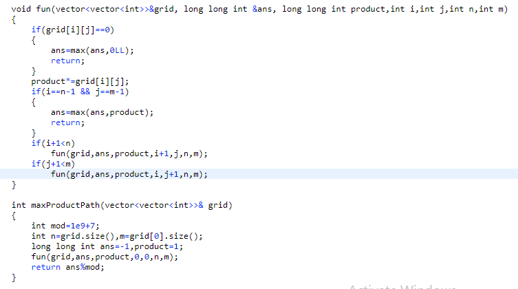

# C++ || DFS || Easy To Understand || Simple Code

**Author:** Samkit_1
**Votes:** 2
**Link:** [https://leetcode.com/problems/maximum-non-negative-product-in-a-matrix/solutions/2409815/](https://leetcode.com/problems/maximum-non-negative-product-in-a-matrix/solutions/2409815/)

---

