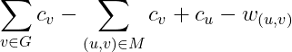

# [C++ - 4ms - beats 100%] Bipartite graph maximum weight matching

**Author:** EulerianMoe
**Votes:** 75
**Link:** [https://leetcode.com/problems/minimum-cost-to-connect-two-groups-of-points/solutions/855686/](https://leetcode.com/problems/minimum-cost-to-connect-two-groups-of-points/solutions/855686/)

---

I just found most people solve this problem via bit mask DP, which runs in *expoential* time. Here, I give a *polynomial* time solution.

**Explanation**:
This problem is called *minimum-cost edge cover* for bipartite graph. We show how to reduce this to a matching problem.
We note that some edge will cover both of endpoints, and some edge will only cover of their endpoints. If the edge only covers one of their endpoints, then this edge must be the edge with minimum weight incident to that particular endpoint. Let c_v be the cost of the minimum weight edge incident to vertex v, and w_(u,v) be the weight of edge (u,v), then the cost of a solution is 



We note that the first sum is fixed, and the second we want maximum the second sum. Hence, the problem becomes find a maximum weight matching with edge weight c_v+c_u-w_(u,v). Using Hungarian algorithm, we can find such matching for bipartite graph in O(n^3).

**Implementation**:
```
class Solution {
public:
   #define getL(x) (x+2)
   #define getR(x) (2+Lmin.size()+x) 

    int connectTwoGroups(vector<vector<int>>& cost) {
        vector<int> Lmin(cost.size());
        vector<int> Rmin(cost[0].size());
        int ans = 0;
        for(int i = 0; i < cost.size();++i) {
            Lmin[i] = INT_MAX;
            for(int j = 0; j < Rmin.size(); ++j) {
                Lmin[i] = min(Lmin[i], cost[i][j]);
            }
            ans += Lmin[i];
        }
        for(int j = 0; j < Rmin.size();++j) {
            Rmin[j] = INT_MAX;
            for(int i = 0; i < Lmin.size(); ++i) {
                Rmin[j] = min(Rmin[j],cost[i][j]);
            }
            ans += Rmin[j];
        }
        hungarian<int> H(Lmin.size(),Rmin.size());
        for(int i = 0; i < Lmin.size(); ++i) {
            for(int j = 0; j < Rmin.size(); ++j) {
                H.addEdge(i,j,-1*(cost[i][j]-Lmin[i]-Rmin[j]));
            }
        }
        int ret = H.solve();
        ans = ans - ret;
        return ans;
    }
};
```

Template for Hungarian Algorithm (Kuhn\u2013Munkres algorithm):
```
template <typename T>
struct hungarian
{ // km
    int n;
    vector<int> matchx;
    vector<int> matchy;
    vector<int> pre;
    vector<bool> visx;
    vector<bool> visy;
    vector<T> lx;
    vector<T> ly;
    vector<vector<T>> g;
    vector<T> slack;
    T inf;
    T res;
    queue<int> q;
    int org_n;
    int org_m;

    hungarian(int _n, int _m)
    {
        org_n = _n;
        org_m = _m;
        n = max(_n, _m);
        inf = numeric_limits<T>::max();
        res = 0;
        g = vector<vector<T>>(n, vector<T>(n));
        matchx = vector<int>(n, -1);
        matchy = vector<int>(n, -1);
        pre = vector<int>(n);
        visx = vector<bool>(n);
        visy = vector<bool>(n);
        lx = vector<T>(n, -inf);
        ly = vector<T>(n);
        slack = vector<T>(n);
    }

    void addEdge(int u, int v, int w)
    {
        g[u][v] = max(w, 0); 
    }

    bool check(int v)
    {
        visy[v] = true;
        if (matchy[v] != -1)
        {
            q.push(matchy[v]);
            visx[matchy[v]] = true;
            return false;
        }
        while (v != -1)
        {
            matchy[v] = pre[v];
            swap(v, matchx[pre[v]]);
        }
        return true;
    }

    void bfs(int i)
    {
        while (!q.empty())
        {
            q.pop();
        }
        q.push(i);
        visx[i] = true;
        while (true)
        {
            while (!q.empty())
            {
                int u = q.front();
                q.pop();
                for (int v = 0; v < n; v++)
                {
                    if (!visy[v])
                    {
                        T delta = lx[u] + ly[v] - g[u][v];
                        if (slack[v] >= delta)
                        {
                            pre[v] = u;
                            if (delta)
                            {
                                slack[v] = delta;
                            }
                            else if (check(v))
                            {
                                return;
                            }
                        }
                    }
                }
            }
            T a = inf;
            for (int j = 0; j < n; j++)
            {
                if (!visy[j])
                {
                    a = min(a, slack[j]);
                }
            }
            for (int j = 0; j < n; j++)
            {
                if (visx[j])
                { // S
                    lx[j] -= a;
                }
                if (visy[j])
                { // T
                    ly[j] += a;
                }
                else
                { // T'
                    slack[j] -= a;
                }
            }
            for (int j = 0; j < n; j++)
            {
                if (!visy[j] && slack[j] == 0 && check(j))
                {
                    return;
                }
            }
        }
    }

    int solve()
    {
        for (int i = 0; i < n; i++)
        {
            for (int j = 0; j < n; j++)
            {
                lx[i] = max(lx[i], g[i][j]);
            }
        }

        for (int i = 0; i < n; i++)
        {
            fill(slack.begin(), slack.end(), inf);
            fill(visx.begin(), visx.end(), false);
            fill(visy.begin(), visy.end(), false);
            bfs(i);
        }

        for (int i = 0; i < n; i++)
        {
            if (g[i][matchx[i]] > 0)
            {
                res += g[i][matchx[i]];
            }
            else
            {
                matchx[i] = -1;
            }
        }
        return res;
    }
};
```