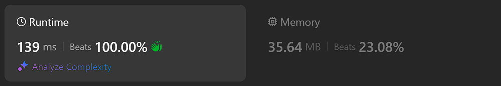

# Kotlin. Beats 100% (139 ms). Simple loop with "." checks

**Author:** mobdev778
**Votes:** 4
**Link:** [https://leetcode.com/problems/crawler-log-folder/solutions/5452613/](https://leetcode.com/problems/crawler-log-folder/solutions/5452613/)

---



# Code
```
class Solution {
    fun minOperations(logs: Array<String>): Int {
        var level = 0
        for (l in logs) {
            when {
                l[0] != '.' -> level++
                l[1] == '.' -> if (level > 0) level--
            }
        }
        return level
    }
}
```

# Approach 

Full string comparison is an expensive operation in terms of performance. 

By limiting ourselves to checking selected characters, we can significantly improve the speed of the algorithm - checking a single character is always faster than checking the entire string.