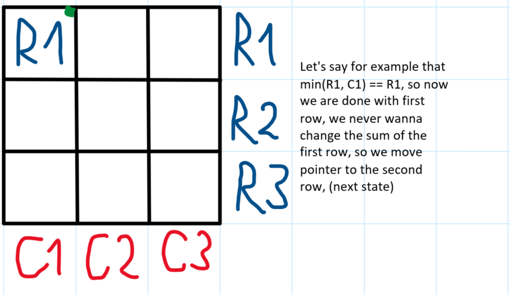
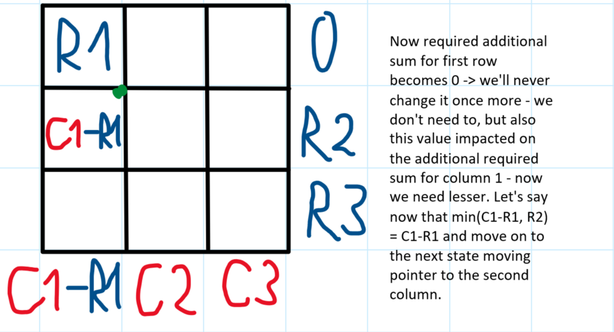
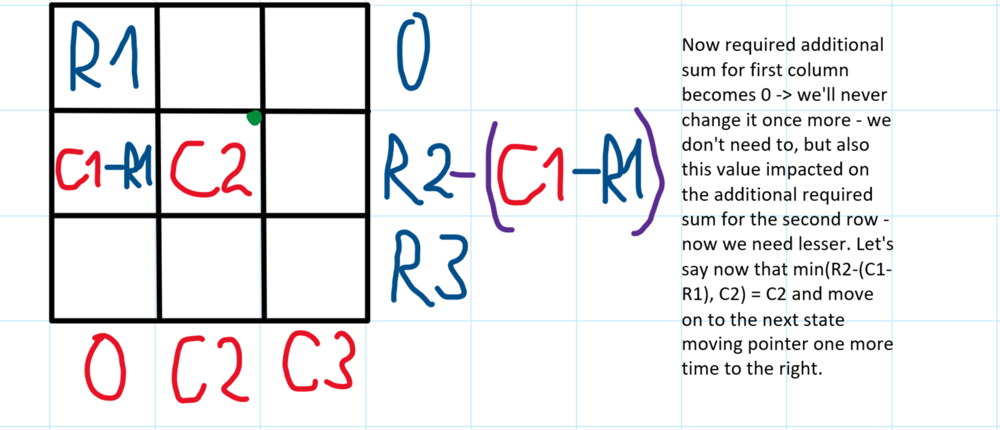
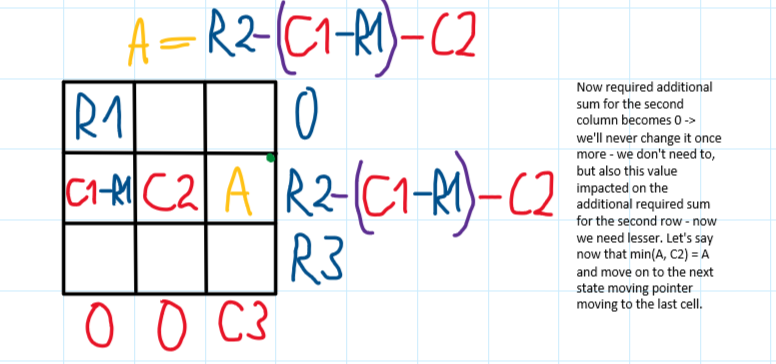
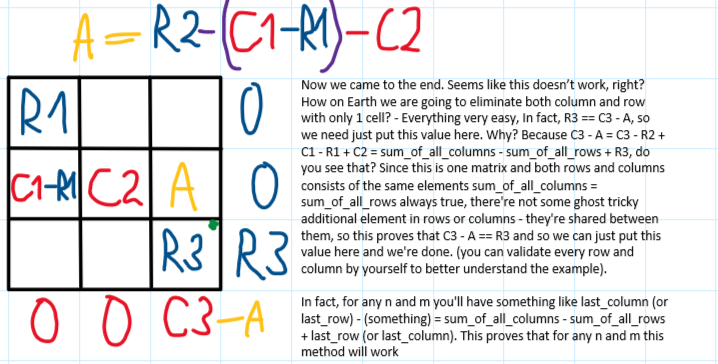

# ✅💯🔥Explanations No One Will Give You🎓🧠Very Detailed Approach🎯🔥Extremely Simple And Effective🔥

**Author:** heir-of-god
**Votes:** 132
**Link:** [https://leetcode.com/problems/find-valid-matrix-given-row-and-column-sums/solutions/5504139/](https://leetcode.com/problems/find-valid-matrix-given-row-and-column-sums/solutions/5504139/)

---

<blockquote>
        <p>
            <b>
                You define beauty yourself, society doesn\u2019t define your beauty.
            </b>        
        </p>
        <p>
            --- Lady Gaga ---
        </p>
</blockquote>

# \uD83D\uDC51Problem Explanation and Understanding:

## \uD83C\uDFAF Problem Description
You are given two arrays - `rowSum` and `colSum`. You need to find any valid matrix that satisfy the sum condition.
 
## \uD83D\uDCE5\u2935\uFE0F Input:
- Integer array `rowSum`
- Integer array `colSum`

## \uD83D\uDCE4\u2934\uFE0F Output:
Any possible matrix that satisfy conditions

---

# 1\uFE0F\u20E3\uD83C\uDFC6 Approach: Greedy With 2 Pointers

# \uD83E\uDD14 Intuition
For today's problem it's hard to explain something in plain text, so I've prepared images with explanations for you. But before this - don't look at that stupid examples in description, they're just distract you, it's common for such problem where you need to find one valid answer among several to put some nonsense as example trying to confuse solvers. In fact, problem is much easier, so let's look at the pictures and then I'll do some more explanations about why this works











First of all, about why this will work for any `n` and `m` - when you came to the last cell you know for sure that you eliminated `cols - 1` columns and `rows - 1` rows, but you came either from top or left, so you've visited either row or column for the FIRST time, what about the sum you left in the other candidate? It's accumulated from `cols - 1` columns and `rows - 1` rows. If you came from left then last column was untouched so far and because you visited all columns you've already column sum among all columns `column_sum - this_last_element` and row sum `row_sum - this_last_element`, but you know for sure that `column_sum = row_sum`, from this you can say that if you fill matrix with this method you always end up with the state where last element is defined by equality. 

Secondly, you always will create valid result and fill every row and column because the condition for loop is `column is in bounds OR row is in bounds`, so this is possible that you will first go all way to right and only then to the bottom (I think so). Also, there might be a case where, for example, initially `C1 == R1` - then you want to move your pointer not one column or one row but BOTH of them. 

This concludes my explanation, hope this makes sense for you - if not feel free to ask any question in comments

# \uD83D\uDC69\uD83C\uDFFB\u200D\uD83D\uDCBB Coding 
- Determine the number of rows (`rows`) from the length of `rowSum`.
- Determine the number of columns (`cols`) from the length of `colSum`.
- Initialize `cur_row` and `cur_col` to track current row and column indices.
- Create a result matrix `res` with dimensions `rows` x `cols`, filled with zeros.
- Use a `while` loop to iterate until all rows and columns of `res` are satisfied:
  - If `cur_row` exceeds `rows`, assign remaining column sums to column in the last row and move to the next column.
  - If `cur_col` exceeds `cols`, assign remaining row sums to this row in the last column and move to the next row.
  - Otherwise, calculate the value to put in the current cell as the minimum of `rowSum[cur_row]` and `colSum[cur_col]`.
  - Subtract this value from the corresponding elements in `rowSum` and `colSum`.
  - Assign the value to the current cell in `res`.
  - Move to the next row if the current row sum is zero.
  - Move to the next column if the current column sum is zero.
- Return the constructed matrix `res`.

# \uD83D\uDCD2 Complexity Analysis
- \u23F0 Time complexity: O(n + m), since we loop `n + m` times to fill matrix (you also can consider `n * m` because of creating `res` but that doesn't make sense because there no way to not construct matrix to return the matrix) 
- \uD83E\uDDFA Space complexity: O(1), since no extra space (beside `res`) is used

# \uD83D\uDCBB Code
``` python []
class Solution:
    def restoreMatrix(self, rowSum: list[int], colSum: list[int]) -> list[list[int]]:
        rows: int = len(rowSum)
        cols: int = len(colSum)
        cur_row: int = 0
        cur_col: int = 0
        res: list[list[int]] = [[0 for _ in range(cols)] for _ in range(rows)]

        while cur_row < rows or cur_col < cols:
            if cur_row >= rows:
                res[rows - 1][cur_col] = colSum[cur_col]
                cur_col += 1
                continue
            elif cur_col >= cols:
                res[cur_row][cols - 1] = rowSum[cur_row]
                cur_row += 1
                continue

            value_to_put: int = min(rowSum[cur_row], colSum[cur_col])
            rowSum[cur_row] -= value_to_put
            colSum[cur_col] -= value_to_put
            res[cur_row][cur_col] = value_to_put

            # I write this as this because it's possible that rowSum[cur_row] == colSum[cur_col] and we'll want to move both row and col pointers
            if rowSum[cur_row] == 0:
                cur_row += 1
            if colSum[cur_col] == 0:
                cur_col += 1

        return res
```
``` C++ []
class Solution {
public:
    vector<vector<int>> restoreMatrix(vector<int>& rowSum, vector<int>& colSum) {
        int rows = rowSum.size();
        int cols = colSum.size();
        int cur_row = 0, cur_col = 0;
        vector<vector<int>> res(rows, vector<int>(cols, 0));

        while (cur_row < rows || cur_col < cols) {
            if (cur_row >= rows) {
                res[rows - 1][cur_col] = colSum[cur_col];
                cur_col++;
                continue;
            } else if (cur_col >= cols) {
                res[cur_row][cols - 1] = rowSum[cur_row];
                cur_row++;
                continue;
            }

            int value_to_put = min(rowSum[cur_row], colSum[cur_col]);
            rowSum[cur_row] -= value_to_put;
            colSum[cur_col] -= value_to_put;
            res[cur_row][cur_col] = value_to_put;

            // I write this as this because it's possible that rowSum[cur_row] == colSum[cur_col] and we'll want to move both row and col pointers
            if (rowSum[cur_row] == 0) {
                cur_row++;
            }
            if (colSum[cur_col] == 0) {
                cur_col++;
            }
        }
        return res;
    }
};
```
``` JavaScript []
var restoreMatrix = function(rowSum, colSum) {
    let rows = rowSum.length;
    let cols = colSum.length;
    let cur_row = 0, cur_col = 0;
    let res = Array.from({ length: rows }, () => Array(cols).fill(0));

    while (cur_row < rows || cur_col < cols) {
        if (cur_row >= rows) {
            res[rows - 1][cur_col] = colSum[cur_col];
            cur_col++;
            continue;
        } else if (cur_col >= cols) {
            res[cur_row][cols - 1] = rowSum[cur_row];
            cur_row++;
            continue;
        }

        let value_to_put = Math.min(rowSum[cur_row], colSum[cur_col]);
        rowSum[cur_row] -= value_to_put;
        colSum[cur_col] -= value_to_put;
        res[cur_row][cur_col] = value_to_put;

        // I write this as this because it's possible that rowSum[cur_row] == colSum[cur_col] and we'll want to move both row and col pointers
        if (rowSum[cur_row] === 0) {
            cur_row++;
        }
        if (colSum[cur_col] === 0) {
            cur_col++;
        }
    }
    return res;
};
```
``` Java []
class Solution {
    public int[][] restoreMatrix(int[] rowSum, int[] colSum) {
        int rows = rowSum.length;
        int cols = colSum.length;
        int cur_row = 0, cur_col = 0;
        int[][] res = new int[rows][cols];

        while (cur_row < rows || cur_col < cols) {
            if (cur_row >= rows) {
                res[rows - 1][cur_col] = colSum[cur_col];
                cur_col++;
                continue;
            } else if (cur_col >= cols) {
                res[cur_row][cols - 1] = rowSum[cur_row];
                cur_row++;
                continue;
            }

            int value_to_put = Math.min(rowSum[cur_row], colSum[cur_col]);
            rowSum[cur_row] -= value_to_put;
            colSum[cur_col] -= value_to_put;
            res[cur_row][cur_col] = value_to_put;

            // I write this as this because it's possible that rowSum[cur_row] == colSum[cur_col] and we'll want to move both row and col pointers
            if (rowSum[cur_row] == 0) {
                cur_row++;
            }
            if (colSum[cur_col] == 0) {
                cur_col++;
            }
        }
        return res;
    }
}
```
``` C []
int** restoreMatrix(int* rowSum, int rowSumSize, int* colSum, int colSumSize, int* returnSize, int** returnColumnSizes) {
    int** res = (int**)malloc(rowSumSize * sizeof(int*));
    for (int i = 0; i < rowSumSize; i++) {
        res[i] = (int*)calloc(colSumSize, sizeof(int));
    }

    int cur_row = 0, cur_col = 0;
    *returnSize = rowSumSize;
    *returnColumnSizes = (int*)malloc(rowSumSize * sizeof(int));
    for (int i = 0; i < rowSumSize; i++) {
        (*returnColumnSizes)[i] = colSumSize;
    }

    while (cur_row < rowSumSize || cur_col < colSumSize) {
        if (cur_row >= rowSumSize) {
            res[rowSumSize - 1][cur_col] = colSum[cur_col];
            cur_col++;
            continue;
        } else if (cur_col >= colSumSize) {
            res[cur_row][colSumSize - 1] = rowSum[cur_row];
            cur_row++;
            continue;
        }

        int value_to_put = rowSum[cur_row] < colSum[cur_col] ? rowSum[cur_row] : colSum[cur_col];
        rowSum[cur_row] -= value_to_put;
        colSum[cur_col] -= value_to_put;
        res[cur_row][cur_col] = value_to_put;

        // I write this as this because it's possible that rowSum[cur_row] == colSum[cur_col] and we'll want to move both row and col pointers
        if (rowSum[cur_row] == 0) {
            cur_row++;
        }
        if (colSum[cur_col] == 0) {
            cur_col++;
        }
    }
    return res;
}
```


## \uD83D\uDCA1\uD83D\uDCA1\uD83D\uDCA1I encourage you to check out [my profile](https://leetcode.com/heir-of-god/) and [Project-S](https://github.com/Heir-of-God/Project-S) project for detailed explanations and code for different problems (not only Leetcode). Happy coding and learning!\uD83D\uDCDA

### Please consider *upvote*\u2B06\uFE0F\u2B06\uFE0F\u2B06\uFE0F because I try really hard not just to put here my code and rewrite testcase to show that it works but explain you WHY it works and HOW. Thank you\u2764\uFE0F

## If you have any doubts or questions feel free to ask them in comments. I will be glad to help you with understanding\u2764\uFE0F\u2764\uFE0F\u2764\uFE0F


