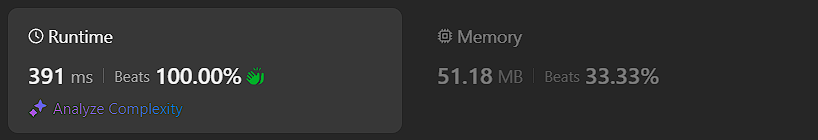
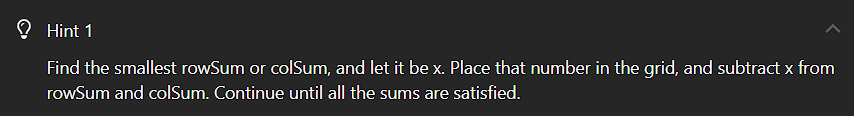
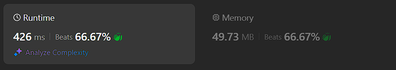

# Kotlin. Beats 100% (391 ms). Minimizing the number of array accesses by index.

**Author:** mobdev778
**Votes:** 1
**Link:** [https://leetcode.com/problems/find-valid-matrix-given-row-and-column-sums/solutions/5504595/](https://leetcode.com/problems/find-valid-matrix-given-row-and-column-sums/solutions/5504595/)

---



# Code
```
class Solution {
    fun restoreMatrix(rowSums: IntArray, colSums: IntArray): Array<IntArray> {
        val newColSums = Array(colSums.size) { Counter(colSums[it]) }
        val newRowSums = Array(rowSums.size) { Counter(rowSums[it]) }
        val result = Array(rowSums.size) { y ->
            buildLine(newRowSums[y], newColSums)
        }
        return result
    }

    private fun buildLine(sum: Counter, colSums: Array<Counter>): IntArray {
        val row = IntArray(colSums.size)
        colSums.forEachIndexed { x, counter ->
            row[x] = sum.min(counter)
        }
        return row
    }

    class Counter(var count: Int) {

        fun min(counter: Counter): Int {
            val value = Math.min(count, counter.count)
            count -= value
            counter.count -= value
            return value
        }
    }
}
```

# Approach

The whole algorithm is described in the hint:



My first solution was made on the hint - for each cell (x,y) I choose the minimum value between rowSums[y] and colSums[x], consider it as the value of the cell and subtract it from both sums:



```
class Solution {
    fun restoreMatrix(rowSums: IntArray, colSums: IntArray): Array<IntArray> {
        val result = Array(rowSums.size) { y ->
            buildLine(rowSums[y], colSums)
        }
        return result
    }

    private fun buildLine(rowSum: Int, colSums: IntArray): IntArray {
        var rowSum = rowSum
        val row = IntArray(colSums.size)
        for (x in 0 until colSums.size) {
            val value = Math.min(rowSum, colSums[x])
            colSums[x] -= value
            rowSum -= value
            row[x] = value
        }
        return row
    }
}
```

The thing that really confused me here is the need to access the array colSums[x] 3 times by index "x".

Each read/write of an array cell contains an implicit multiplication operation inside - the virtual machine has the address of the initial memory cell, and to find the offset for a given cell, you need to add the cell index multiplied by the size of one cell to the address of the initial cell:
```
cell address = array address + index * sizeOf(cell)
```

To reduce the number of index calls, we can introduce an additional class "Counter", which will minimize the number of calls by 3 times.

When working with columns, we get a "counter" of sums for a given column and decrease its value without having to do the index call operation again.

This technique should work almost 3 times faster than
```
val value = Math.min(rowSum, colSums[x])
colSums[x] = colSums[x] - value
```