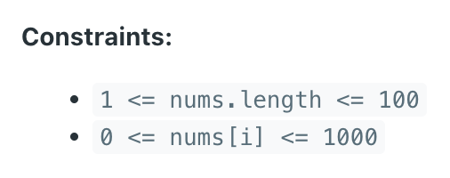

# 🔥🔥 Every Step Explained! A detailed Explanation 😱😱 || 2 Methods

**Author:** hi-malik
**Votes:** 69
**Link:** [https://leetcode.com/problems/special-array-with-x-elements-greater-than-or-equal-x/solutions/5213381/](https://leetcode.com/problems/special-array-with-x-elements-greater-than-or-equal-x/solutions/5213381/)

---

**Approach - 1**

Let's understand and solve this problem using an example!
```
Input: nums = [1,2,5,3,4]
Output: 3
```

So, in the starting we will check!
```
[1, 2, 5, 3, 4]
 ^
```
Is there one number, i.e. greater than or equals to **1**, **`No`** there are **5** numbers that are greater than or equals to **1**
```
[1, 2, 5, 3, 4]
    ^
```
Is there two numbers, which greater than or equals to **2**, **`No`** there are **4** numbers that are greater than or equals to **2**
```
[1, 2, 5, 3, 4]
       ^
```
Is there three numbers, which greater than or equals to **3**, **`YES`** there are **3** numbers that are greater than or equals to **3**

> So we going to return **x = 3**

Let's understand with one more example!
```
Input: nums = [2,3,4,1]
Output: 3
```
So, in the starting we will check!
```
[2, 3, 4, 1]
 ^
```
Is there one number, which are greater than or equals to **1**, **`No`** there are **4** numbers that are greater than or equals to **1**
```
[2, 3, 4, 1]
    ^
```
Is there two numbers, which are. greater than or equals to **2**, **`No`** there are **3** numbers that are greater than or equals to **2**
```
[2, 3, 4, 1]
       ^
```
Is there three numbers, which are greater than or equals to **3**, **`No`** there are **2** numbers that are greater than or equals to **3**
```
[2, 3, 4, 1]
          ^
```
Is there four numbers, which are greater than or equals to **4**, **`No`** there are **1** numbers that are greater than or equals to **4**

> So in this case we going to return **x = -1**

As you see, if all the numbers are greater then the length! The **length itself is the answer**! And if, not then we will going to **return -1**

Let me explain you the code first and give you the pseudo code too!

```pseudo
function specialArray(nums):
    sort(nums in ascending order)
    n = length of nums
    
    if nums[0] >= n:
        return n
    
    for i from 1 to n:
        if nums[n - i] >= i AND (n - i - 1 < 0 OR nums[n - i - 1] < i):
            return i
    
    return -1
```

### Explanation:

1. **Sort the Array:**
   - Sort the array `nums` in ascending order.

2. **Check if the first element is greater than or equal to the length of the array:**
   - If the first element `nums[0]` is greater than or equal to `n` (length of the array), return `n`. This handles the edge case where all elements in the array are greater than or equal to the length of the array.

3. **Iterate through the array to find the special number `x`:**
   - Iterate `i` from 1 to `n`.
   - For each `i`, check if the element at index `n - i` is greater than or equal to `i` AND either there is no previous element (`n - i - 1 < 0`) or the previous element is less than `i`.
   - If both conditions are true, return `i` as the special number.

4. **Return -1 if no special number is found:**
   - If no special number `x` is found in the loop, return -1.

**Now, Let's Code it UP :**

**C++**
```
class Solution {
public:
    int specialArray(vector<int>& nums) {
        sort(nums.begin(), nums.end(), greater<int>());
        int n = nums.size();
        
        if (nums[n - 1] > n) return n;
        if (nums[0] == 0) return -1;

        int l = 0, r = n - 1, m = 0;
        while (l <= r) {
            m = l + (r - l) / 2;
            if (nums[m] > m) {
                l = m + 1;
            } else if (nums[m] < m) {
                r = m - 1;
            } else {
                return -1;
            }
        }
        return nums[m] > m ? m + 1 : m;
    }
};
```
**JAVA**
```
class Solution {
    public int specialArray(int[] nums) {
        Arrays.sort(nums);
        int n = nums.length;
        
        if (nums[0] >= n) return n;
        
        for (int i = 1; i <= n; i++) {
            if (nums[n - i] >= i && (n - i - 1 < 0 || nums[n - i - 1] < i)) {
                return i;
            }
        }
        
        return -1;
    }
}
```
**PYTHON**
```
class Solution:
    def specialArray(self, nums: List[int]) -> int:
        nums.sort(reverse=True)
        
        if nums[-1] > len(nums):
            return len(nums)
        
        if nums[0] == 0:
            return -1
        
        l = 0
        r = len(nums) - 1
        m = 0
        
        while l <= r:
            m = l + (r - l) // 2
            if nums[m] > m:
                l = m + 1
            elif nums[m] < m:
                r = m - 1
            else:
                return -1
        
        return m + 1 if nums[m] > m else m
```

___
Complexity Analysis

___

* **Time Complexity :-** BigO(nlogn)
* **Space Complexity :-** BigO(1)

___
___

**Approach - 2**

### Simple

1. **Let's first Initialize:**
    - Input: `nums = {3, 5}`
    - `bucket` array is initialized with 1001 zeros.
    ```
    bucket: [0, 0, 0, 0, ..., 0]
    ```
Now why array size is 1001, because it's given in constraints :


    
2. **Now let's Count the Occurrences of each number in the array:**
    - Count occurrences of each number in `nums`.
    - `bucket[3] = 1`, `bucket[5] = 1`
    ```
    bucket: [0, 0, 0, 1, 0, 1, 0, ..., 0]
    ```
    
3. **Now, lets count the size of array**
    - Set `total` to the length of `nums`.
    ```
    total = 2
    ```
    
4. **Therefore, we going to Iterate Through Possible Values of `x`:**
    - Iterate `i` from 0 to 1000.
    
5. **Check if Current `i` is the Special Number:**
    - For `i = 0`: `i != total` (2)
    - For `i = 1`: `i != total` (2)
    - For `i = 2`: `i == total` (2) \u2192 Return `i`
    ```
    if (i == total) return i;
    ```
    
6. **In the end, before returning the Total, we going to Update it:**
    - Subtract the count of current number `i` from `total`.
    - For `i = 0`: `bucket[0] = 0` \u2192 `total = 2 - 0 = 2`
    - For `i = 1`: `bucket[1] = 0` \u2192 `total = 2 - 0 = 2`
    - For `i = 2`: `bucket[2] = 0` \u2192 `total = 2 - 0 = 2`
    - For `i = 3`: `bucket[3] = 1` \u2192 `total = 2 - 1 = 1`
    - For `i = 4`: `bucket[4] = 0` \u2192 `total = 1 - 0 = 1`
    - For `i = 5`: `bucket[5] = 1` \u2192 `total = 1 - 1 = 0`
    ```
    total -= bucket[i];
    ```
    
7. **Return -1 if No Special Number is Found:**
    - If the loop completes without finding a special number, return -1.
    ```
    return -1;
    ```

**Let's Code it UP:**

**C++**
```
class Solution {
public:
    int specialArray(vector<int>& nums) {
        int bucket[1001] = {0};
        for (int num : nums) {
            bucket[num]++;
        }
        int total = nums.size();
        for (int i = 0; i < 1001; i++) {
            if (i == total) {
                return i;
            }
            total -= bucket[i];
        }
        return -1;
    }
};
```
**JAVA**
```
class Solution {
    public int specialArray(int[] nums) {
        int[] bucket = new int[1001];
        for (int num : nums) {
            bucket[num]++;
        }
        int total = nums.length;
        for (int i = 0; i < 1001; i++) {
            if (i == total) {
                return i;
            }
            total -= bucket[i];
        }
        return -1;
    }
}
```
**PYTHON**
```
class Solution:
    def specialArray(self, nums: List[int]) -> int:
        bucket = [0] * 1001
        for num in nums:
            bucket[num] += 1
        total = len(nums)
        for i in range(1001):
            if i == total:
                return i
            total -= bucket[i]
        return -1
```

___
Complexity Analysis

___

* **Time Complexity :-** BigO(N)
* **Space Complexity :-** BigO(N)