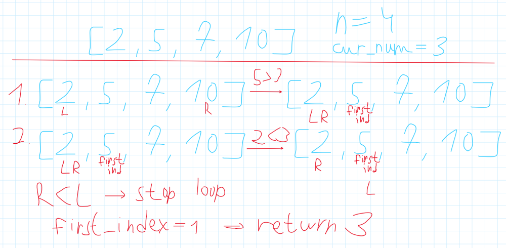

# ✅Detailed Explanation🔥2 Approaches🔥🔥Extremely Simple and effective🔥🔥🔥 Beginner-friendly🔥

**Author:** heir-of-god
**Votes:** 66
**Link:** [https://leetcode.com/problems/special-array-with-x-elements-greater-than-or-equal-x/solutions/5214328/](https://leetcode.com/problems/special-array-with-x-elements-greater-than-or-equal-x/solutions/5214328/)

---

# \uD83C\uDFAFProblem Explanation:
You are given a list of integers ```nums``` and want to find the special number ```i``` for which here's exactly ```i``` numbers greater then or equal to ```i```. (If ```i``` doesn't exist then return -1)

# \uD83D\uDCE5Input:
- Integer array ```nums```

# \uD83D\uDCE4Output:
Special number ```i``` or -1 if it doesn't exist

# \uD83E\uDDE0 Approach 1: Brute force with binary search

# \uD83E\uDD14 Intuition
Okay, so this problem has some points to think about before we start code something.
- Firstly, in which range the speacial number ```i``` can be? If we take ```i=0``` then in array must be 0 elements which is impossible by constraints and if we take ```i=n+1``` then in the array must be ```n + 1``` number greater then or equal to ```n + 1``` but its length is ```n``` so this is impossible => ```i is in the range [1, n]```.
- After we figured out this we can come up with very simple brute force solution - let's iterate through every possible i from 1 to n and calculate how many elements are greater than or equal to this ```i```. If we haven't found number like this then return -1.

# \uD83D\uDCBB Coding 
The main point in this solution is to how to find number of elements greater then or equal efficiently.
- To find something efficiently we can use ```binary_search```. This is it, we don't interested in the order of elements in array so we can just sort it and implement binary search to find out how many elements are greater than or equal to ```i```
- Let's talk about binary search and consider a simple example.
    - We don't want to find some element with binary search but rather number of elements greater or equal to ```i```.
    - So, in fact, what we are interested in is the index of first element in array which is greater or equal to ```i``` because if array sorted and ```nums[j] >= i``` then ```nums[j + 1] >= i```. (So we want to return the index of ```mid``` at the time we changed right pointer last time because we know for sure that ```nums[mid] >= cur_num```)
- There's my image which exemplifies binary search algorithm for our situation.



# \uD83D\uDCD2 Complexity
- \u23F0 Time complexity: O(n*log n), we use sorting (nlogn) and also for every num in range [1, n] we call binary search which is also O(nlogn)
- \uD83E\uDDFA Space complexity: O(1) no extra space is used

# \uD83E\uDDD1\u200D\uD83D\uDCBB Code
``` python []
class Solution:
    def specialArray(self, nums: list[int]) -> int:
        nums.sort()
        n: int = len(nums)

        def find_number_of_nums(cur_num) -> int:
            left: int = 0
            right: int = n - 1

            first_index: int = n
            while left <= right:
                mid: int = (left + right) // 2

                if nums[mid] >= cur_num:
                    first_index = mid
                    right = mid - 1
                else:
                    left = mid + 1

            return n - first_index

        for candidate_number in range(1, n + 1, 1):
            if candidate_number == find_number_of_nums(candidate_number):
                return candidate_number

        return -1
```
``` C++ []
class Solution {
public:
    int specialArray(vector<int>& nums) {
        sort(nums.begin(), nums.end());
        int n = nums.size();
        
        auto find_number_of_nums = [&](int cur_num) -> int {
            int left = 0, right = n - 1;
            int first_index = n;

            while (left <= right) {
                int mid = (left + right) / 2;

                if (nums[mid] >= cur_num) {
                    first_index = mid;
                    right = mid - 1;
                } else {
                    left = mid + 1;
                }
            }

            return n - first_index;
        };

        for (int candidate_number = 1; candidate_number <= n; ++candidate_number) {
            if (candidate_number == find_number_of_nums(candidate_number)) {
                return candidate_number;
            }
        }

        return -1;
    }
};
```
``` JavaScript []
var specialArray = function(nums) {
    nums.sort((a, b) => a - b);
    let n = nums.length;

    function findNumberOfNums(curNum) {
        let left = 0, right = n - 1;
        let firstIndex = n;

        while (left <= right) {
            let mid = Math.floor((left + right) / 2);

            if (nums[mid] >= curNum) {
                firstIndex = mid;
                right = mid - 1;
            } else {
                left = mid + 1;
            }
        }

        return n - firstIndex;
    }

    for (let candidateNumber = 1; candidateNumber <= n; ++candidateNumber) {
        if (candidateNumber === findNumberOfNums(candidateNumber)) {
            return candidateNumber;
        }
    }

    return -1;
};
```
``` Java []
class Solution {
    public int specialArray(int[] nums) {
        Arrays.sort(nums);
        int n = nums.length;

        for (int candidateNumber = 1; candidateNumber <= n; ++candidateNumber) {
            if (candidateNumber == findNumberOfNums(nums, n, candidateNumber)) {
                return candidateNumber;
            }
        }

        return -1;
    }

    private int findNumberOfNums(int[] nums, int n, int curNum) {
        int left = 0, right = n - 1;
        int firstIndex = n;

        while (left <= right) {
            int mid = (left + right) / 2;

            if (nums[mid] >= curNum) {
                firstIndex = mid;
                right = mid - 1;
            } else {
                left = mid + 1;
            }
        }

        return n - firstIndex;
    }
}
```
``` C []
int compare(const void* a, const void* b) {
    return (*(int*)a - *(int*)b);
}

int specialArray(int* nums, int numsSize) {
    qsort(nums, numsSize, sizeof(int), compare);

    int findNumberOfNums(int curNum) {
        int left = 0, right = numsSize - 1;
        int firstIndex = numsSize;

        while (left <= right) {
            int mid = (left + right) / 2;

            if (nums[mid] >= curNum) {
                firstIndex = mid;
                right = mid - 1;
            } else {
                left = mid + 1;
            }
        }

        return numsSize - firstIndex;
    }

    for (int candidateNumber = 1; candidateNumber <= numsSize; ++candidateNumber) {
        if (candidateNumber == findNumberOfNums(candidateNumber)) {
            return candidateNumber;
        }
    }

    return -1;
}
```


# \uD83E\uDDE0 Approach 2: Suffix-sum with pretty logic

# \uD83E\uDD14 Intuition
This approach is optimized but a little harder to understand but I'm sure you will.
- One of the main point to understand is that maximum value of ```i``` is ```n``` so this is doesn't matter whether we have ```2n``` or ```10000n```. For our solution this numbers are the same, they're both greater then any possible ```i``` so when we will calculate frequency we can calculate any number greater than ```n``` as frequency of ```n``` to reduce space complexity.
- Okay, the next very important thing is that (was already said) if ```nums[j] > i``` so ```nums[j] > i - 1 ```. That means that if we will iterate ```i``` in reverse order then we can just use previous number of elements greater or equal and add only elements which is equal to this ```i``` (because step of ```i``` is -1). 
- So if at any moment we have situation where ```current_number_of_greater_or_equal == cur_index``` we want to return this ```cur_index``` and in case we've reached the end of the loop and haven't returned any value then this special number doesn't exist and we want to return -1.

# \uD83D\uDCBB Coding 
Let's code this up
- Initialize array for frequency ```frequency``` (any number from [n, +inf] is the same as n so we will count this just to ```frequency[n]```).
- Count every frequency with loop
- Iterate ```i``` from n to one and for every number add to ```num_greater_equal``` number of numbers which are equal to current ```i``` and on every step check whether current candidate for special number is equal to number of greater or equal. 

# \uD83D\uDCD2 Complexity
- \u23F0 Time complexity: O(n), we iterate from 1 to n which is O(n) and also every num in array to store frequency which is O(n)
- \uD83E\uDDFA Space complexity: O(n), since we're creating array of size n + 1 (from 0 to n) which is O(n)

# \uD83E\uDDD1\u200D\uD83D\uDCBB Code
``` python []
class Solution:
    def specialArray(self, nums: list[int]) -> int:
        n: int = len(nums)
        frequency: list[int] = [0 for _ in range(n + 1)]  # frequence[i] means there is frequence[i] elements equal to i

        for num in nums:
            frequency[min(n, num)] += 1

        num_greater_equal = 0
        for candidate_number in range(n, 0, -1):
            num_greater_equal += frequency[candidate_number]
            if candidate_number == num_greater_equal:
                return candidate_number

        return -1
```
``` C++ []
class Solution {
public:
    int specialArray(vector<int>& nums) {
        int n = nums.size();
        vector<int> frequency(n + 1, 0);

        for (int num : nums) {
            frequency[min(n, num)]++;
        }

        int num_greater_equal = 0;
        for (int candidate_number = n; candidate_number > 0; --candidate_number) {
            num_greater_equal += frequency[candidate_number];
            if (candidate_number == num_greater_equal) {
                return candidate_number;
            }
        }

        return -1;
    }
};
```
``` JavaScript []
var specialArray = function(nums) {
    let n = nums.length;
    let frequency = new Array(n + 1).fill(0);

    for (let num of nums) {
        frequency[Math.min(n, num)]++;
    }

    let num_greater_equal = 0;
    for (let candidate_number = n; candidate_number > 0; --candidate_number) {
        num_greater_equal += frequency[candidate_number];
        if (candidate_number === num_greater_equal) {
            return candidate_number;
        }
    }

    return -1;
};
```
``` Java []
class Solution {
    public int specialArray(int[] nums) {
        int n = nums.length;
        int[] frequency = new int[n + 1];

        for (int num : nums) {
            frequency[Math.min(n, num)]++;
        }

        int num_greater_equal = 0;
        for (int candidate_number = n; candidate_number > 0; --candidate_number) {
            num_greater_equal += frequency[candidate_number];
            if (candidate_number == num_greater_equal) {
                return candidate_number;
            }
        }

        return -1;
    }
}
```
``` C []
int specialArray(int* nums, int numsSize) {
    int n = numsSize;
    int* frequency = (int*)calloc(n + 1, sizeof(int));

    for (int i = 0; i < numsSize; ++i) {
        int num = nums[i];
        if (num >= n) {
            frequency[n]++;
        } else {
            frequency[num]++;
        }
    }

    int num_greater_equal = 0;
    for (int candidate_number = n; candidate_number > 0; --candidate_number) {
        num_greater_equal += frequency[candidate_number];
        if (candidate_number == num_greater_equal) {
            free(frequency);
            return candidate_number;
        }
    }

    free(frequency);
    return -1;
}
```

## \uD83D\uDCA1I encourage you to check out [my profile](https://leetcode.com/heir-of-god/) and [Project-S](https://github.com/Heir-of-God/Project-S) project for detailed explanations and code for different problems (not only Leetcode). Happy coding and learning! \uD83D\uDCDA

### Please consider *upvote* because I try really hard not just to put here my code and rewrite testcase to show that it works but explain you WHY it works and HOW. Thank you\u2764\uFE0F

## If you have any doubts or questions feel free to ask them in comments. I will be glad to help you with understanding\u2764\uFE0F\u2764\uFE0F\u2764\uFE0F


