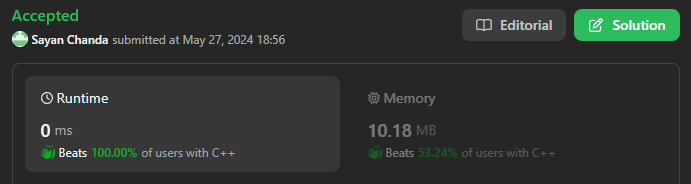

# ✅Simple Solution || Beats 100% || Multiple Approach || Easy Explanation || Beginner Friendly 🔥🔥🔥

**Author:** Sayan98
**Votes:** 1
**Link:** [https://leetcode.com/problems/special-array-with-x-elements-greater-than-or-equal-x/solutions/5216431/](https://leetcode.com/problems/special-array-with-x-elements-greater-than-or-equal-x/solutions/5216431/)

---



# Intuition
The problem is to find an integer x such that there are exactly x elements in the given array nums that are greater than or equal to x. If such an integer exists, we need to return it; otherwise, we return -1.

# Approach
- **Sort** the array nums in ascending order.
- Iterate through nums in reverse order (from the largest element to the smallest).
- For each element **nums[i]**, check if:
    - **nums[i]** is greater than or equal to the number of elements remaining from i to the end of the array (i.e., **nums[i] >= n - i**).
    - If **i** is not the first index, ensure that the previous element **nums[i-1]** is strictly less than **n - i** (to avoid duplicates).
- If both conditions are met, return **n - i** as the special integer.
- If no such integer is found, return **-1**.

# Complexity
- Time complexity: **O(n log n)**
Where n is the length of the input array nums. 


- Space complexity: **O(1)**
Not using any additional data structures that grow with the input size.


```C++ []
class Solution {
public:
    int specialArray(vector<int>& nums) {
        sort(nums.begin(), nums.end());
        int n = nums.size();
        for (int i = n - 1; i >= 0 ; i--)
            if(nums[i] >= (n - i) && (i == 0 || nums[i - 1] < n - i))
                return n - i;
        return -1;   
    }
};
```
```Java []
class Solution {
    public int specialArray(int[] nums) {
        Arrays.sort(nums);
        var n = nums.length;
        for (int i = n - 1; i >= 0 ; i--)
            if(nums[i] >= (n - i) && (i == 0 || nums[i - 1] < n - i))
                return n - i;
        return -1;
    }
}
```
```C# []
public class Solution {
    public int SpecialArray(int[] nums) {
        Array.Sort(nums);
        var n = nums.Length;
        for (int i = n - 1; i >= 0 ; i--)
            if(nums[i] >= (n - i) && (i == 0 || nums[i - 1] < n - i))
                return n - i;
        return -1;
    }
}
```

# Reverse
```C# []
public class Solution {
    public int SpecialArray(int[] nums) {
        Array.Sort(nums);
        Array.Reverse(nums);
        for (int i = nums.Length - 1; i >= 0 ; i--)
            if(nums[i] >= (i + 1))
                if((i + 1) != nums.Length && nums[i + 1] >= (i + 1)) continue;
                else return i + 1;
        return -1;
    }
}
```

