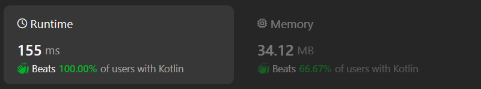

# Kotlin binary search solution without sorting

**Author:** chayangkoon
**Votes:** 3
**Link:** [https://leetcode.com/problems/special-array-with-x-elements-greater-than-or-equal-x/solutions/4963135/](https://leetcode.com/problems/special-array-with-x-elements-greater-than-or-equal-x/solutions/4963135/)

---



# Code
```
class Solution {
    fun specialArray(nums: IntArray): Int {
        var low = 0
        var high = nums.size
        while(low <= high) {
            val middle = low + (high - low) / 2
            val count = nums.count { it >= middle }
            if(count == middle) {
                return middle
            } else if(count < middle) {
                high = middle - 1
            } else {
                low = middle + 1
            }
        }
        return -1
    }
}
```