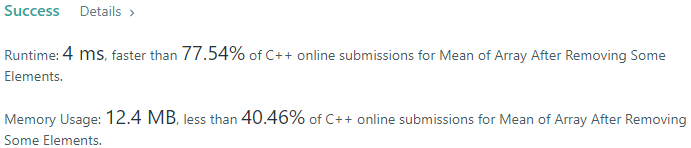
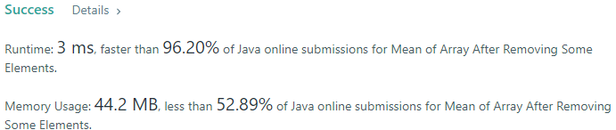
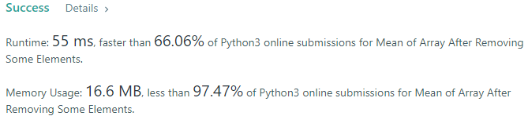
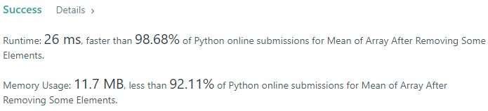
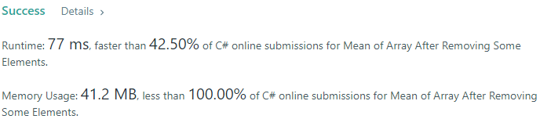
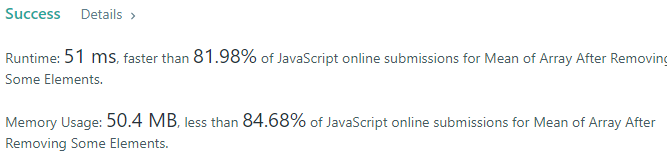
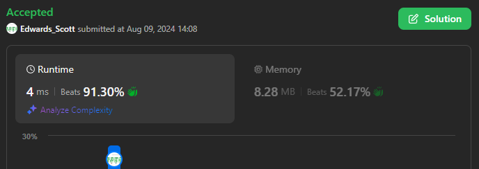

# 💢☠💫Easiest👾Faster✅💯 Lesser🧠 🎯 C++✅Python3🐍✅Java✅C✅Python🐍✅C#✅💥🔥💫Explained☠💥🔥 Beats 💯

**Author:** Edwards310
**Votes:** 2
**Link:** [https://leetcode.com/problems/mean-of-array-after-removing-some-elements/solutions/5611893/](https://leetcode.com/problems/mean-of-array-after-removing-some-elements/solutions/5611893/)

---

# Intuition









```javascript []
//JavaScript Code
/**
 * @param {number[]} arr
 * @return {number}
 */
var trimMean = function(arr) {
    let sum = 0, n = arr.length, cnt = 0
    let skip = Math.floor(n / 20)
    arr.sort((a, b) => {
        return a - b
    })
    for(let i = skip; i < n - skip; ++i){
        sum += arr[i]
        cnt++
    }
    return sum / cnt
};
```
```C++ []
//C++ Code
// Start Of Edwards310's Template...

#include <bits/stdc++.h>
using namespace std;

#define FOR(a, b, c) for (int a = b; a < c; a++)
#define ALL(v) v.begin(), v.end()
#define SORT(v) sort(ALL(v))

// end of Edwards310's Template
class Solution {
public:
    double trimMean(vector<int>& arr) {
        int sum = 0, cnt = 0, len = arr.size();
        SORT(arr);
        int percent5 = len / 20;
        FOR(i, percent5, len - percent5){
            sum += arr[i];
            cnt++;
        }
        return (double)sum / cnt;
    }
};
```
```Python3 []
#Python3 Code
class Solution:
    def trimMean(self, arr: List[int]) -> float:
        m = len(arr)
        arr.sort()
        trimmed = (m * 5) // 100
        sm = 0
        for i in range(trimmed, m - trimmed):
            sm += arr[i]
        return sm / (m - (2 * trimmed))
```
```Java []
//Java Code
class Solution {
    public double trimMean(int[] arr) {
        int sum = 0, n = arr.length, percent5 = n / 20, cnt = 0;
        Arrays.sort(arr);
        for(int i = percent5; i < n - percent5; i++){
            sum += arr[i];
            cnt++;
        }
        return (double)sum / cnt;
    }
}
```
```C []
//C Code
int comparator(const void* a, const void* b){
    return *(int*)a - *(int*)b;
}
double trimMean(int* arr, int arrSize) {
    int sum = 0, cnt = 0, len = arrSize;
    qsort(arr, arrSize, sizeof(int), comparator);
    int percent5 = len / 20;
    for (int i = percent5; i < len - percent5; ++i){
        sum += arr[i];
        cnt++;
    }
    return (double)sum / cnt;
}
```
```Python []
#Python Code
class Solution(object):
    def trimMean(self, arr):
        """
        :type arr: List[int]
        :rtype: float
        """
        arr.sort()
        n = len(arr)
        i = n / 20
        return sum(arr[i : -i]) / float(n - 2 * i)
```
```C# []
//C# Code
public class Solution {
    public double TrimMean(int[] arr) {
        Array.Sort(arr);
        var n = arr.Length;
        
        var start = n / 20;
        var end = n - start;
        var sum = 0;
        
        for (var i = start; i < end; i++)
            sum += arr[i];
        
        return (double)sum / (end - start);
    }
}
```

<!-- Describe your first thoughts on how to solve this problem. -->

# Approach
<!-- Describe your approach to solving the problem. -->

# Complexity
- Time complexity:
<!-- Add your time complexity here, e.g. $$O(n)$$ -->
     O(nlogn)
- Space complexity:
<!-- Add your space complexity here, e.g. $$O(n)$$ -->
    O(1)
# Code
```
/**
 * @param {number[]} arr
 * @return {number}
 */
var trimMean = function(arr) {
    let sum = 0, n = arr.length, cnt = 0
    let skip = Math.floor(n / 20)
    arr.sort((a, b) => {
        return a - b
    })
    for(let i = skip; i < n - skip; ++i){
        sum += arr[i]
        cnt++
    }
    return sum / cnt
};
```

