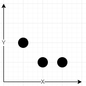

# [1620. Coordinate With Maximum Network Quality](https://leetcode.com/problems/coordinate-with-maximum-network-quality/)

| Category | Difficulty | Likes | Dislikes |
| :------: | :--------: | :---: | :------: |
| Algorithms | Medium | 91 | 274 |

**Tags:** [`array`](https://leetcode.com/tag/array), [`enumeration`](https://leetcode.com/tag/enumeration)

**Companies:** `lyft`

## Description

You are given an array of network towers `towers`, where `towers[i] = [x_i, y_i, q_i]` denotes the `i^th` network tower with location `(x_i, y_i)` and quality factor `q_i`. All the coordinates are **integral coordinates** on the X-Y plane, and the distance between the two coordinates is the **Euclidean distance**.

You are also given an integer `radius` where a tower is **reachable** if the distance is **less than or equal to** `radius`. Outside that distance, the signal becomes garbled, and the tower is **not reachable**.

The signal quality of the `i^th` tower at a coordinate `(x, y)` is calculated with the formula `&lfloor;q_i / (1 + d)&rfloor;`, where `d` is the distance between the tower and the coordinate. The **network quality** at a coordinate is the sum of the signal qualities from all the **reachable** towers.

Return *the array *`[c_x, c_y]`* representing the **integral** coordinate *`(c_x, c_y)`* where the **network quality** is maximum. If there are multiple coordinates with the same **network quality**, return the lexicographically minimum **non-negative** coordinate.*

**Note:**

	- A coordinate `(x1, y1)` is lexicographically smaller than `(x2, y2)` if either:

	
		`x1 
	- `&lfloor;val&rfloor;` is the greatest integer less than or equal to `val` (the floor function).

 

**Example 1:**


```

Input: towers = [[1,2,5],[2,1,7],[3,1,9]], radius = 2
Output: [2,1]
Explanation: At coordinate (2, 1) the total quality is 13.
- Quality of 7 from (2, 1) results in &lfloor;7 / (1 + sqrt(0)&rfloor; = &lfloor;7&rfloor; = 7
- Quality of 5 from (1, 2) results in &lfloor;5 / (1 + sqrt(2)&rfloor; = &lfloor;2.07&rfloor; = 2
- Quality of 9 from (3, 1) results in &lfloor;9 / (1 + sqrt(1)&rfloor; = &lfloor;4.5&rfloor; = 4
No other coordinate has a higher network quality.
```

**Example 2:**

```

Input: towers = [[23,11,21]], radius = 9
Output: [23,11]
Explanation: Since there is only one tower, the network quality is highest right at the tower&#39;s location.

```

**Example 3:**

```

Input: towers = [[1,2,13],[2,1,7],[0,1,9]], radius = 2
Output: [1,2]
Explanation: Coordinate (1, 2) has the highest network quality.

```

 

**Constraints:**

	- `1 <= towers.length <= 50`

	- `towers[i].length == 3`

	- `0 <= x_i, y_i, q_i <= 50`

	- `1 <= radius <= 50`

---

**Links:** [Submissions](https://leetcode.com/problems/coordinate-with-maximum-network-quality/) | [Solutions](https://leetcode.com/problems/coordinate-with-maximum-network-quality/)
