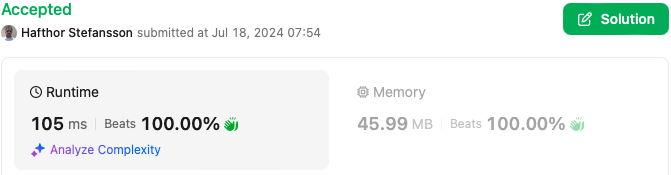

# C# - Fastest - 3 Approaches Explained: Brute Force, Hill Climbing and Center of Mass

**Author:** hafthor
**Votes:** 0
**Link:** [https://leetcode.com/problems/coordinate-with-maximum-network-quality/solutions/5495590/](https://leetcode.com/problems/coordinate-with-maximum-network-quality/solutions/5495590/)

---


(for Approach #3)

# Intuition / Approach #1
The brute force approach simply iterates through the x,y plane and computes the network quality at each point looking for the best result. We optimize this a bit by limiting our search to the min/max coordinates of the towers.

# Complexity #1
- Time complexity: O(XYn) - points in the X/Y plane times the number of towers
- Space complexity: O(1)

# Code #1
```
public class Solution {
    public int[] BestCoordinate(int[][] towers, int radius) {
        // get the boundaries of the towers to limit our search space
        int top = int.MaxValue, bottom = int.MinValue, left = int.MaxValue, right = int.MinValue, x, y;
        foreach (var tower in towers) {
            top = Math.Min(top, y = tower[1]);
            bottom = Math.Max(bottom, y);
            left = Math.Min(left, x = tower[0]);
            right = Math.Max(right, x);
        }

        var best = (x: 0, y: 0, q: 0);
        int radiusSq = radius * radius; // optimization to avoid Sqrt until after filter
        for (x = left; x <= right; x++) {
            for (y = top; y <= bottom; y++) {
                // calculate the network quality at this point
                int netQ = 0;
                foreach (var tower in towers) {
                    int dx = tower[0] - x, dy = tower[1] - y, distSq = dx * dx + dy * dy;
                    if (distSq <= radiusSq) {
                        netQ += (int)(tower[2] / (1 + Math.Sqrt(distSq)));
                    }
                }
                // if this point has better network quality, save it
                if (netQ > best.q) {
                    best = (x, y, netQ);
                }
            }
        }
        // return the best point
        return [best.x, best.y];
    }
}
```

# Intuition / Approach #2
This approach recognizes that the optimum network quality will either be directly on a tower or may increase as we move away from the tower, so we calculate network quality at each tower location, then check neighboring locations to see if it increased. If so, we continue to check the neighbors of the neighbor as long as it continues to increase.

# Complexity #2
- Time complexity: O(n\xB2) - towers squared with 8 neighbors checked each
- Space complexity: O(n) - towers of cache and queue

# Code #2
```
public class Solution {
    public int[] BestCoordinate(int[][] towers, int radius) {
        // get the boundaries of the towers to limit our search space
        int top = int.MaxValue, bottom = int.MinValue, left = int.MaxValue, right = int.MinValue, x, y;
        foreach (var tower in towers) {
            top = Math.Min(top, y = tower[1]);
            bottom = Math.Max(bottom, y);
            left = Math.Min(left, x = tower[0]);
            right = Math.Max(right, x);
        }

        int radiusSq = radius * radius; // optimization to avoid Sqrt until after filter
        var best = (x: 0, y: 0, q: 0);
        Queue<(int x, int y)> q = new(); // locations to search for local maxima
        Dictionary<(int x, int y), int> qualityCache = new();
        foreach (var tower in towers) {
            // compute/cache network quality at each tower
            NetworkQualityAt(x = tower[0], y = tower[1]);
            // add towers to the queue to search for local maxima
            q.Enqueue((x, y));
        }
        while (q.Count > 0) {
            (x, y) = q.Dequeue();
            // look at the neighbors of this point for a local maxima
            for (int netQ = qualityCache[(x, y)], x2 = Math.Max(left, x - 1), xl = Math.Min(right, x + 1); x2 <= xl; x2++) {
                for (int y2 = Math.Max(top, y - 1), yl = Math.Min(bottom, y + 1); y2 <= yl; y2++) {
                    if (!qualityCache.ContainsKey((x2, y2)) && NetworkQualityAt(x2, y2) > netQ) {
                        // if we found a local maxima, add this location to the queue to see if we can do better
                        q.Enqueue((x2, y2));
                    }
                }
            }
        }
        // return the best point
        return [best.x, best.y];

        // helper function to compute the network quality at a point w/ cache and update best if needed
        int NetworkQualityAt(int x, int y) {
            // if we have already computed the network quality at this point, return it
            if (qualityCache.TryGetValue((x, y), out var netQ)) return netQ;

            // calculate the network quality at this point
            foreach (var tower in towers) {
                int dx = tower[0] - x, dy = tower[1] - y, distSq = dx * dx + dy * dy;
                if (distSq <= radiusSq) {
                    netQ += (int)(tower[2] / (1 + Math.Sqrt(distSq)));
                }
            }
            // if this point has better network quality or the same quality but is lexicographically smaller, save it
            if (netQ >= best.q && (netQ > best.q || x < best.x || x == best.x && y < best.y)) {
                best = (x, y, netQ);
            }
            // cache/return the network quality at this point
            return qualityCache[(x, y)] = netQ;
        }
    }
}
```

# Intuition / Approach #3
This approach only checks the network quality at the computed center of mass on the 2-D plane, and at the locations of the individual towers.

# Complexity #3
* Time complexity: O(n\xB2) - towers squared
* Space complexity: O(1)

# Code #3
```
public class Solution {
    public int[] BestCoordinate(int[][] towers, int radius) {
        int x = 0, y = 0, q = 0, radiusSq = radius * radius;
        // compute center of mass 
        foreach (var tower in towers) {
            x += tower[0] * tower[2];
            y += tower[1] * tower[2];
            q += tower[2];
        }
        x = (int)Math.Round(1.0 * x / q);
        y = (int)Math.Round(1.0 * y / q);
        q = 0;
        // compute network quality at center of mass
        foreach (var tower in towers) {
            int dx = tower[0] - x, dy = tower[1] - y, distSq = dx * dx + dy * dy;
            if (distSq <= radiusSq) {
                q += (int)(tower[2] / (1 + Math.Sqrt(distSq)));
            }
        }
        var best = (x, y, q);
        // also check the tower locations
        foreach (var t in towers) {
            x = t[0];
            y = t[1];
            if (x == best.x && y == best.y) continue;
            q = 0;
            foreach (var tower in towers) {
                int dx = tower[0] - x, dy = tower[1] - y, distSq = dx * dx + dy * dy;
                if (distSq <= radiusSq) {
                    q += (int)(tower[2] / (1 + Math.Sqrt(distSq)));
                }
            }
            if (q >= best.q && (q > best.q || x < best.x || x == best.x && y < best.y)) {
                best = (x, y, q);
            }
        }
        return [best.x, best.y];
    }
}
```

# Bonus: Code Golf of Brute Force
```
public class Solution {
    public int[] BestCoordinate(int[][] t, int r) { // 189 characters
        int i=0,j=0,k=0,x=0,y,q;for(;x<51;x++)for(y=0;y<51;y++){q=0;foreach(var u in t){int v=u[0]-x,w=u[1]-y,z=v*v+w*w;if(z<=r*r)q+=(int)(u[2]/(1+Math.Sqrt(z)));}if(q>k){k=q;i=x;j=y;}}return[i,j];
    }
}
```