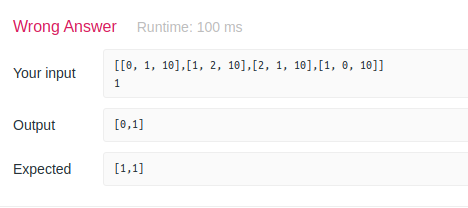

# [SOLVED]My solution passed contest submission but failed with custom test case.

**Author:** ecgan
**Votes:** 1
**Link:** [https://leetcode.com/problems/coordinate-with-maximum-network-quality/solutions/898796/](https://leetcode.com/problems/coordinate-with-maximum-network-quality/solutions/898796/)

---

I had a wrong thought that "the answer is always a tower's coordinate" and came up with the following solution and it passes LeetCode submission: 

```js
const getDistance = ([x1, y1], [x2, y2]) => {
  return Math.sqrt(Math.pow(x2 - x1, 2) + Math.pow(y2 - y1, 2))
}

/**
 * @param {number[][]} towers
 * @param {number} radius
 * @return {number[]}
 */
const bestCoordinate = function (towers, radius) {
  let [x, y] = [0, 0]
  let max = 0

  /**
   * Function containing the logic to
   * update coordinate with the best network quality.
   */
  const updateBestNetworkQuality = ([newX, newY], newNetworkQuality) => {
    if (
      newNetworkQuality > max ||
      (
        newNetworkQuality === max &&
        (
          newX < x ||
          (newX === x && newY < y)
        )
      )
    ) {
      max = newNetworkQuality
      ;[x, y] = [newX, newY]
    }
  }

  for (const [toX, toY] of towers) {
    const networkQuality = towers.reduce((acc, cur) => {
      const [fromX, fromY, fromQ] = cur
      const distance = getDistance([fromX, fromY], [toX, toY])
      const signalQuality = Math.floor(fromQ / (1 + distance))

      return (distance <= radius)
        ? acc + signalQuality
        : acc
    }, 0)

    updateBestNetworkQuality([toX, toY], networkQuality)
  }

  return [x, y]
}

module.exports = bestCoordinate
```

Then [rockwell153](https://leetcode.com/rockwell153) pointed out that my assumption and solution is wrong, I put it into custom test case and indeed I get a wrong answer:


