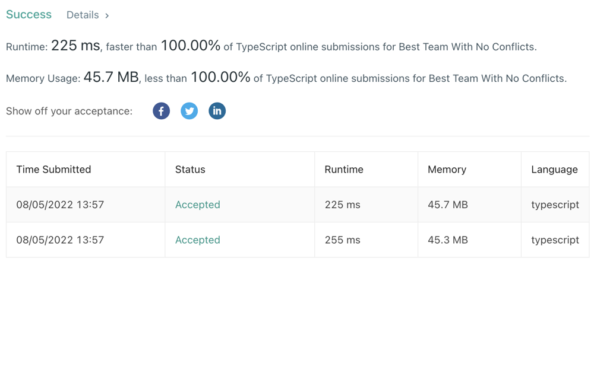

# Typescript 100% both time and space

**Author:** vimalkumar
**Votes:** 1
**Link:** [https://leetcode.com/problems/best-team-with-no-conflicts/solutions/2384467/](https://leetcode.com/problems/best-team-with-no-conflicts/solutions/2384467/)

---

Typescript 100% both time and space


```
function bestTeamScore(scores: number[], ages: number[]): number {

    // Sorting the scores array by age and score
    for(let i=0; i< ages.length-1; i++) {
        for(let j=i+1; j< ages.length; j++) {
            if(ages[i]>ages[j] || (ages[i]==ages[j] && scores[i]>scores[j])) {
                let ageT = ages[i];
                ages[i] = ages[j];
                ages[j] = ageT;
                let scoreT = scores[i];
                scores[i] = scores[j];
                scores[j] = scoreT;
            }
            
        }
        
    }
    
    // DP for maxScore each position from start
    // dp[i] = scores[i] + max(dp[0]...dp[i-1]) if the score is smaller than current score
    let dp: number[] = [];
    for(let i=0; i<scores.length; i++) {
        let max = 0;
        let j= i-1;
        while(j>=0) {
            if(scores[j] <= scores[i]) {
                max = Math.max(max, dp[j])
            }
            j--;
        }
        
        dp[i] = max + scores[i];
    }
    
    return Math.max(...dp);
};
```
