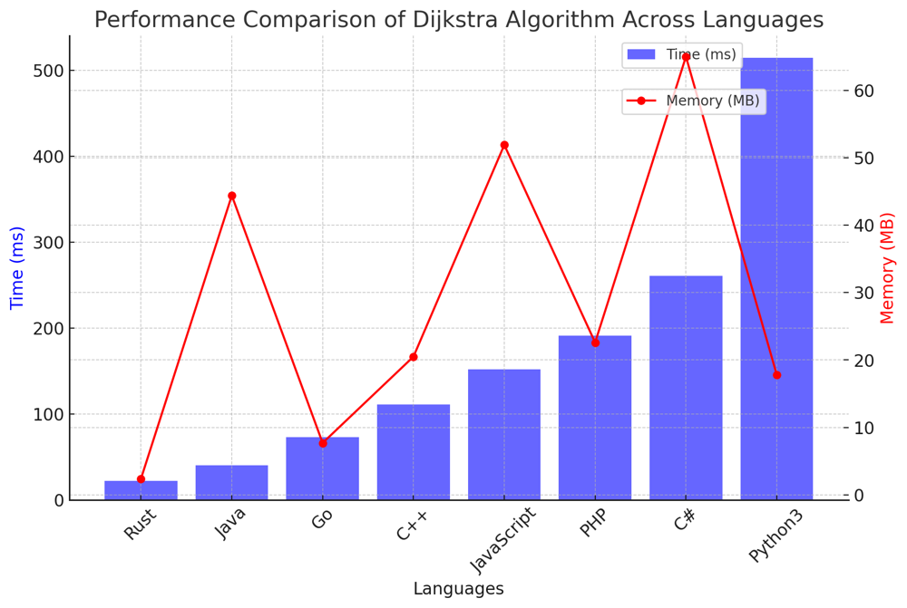

# ✅ 97.67% Optimal Dijkstra with Heap

**Author:** vanAmsen
**Votes:** 110
**Link:** [https://leetcode.com/problems/path-with-minimum-effort/solutions/4049557/](https://leetcode.com/problems/path-with-minimum-effort/solutions/4049557/)

---

# Comprehensive Guide to Solving "Path With Minimum Effort": Conquering the Terrain Efficiently\r
\r
## Introduction & Problem Statement\r
\r
Greetings, algorithmic adventurers! Today's quest leads us through a matrix of heights, representing terrains that a hiker needs to cross. The task is to find the path that requires the minimum effort. The effort is calculated as the maximum absolute difference in heights between two consecutive cells of the route. Intriguing, isn't it?\r
\r
## Key Concepts and Constraints\r
\r
### What Makes This Problem Unique?\r
\r
1. **Graph Representation**: \r
   This problem can be mapped to a graph where each cell in the 2D matrix is a node. The edges connecting these nodes represent the "effort" required to move from one cell to another.\r
\r
2. **Variants of Shortest Path Algorithms**: \r
   The objective is similar to finding the shortest path, but with a different metric. We need to minimize the maximum absolute difference between adjacent nodes.\r
\r
3. **Constraints**: \r
   - $$1 \\leq \	ext{rows, columns} \\leq 100$$\r
   - $$1 \\leq \	ext{heights}[i][j] \\leq 10^6$$\r
\r
### Strategies to Tackle the Problem\r
\r
1. **Dijkstra's Algorithm**: \r
   A classic algorithm for finding the shortest path in a weighted graph, adapted for this problem.\r
\r
---\r
\r
## Live Coding Dijkstra's + Explain\r
https://youtu.be/4VsdOZnViYc?si=4zNaGwKudgqIpyTc\r
\r
## Dijkstra's Algorithm Explained\r
\r
### What is Dijkstra's Algorithm?\r
\r
Dijkstra's Algorithm is a classic graph algorithm that finds the shortest path from a source node to all other nodes in a weighted graph. In this case, the graph is represented by a 2D grid of cells, where each cell is a node and the edges between them represent the effort to move from one cell to another.\r
\r
### Mechanics of Dijkstra's Algorithm in "Path With Minimum Effort"\r
\r
1. **Initialize Priority Queue**:  \r
    - The algorithm starts at the top-left corner (the source). The priority queue is initialized to store the effort needed to reach each cell from the source. The effort for the source itself is zero.\r
\r
2. **Distance Matrix**:  \r
    - A 2D array keeps track of the minimum effort required to reach each cell. Initially, this is set to infinity for all cells except the source.\r
\r
3. **Iterate and Update Distances**:  \r
    - The algorithm pops the cell with the smallest effort from the priority queue and explores its neighbors. The effort required to reach a neighbor is updated if a smaller effort is found.\r
\r
4. **Early Exit**:  \r
    - The algorithm stops when it reaches the bottom-right corner, returning the effort required to get there.\r
\r
### Time and Space Complexity\r
\r
- **Time Complexity**: $$O(M \	imes N \\log(M \	imes N))$$, where $$M$$ and $$N$$ are the dimensions of the grid. This is primarily due to the operations on the priority queue.\r
- **Space Complexity**: $$O(M \	imes N)$$, needed for the distance matrix and the priority queue.\r
\r
# Code Dijkstra\r
``` Python []\r
class Solution:\r
    def minimumEffortPath(self, heights: List[List[int]]) -> int:\r
        rows, cols = len(heights), len(heights[0])\r
        directions = [(0, 1), (0, -1), (1, 0), (-1, 0)]\r
        dist = [[math.inf for _ in range(cols)] for _ in range(rows)]\r
        dist[0][0] = 0\r
        minHeap = [(0, 0, 0)] \r
        \r
        while minHeap:\r
            effort, x, y = heappop(minHeap)\r
\r
            if x == rows - 1 and y == cols - 1:\r
                return effort\r
            \r
            for dx, dy in directions:\r
                nx, ny = x + dx, y + dy\r
                \r
                if 0 <= nx < rows and 0 <= ny < cols:\r
                    new_effort = max(effort, abs(heights[x][y] - heights[nx][ny]))\r
                    \r
                    if new_effort < dist[nx][ny]:\r
                        dist[nx][ny] = new_effort\r
                        heappush(minHeap, (new_effort, nx, ny))\r
```\r
``` Rust []\r
use std::collections::BinaryHeap;\r
use std::cmp::Reverse;\r
\r
impl Solution {\r
    pub fn minimum_effort_path(heights: Vec<Vec<i32>>) -> i32 {\r
        let rows = heights.len();\r
        let cols = heights[0].len();\r
        let mut dist = vec![vec![i32::MAX; cols]; rows];\r
        let mut min_heap: BinaryHeap<Reverse<(i32, usize, usize)>> = BinaryHeap::new();\r
        \r
        dist[0][0] = 0;\r
        min_heap.push(Reverse((0, 0, 0)));\r
        \r
        let directions = [(0, 1), (0, -1), (1, 0), (-1, 0)];\r
        \r
        while let Some(Reverse((effort, x, y))) = min_heap.pop() {\r
            if effort > dist[x][y] {\r
                continue;\r
            }\r
            if x == rows - 1 && y == cols - 1 {\r
                return effort;\r
            }\r
            for (dx, dy) in directions.iter() {\r
                let nx = (x as i32 + dx) as usize;\r
                let ny = (y as i32 + dy) as usize;\r
                if nx < rows && ny < cols {\r
                    let new_effort = std::cmp::max(effort, (heights[x][y] - heights[nx][ny]).abs());\r
                    if new_effort < dist[nx][ny] {\r
                        dist[nx][ny] = new_effort;\r
                        min_heap.push(Reverse((new_effort, nx, ny)));\r
                    }\r
                }\r
            }\r
        }\r
        -1\r
    }\r
}\r
```\r
``` Go []\r
type Item struct {\r
	effort, x, y int\r
}\r
\r
type PriorityQueue []Item\r
\r
func (pq PriorityQueue) Len() int { return len(pq) }\r
\r
func (pq PriorityQueue) Less(i, j int) bool {\r
	return pq[i].effort < pq[j].effort\r
}\r
\r
func (pq PriorityQueue) Swap(i, j int) {\r
	pq[i], pq[j] = pq[j], pq[i]\r
}\r
\r
func (pq *PriorityQueue) Push(x interface{}) {\r
	*pq = append(*pq, x.(Item))\r
}\r
\r
func (pq *PriorityQueue) Pop() interface{} {\r
	old := *pq\r
	n := len(old)\r
	item := old[n-1]\r
	*pq = old[0 : n-1]\r
	return item\r
}\r
\r
func minimumEffortPath(heights [][]int) int {\r
	rows, cols := len(heights), len(heights[0])\r
	dist := make([][]int, rows)\r
	for i := range dist {\r
		dist[i] = make([]int, cols)\r
		for j := range dist[i] {\r
			dist[i][j] = math.MaxInt32\r
		}\r
	}\r
	dist[0][0] = 0\r
	directions := [][2]int{{0, 1}, {0, -1}, {1, 0}, {-1, 0}}\r
\r
	pq := &PriorityQueue{Item{0, 0, 0}}\r
	heap.Init(pq)\r
\r
	for pq.Len() > 0 {\r
		item := heap.Pop(pq).(Item)\r
		effort, x, y := item.effort, item.x, item.y\r
		if effort > dist[x][y] {\r
			continue\r
		}\r
		if x == rows-1 && y == cols-1 {\r
			return effort\r
		}\r
		for _, dir := range directions {\r
			nx, ny := x+dir[0], y+dir[1]\r
			if nx >= 0 && nx < rows && ny >= 0 && ny < cols {\r
				newEffort := int(math.Max(float64(effort), math.Abs(float64(heights[x][y]-heights[nx][ny]))))\r
				if newEffort < dist[nx][ny] {\r
					dist[nx][ny] = newEffort\r
					heap.Push(pq, Item{newEffort, nx, ny})\r
				}\r
			}\r
		}\r
	}\r
	return -1\r
}\r
```\r
``` C++ []\r
class Solution {\r
public:\r
    int minimumEffortPath(vector<vector<int>>& heights) {\r
        int rows = heights.size(), cols = heights[0].size();\r
        vector<vector<int>> dist(rows, vector<int>(cols, INT_MAX));\r
        priority_queue<tuple<int, int, int>, vector<tuple<int, int, int>>, greater<>> minHeap;\r
        minHeap.emplace(0, 0, 0);\r
        dist[0][0] = 0;\r
        \r
        int directions[4][2] = {{0, 1}, {0, -1}, {1, 0}, {-1, 0}};\r
        \r
        while (!minHeap.empty()) {\r
            auto [effort, x, y] = minHeap.top();\r
            minHeap.pop();\r
            \r
            if (effort > dist[x][y]) continue;\r
            \r
            if (x == rows - 1 && y == cols - 1) return effort;\r
            \r
            for (auto& dir : directions) {\r
                int nx = x + dir[0], ny = y + dir[1];\r
                if (nx >= 0 && nx < rows && ny >= 0 && ny < cols) {\r
                    int new_effort = max(effort, abs(heights[x][y] - heights[nx][ny]));\r
                    if (new_effort < dist[nx][ny]) {\r
                        dist[nx][ny] = new_effort;\r
                        minHeap.emplace(new_effort, nx, ny);\r
                    }\r
                }\r
            }\r
        }\r
        return -1;\r
    }\r
};\r
```\r
``` Java []\r
public class Solution {\r
    public int minimumEffortPath(int[][] heights) {\r
        int rows = heights.length, cols = heights[0].length;\r
        int[][] dist = new int[rows][cols];\r
        PriorityQueue<int[]> minHeap = new PriorityQueue<>((a, b) -> Integer.compare(a[0], b[0]));\r
        minHeap.add(new int[]{0, 0, 0});\r
        \r
        for (int i = 0; i < rows; i++) {\r
            for (int j = 0; j < cols; j++) {\r
                dist[i][j] = Integer.MAX_VALUE;\r
            }\r
        }\r
        dist[0][0] = 0;\r
        \r
        int[][] directions = {{0, 1}, {0, -1}, {1, 0}, {-1, 0}};\r
        \r
        while (!minHeap.isEmpty()) {\r
            int[] top = minHeap.poll();\r
            int effort = top[0], x = top[1], y = top[2];\r
            \r
            if (effort > dist[x][y]) continue;\r
            \r
            if (x == rows - 1 && y == cols - 1) return effort;\r
            \r
            for (int[] dir : directions) {\r
                int nx = x + dir[0], ny = y + dir[1];\r
                if (nx >= 0 && nx < rows && ny >= 0 && ny < cols) {\r
                    int new_effort = Math.max(effort, Math.abs(heights[x][y] - heights[nx][ny]));\r
                    if (new_effort < dist[nx][ny]) {\r
                        dist[nx][ny] = new_effort;\r
                        minHeap.add(new int[]{new_effort, nx, ny});\r
                    }\r
                }\r
            }\r
        }\r
        return -1;\r
    }\r
}\r
```\r
``` C# []\r
public class Solution {\r
    public int MinimumEffortPath(int[][] heights) {\r
        int rows = heights.Length, cols = heights[0].Length;\r
        int[,] dist = new int[rows, cols];\r
        var minHeap = new SortedSet<(int effort, int x, int y)>();\r
        minHeap.Add((0, 0, 0));\r
        \r
        for (int i = 0; i < rows; i++) {\r
            for (int j = 0; j < cols; j++) {\r
                dist[i, j] = int.MaxValue;\r
            }\r
        }\r
        dist[0, 0] = 0;\r
        \r
        int[][] directions = new int[][] { new int[]{ 0, 1 }, new int[]{ 0, -1 }, new int[]{ 1, 0 }, new int[]{ -1, 0 }};\r
        \r
        while (minHeap.Count > 0) {\r
            var (effort, x, y) = minHeap.Min;\r
            minHeap.Remove(minHeap.Min);\r
            \r
            if (effort > dist[x, y]) continue;\r
            \r
            if (x == rows - 1 && y == cols - 1) return effort;\r
            \r
            foreach (var dir in directions) {\r
                int nx = x + dir[0], ny = y + dir[1];\r
                if (nx >= 0 && nx < rows && ny >= 0 && ny < cols) {\r
                    int new_effort = Math.Max(effort, Math.Abs(heights[x][y] - heights[nx][ny]));\r
                    if (new_effort < dist[nx, ny]) {\r
                        dist[nx, ny] = new_effort;\r
                        minHeap.Add((new_effort, nx, ny));\r
                    }\r
                }\r
            }\r
        }\r
        return -1;\r
    }\r
}\r
```\r
``` JavaScript []\r
/**\r
 * @param {number[][]} heights\r
 * @return {number}\r
 */\r
var minimumEffortPath = function(heights) {\r
    const rows = heights.length, cols = heights[0].length;\r
    const dist = Array.from(Array(rows), () => Array(cols).fill(Infinity));\r
    const minHeap = [[0, 0, 0]];  // [effort, x, y]\r
    \r
    dist[0][0] = 0;\r
    const directions = [[0, 1], [0, -1], [1, 0], [-1, 0]];\r
    \r
    while (minHeap.length > 0) {\r
        const [effort, x, y] = minHeap.shift();\r
        \r
        if (effort > dist[x][y]) continue;\r
        \r
        if (x === rows - 1 && y === cols - 1) return effort;\r
        \r
        for (const [dx, dy] of directions) {\r
            const nx = x + dx, ny = y + dy;\r
            if (nx >= 0 && nx < rows && ny >= 0 && ny < cols) {\r
                const newEffort = Math.max(effort, Math.abs(heights[x][y] - heights[nx][ny]));\r
                if (newEffort < dist[nx][ny]) {\r
                    dist[nx][ny] = newEffort;\r
                    minHeap.push([newEffort, nx, ny]);\r
                    minHeap.sort((a, b) => a[0] - b[0]);\r
                }\r
            }\r
        }\r
    }\r
    return -1;\r
};\r
```\r
``` PHP []\r
class Solution {\r
\r
    function minimumEffortPath($heights) {\r
        $rows = count($heights);\r
        $cols = count($heights[0]);\r
        $dist = array_fill(0, $rows, array_fill(0, $cols, PHP_INT_MAX));\r
        \r
        $minHeap = new SplPriorityQueue();\r
        $minHeap->insert([0, 0, 0], 0);\r
        \r
        $dist[0][0] = 0;\r
        $directions = [[0, 1], [0, -1], [1, 0], [-1, 0]];\r
        \r
        while (!$minHeap->isEmpty()) {\r
            list($effort, $x, $y) = $minHeap->extract();\r
            \r
            if ($effort > $dist[$x][$y]) continue;\r
            \r
            if ($x === $rows - 1 && $y === $cols - 1) return $effort;\r
            \r
            foreach ($directions as $dir) {\r
                list($dx, $dy) = $dir;\r
                $nx = $x + $dx;\r
                $ny = $y + $dy;\r
                \r
                if ($nx >= 0 && $nx < $rows && $ny >= 0 && $ny < $cols) {\r
                    $newEffort = max($effort, abs($heights[$x][$y] - $heights[$nx][$ny]));\r
                    if ($newEffort < $dist[$nx][$ny]) {\r
                        $dist[$nx][$ny] = $newEffort;\r
                        $minHeap->insert([$newEffort, $nx, $ny], -$newEffort);\r
                    }\r
                }\r
            }\r
        }\r
        return -1;\r
    }\r
}\r
```\r
\r
## Performance\r
\r
| Language    | Algorithm | Time (ms) | Memory (MB) |\r
|-------------|-----------|-----------|-------------|\r
| Rust        | Dijkstra  | 22        | 2.4         |\r
| Java        | Dijkstra  | 40        | 44.4        |\r
| Go          | Dijkstra  | 73        | 7.7         |\r
| C++         | Dijkstra  | 111       | 20.5        |\r
| JavaScript  | Dijkstra  | 152       | 51.9        |\r
| PHP         | Dijkstra  | 191       | 22.6        |\r
| C#          | Dijkstra  | 261       | 65          |\r
| Python3     | Dijkstra  | 515       | 17.8        |\r
\r
\r
\r
\r
## Code Highlights and Best Practices\r
\r
- Dijkstra's algorithm is straightforward to implement and can be optimized using a 2D array for storing distances.\r
\r
Mastering these algorithms will not only help you solve this particular problem but will also give you tools that are highly applicable in various domains. So, are you ready to find the path with minimum effort? Let's do it!