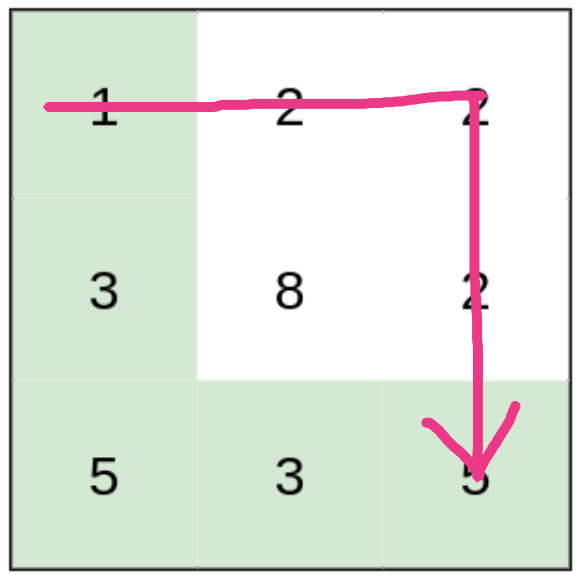
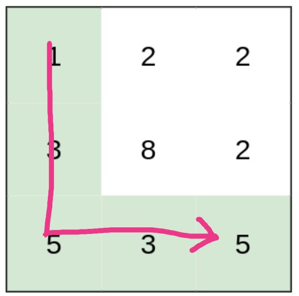

# Thought Process from Naive BFS to Dijkstra

**Author:** jasonlimantoro
**Votes:** 324
**Link:** [https://leetcode.com/problems/path-with-minimum-effort/solutions/1000195/](https://leetcode.com/problems/path-with-minimum-effort/solutions/1000195/)

---

**TLDR**: Naive BFS doesn't work because you only visit the node once, and therefore you **only consider one of many paths.** Secondly, a naive BFS will give you the path with minimal nodes visited and doesn't care about the `effort`. In this problem, though, we can clearly see that `optimal path != path with minimal length` (look at **Example 3**), which naive BFS is unable to differentiate.

# Thought Process

When a question asks about something related to shortest path, always consider how BFS can help because that's what BFS does. However after a few minutes of thinking, I quickly realize that a simple naive BFS would not work.

Before going further, here is the pseudocode of naive BFS:
```
queue = []
visited = set()
while queue:
	me = queue.popleft()
	for every neighbor of me:
		if neighbor not in visited:
			visited.add(neighbor)
			queue.append(neighbor)
```
Consider the **Example 1**. If you loop the neighbors in the following order: **right,left,bottom,up** then you would find the below path before other possible paths


That's great. Although it is not the optimal path, at least you found a path to the destination and you know the `effort` here is 3. Now, you can look for other better paths right? Unfortunately, in naive BFS, you only visit a node exactly once. This means that unless you reset the `visited` set, you can't find other way to the destination. Remember, by now, the destination itself is already marked as visited right? So you will not visit it again.

Interestingly, if you loop your neighbors in the following order: **bottom,right,left,up**, then you will find optimal path.


So the order of iterating the neighbor clearly matters. But wait a minute! that's no longer the scope of BFS!

> In BFS, the order of looping the neighbors should never affect the answer. BFS should find the shortest path regardless of how you iterate your neighbors. 

It is true our BFS has found the path with minimal length (i.e. both of the above paths visit 4 nodes). However, our BFS cannot differentiate the `effort` of the two paths above. In fact, once you introduce any notion of weight to the graph, BFS will fail since BFS doesn't really care about weight.  And so, naive BFS would not work for this problem. We need to modify our stupid BFS.

Fortunately, we're close. At this point, I know that the logic for visiting a node is messed up; I cannot just visit a node once and call it a day, I need to visit it more than once. Where in the code that is responsible of whether or not I should visit a node?

That's right. It's this dude:
```
if neighbor not in visited:
	# visit neighbor
```
So we need to change the logic and how we store the BFS's visited state. How? Well, ask this question.

> When would I ever bother to visit a node for the second time?

The answer is 

> when we found a better path (i.e. lower cost)

And this answer should be sufficient to give me a hint that instead of a visited set, we need to store **a cost in dictionary**. Hence, the modified BFS should look like the following (pseudocode):
```python
queue = []
cost = {} # dictionary, instead of a set
while queue:
	me = queue.popleft()
	for every neighbor of me:
		new_cost = compute_cost()
		if new_cost < cost[neighbor]: # better path!
			cost[neighbor] = new_cost
			queue.append(neighbor)
```

**And this modified BFS is actually what Dijkstra does :)**.

## Solution
For reference, this is just one way of implementing the Dijkstra's algorithm (no priority queue).

```python
from collections import deque

class Solution:
    def minimumEffortPath(self, heights: List[List[int]]) -> int:
        H = len(heights)
        W = len(heights[0])

        queue = deque([])
        queue.append((0, 0))

        cost = { (row, col): float('inf') for col in range(W) for row in range(H) }
        cost[(0, 0)] = 0

        directions = [[1,0], [0,1], [-1,0], [0,-1]]
        
        def inside(row, col):
            return 0 <= row < H and 0 <= col < W
        
        while queue:
            row, col = queue.popleft()
            current_height = heights[row][col]
            current_cost = cost[(row, col)]

            for d_row, d_col in directions:
                new_row = row + d_row
                new_col = col + d_col

                if inside(new_row, new_col):
                    neighbor_height = heights[new_row][new_col]
                    new_cost = max(current_cost, abs(neighbor_height - current_height))
                    if new_cost < cost[(new_row, new_col)]:
                        cost[(new_row, new_col)] = new_cost
                        queue.append((new_row, new_col))
        
        return cost[(H - 1, W - 1)]
```

# Analysis
Right now we have working answer. But it is `O(V^2)`. Where `V` is the number of nodes (H * W). We could optimize the Dijkstra's algorithm with minimizing heap (or priority queue, if you will) instead of a simple queue. That will bring the complexity down to `O(ElgV)`. I'm sure every other posts would have already had this solution.
