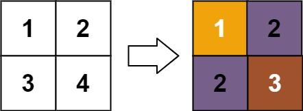
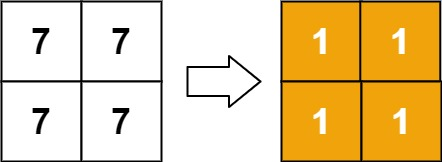
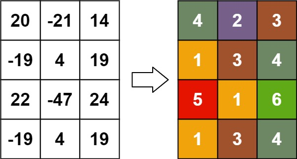

# [1632. Rank Transform of a Matrix](https://leetcode.com/problems/rank-transform-of-a-matrix/)

| Category | Difficulty | Likes | Dislikes |
| :------: | :--------: | :---: | :------: |
| Algorithms | Hard | 927 | 58 |

**Tags:** [`array`](https://leetcode.com/tag/array), [`union-find`](https://leetcode.com/tag/union-find), [`graph`](https://leetcode.com/tag/graph), [`topological-sort`](https://leetcode.com/tag/topological-sort), [`sorting`](https://leetcode.com/tag/sorting), [`matrix`](https://leetcode.com/tag/matrix)

**Companies:** `google`, `facebook`, `citadel`

## Description

Given an `m x n` `matrix`, return *a new matrix *`answer`* where *`answer[row][col]`* is the ****rank** of *`matrix[row][col]`.

The **rank** is an **integer** that represents how large an element is compared to other elements. It is calculated using the following rules:

	- The rank is an integer starting from `1`.

	- If two elements `p` and `q` are in the **same row or column**, then:
	
		If `p  q` then `rank(p) > rank(q)`

	
	
	- The **rank** should be as **small** as possible.

The test cases are generated so that `answer` is unique under the given rules.

 

**Example 1:**


```

Input: matrix = [[1,2],[3,4]]
Output: [[1,2],[2,3]]
Explanation:
The rank of matrix[0][0] is 1 because it is the smallest integer in its row and column.
The rank of matrix[0][1] is 2 because matrix[0][1] &gt; matrix[0][0] and matrix[0][0] is rank 1.
The rank of matrix[1][0] is 2 because matrix[1][0] &gt; matrix[0][0] and matrix[0][0] is rank 1.
The rank of matrix[1][1] is 3 because matrix[1][1] &gt; matrix[0][1], matrix[1][1] &gt; matrix[1][0], and both matrix[0][1] and matrix[1][0] are rank 2.

```

**Example 2:**


```

Input: matrix = [[7,7],[7,7]]
Output: [[1,1],[1,1]]

```

**Example 3:**


```

Input: matrix = [[20,-21,14],[-19,4,19],[22,-47,24],[-19,4,19]]
Output: [[4,2,3],[1,3,4],[5,1,6],[1,3,4]]

```

 

**Constraints:**

	- `m == matrix.length`

	- `n == matrix[i].length`

	- `1 <= m, n <= 500`

	- `-10^9 <= matrix[row][col] <= 10^9`

---

**Links:** [Submissions](https://leetcode.com/problems/rank-transform-of-a-matrix/) | [Solutions](https://leetcode.com/problems/rank-transform-of-a-matrix/)
