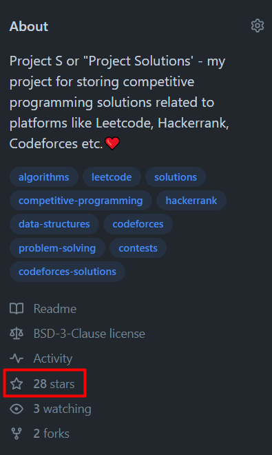

# ✅💯🔥Explanations No One Will Give You🎓🧠Very Detailed Approach🎯🔥Extremely Simple And Effective🔥

**Author:** heir-of-god
**Votes:** 125
**Link:** [https://leetcode.com/problems/sort-array-by-increasing-frequency/solutions/5520483/](https://leetcode.com/problems/sort-array-by-increasing-frequency/solutions/5520483/)

---

<blockquote>
        <p>
            <b>
                Never limit yourself because of others\u2019 limited imagination; never limit others because of your own limited imagination
            </b>        
        </p>
        <p>
            --- Mae Jemison ---
        </p>
</blockquote>

# \uD83D\uDC51Problem Explanation and Understanding:

## \uD83C\uDFAF Problem Description
You are given an integer array `nums` and asked to sort this array by frequency of its elements first (In increasing order) and by elements theyselves second (In decreasing order).

## \uD83D\uDCE5\u2935\uFE0F Input:
- Integer array `nums`

## \uD83D\uDCE4\u2934\uFE0F Output:
Array after perfoming sorting

---

# 1\uFE0F\u20E3\uD83D\uDE0E Approach: Custom Sort Comparator

# \uD83E\uDD14 Intuition
- We know how to perform sorting with comparators but we need to somehow optimize getting frequency, because counting number of elements iterating through whole list for every element is quite unefficient.
- One of your choices - hashmap, but since constraints are pretty small I would say that using array with constant space (for this problem) can help to achieve O(1) space with counting sort but since there functions for sorting (like in Python) which uses algorithms like Timsort for sorting they use extra space in their implementation O(n) 
- Using frequency counter and elements themselves we can easily sort array by creating new custom comparator and pass it to the sort function.
- Because we can have negative values (-100 <= num <= 100) in order to find index for counter for current element we must add to this element 100 - think about it, for -100 index will be 0, for -99 index will be 1 and for 100 index will be 200 (So we need 201 elements in the array - 100 + 100 + 1 (100 negative + 100 positive + zero))

# \uD83D\uDC69\uD83C\uDFFB\u200D\uD83D\uDCBB Coding 
- Initializes a list `count` of size 201 with all elements set to 0.
- Iterates over each number `num` in `nums`.
- Increments the count of `num + 100` in the `count` list.
- Sorts `nums` using a custom key.
- The custom key sorts `nums` based on two criteria: the frequency of each number (increasing order) and the value of the number itself (decreasing order if frequencies are the same).
- Returns the sorted `nums` list.

# \uD83D\uDCD7 Complexity Analysis
- \u23F0 Time complexity: O(n * log n), since we use built-in sort functions which is n * log n for most languages
- \uD83E\uDDFA Space complexity: O(n), since since most sort functions use extraspace up to O(n) but if we don't count this our implementation takes O(1) space (array always have a size of 201)

# \uD83D\uDCBB Code
``` python []
class Solution:
    def frequencySort(self, nums: list[int]) -> list[int]:
        count: list[int] = [0 for _ in range(201)]
        for num in nums:
            count[num + 100] += 1
        nums.sort(key=lambda val: (count[val + 100], -val))
        return nums
```
``` C++ []
class Solution {
public:
    vector<int> frequencySort(vector<int>& nums) {
        vector<int> count(201, 0);
        for (int num : nums) {
            count[num + 100]++;
        }
        sort(nums.begin(), nums.end(), [&](int a, int b) {
            if (count[a + 100] == count[b + 100])
                return a > b;
            return count[a + 100] < count[b + 100];
        });
        return nums;
    }
};
```
``` JavaScript []
function frequencySort(nums) {
    let count = Array(201).fill(0);
    nums.forEach(num => {
        count[num + 100]++;
    });
    return nums.sort((a, b) => {
        if (count[a + 100] === count[b + 100]) {
            return b - a;
        }
        return count[a + 100] - count[b + 100];
    });
}
```
``` Java []
class Solution {
    public int[] frequencySort(int[] nums) {
        int[] count = new int[201];
        for (int num : nums) {
            count[num + 100]++;
        }
        Integer[] numsArr = Arrays.stream(nums).boxed().toArray(Integer[]::new);
        Arrays.sort(numsArr, (a, b) -> {
            if (count[a + 100] == count[b + 100]) {
                return b - a;
            }
            return count[a + 100] - count[b + 100];
        });
        return Arrays.stream(numsArr).mapToInt(Integer::intValue).toArray();
    }
}
```
``` C []
int compare(const void* a, const void* b, void* count) {
    int valA = *(int*)a;
    int valB = *(int*)b;
    int* cnt = (int*)count;

    if (cnt[valA + 100] == cnt[valB + 100]) {
        return valB - valA;
    }
    return cnt[valA + 100] - cnt[valB + 100]; 
}

int* frequencySort(int* nums, int numsSize, int* returnSize) {
    int count[201] = {0};
    for (int i = 0; i < numsSize; i++) {
        count[nums[i] + 100]++;
    }

    qsort_r(nums, numsSize, sizeof(int), compare, count);

    *returnSize = numsSize;
    return nums;
}
```

# Additional Python One-liner (Not recommend to use, it's slow because, I think, it creates new Counter() object for every iteration (element) and also creates new array in memory instead of using input)
```python
class Solution:
    def frequencySort(self, nums: list[int]) -> list[int]:
        return sorted(nums, key=lambda val: (Counter(nums)[val], -val))
```

## \uD83D\uDCA1\uD83D\uDCA1\uD83D\uDCA1I encourage you to check out [my profile](https://leetcode.com/heir-of-god/) and [Project-S](https://github.com/Heir-of-God/Project-S) project for detailed explanations and code for different problems (not only Leetcode). Happy coding and learning!\uD83D\uDCDA

### Sorry for that, but I missed the moment repository gets 25 stars\u2B50 I want to say much thanks for everyone who support me this way, you all are great, I really appreciate that, keep moving!

<div align="center">



</div>

### Please consider *upvote*\u2B06\uFE0F\u2B06\uFE0F\u2B06\uFE0F because I try really hard not just to put here my code and rewrite testcase to show that it works but explain you WHY it works and HOW. Thank you\u2764\uFE0F

## If you have any doubts or questions feel free to ask them in comments. I will be glad to help you with understanding\u2764\uFE0F\u2764\uFE0F\u2764\uFE0F


