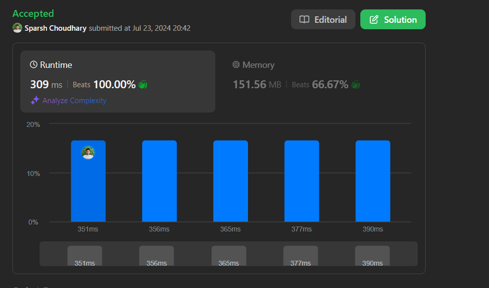

# SUPER EASY 😂 | BEATS 100% ✨ | EK DUM LOLLIPOP 🍭 |

**Author:** CodeWithSparsh
**Votes:** 2
**Link:** [https://leetcode.com/problems/sort-array-by-increasing-frequency/solutions/5523301/](https://leetcode.com/problems/sort-array-by-increasing-frequency/solutions/5523301/)

---

image.png# 



<!-- Describe your first thoughts on how to solve this problem. -->
# Intuition
To solve this problem, we need to sort an array of integers based on their frequency in ascending order. If two numbers have the same frequency, they should be sorted in descending order.

# Approach
1. **Frequency Counting:** First, iterate through the array to count the frequency of each number using a HashMap.
2. **Sorting Criteria:** Sort the numbers based on two criteria:
   - Sort by frequency in ascending order.
   - If two numbers have the same frequency, sort them in descending order.
3. **Sorting:** Use Dart's `sort` method with a custom comparator to achieve the desired sorting order.
4. **Return:** Return the sorted array.

# Complexity
- Time complexity: \\(O(n \\log n)\\) due to sorting, where \\(n\\) is the number of elements in the array.
- Space complexity: \\(O(n)\\) for the HashMap used to store the frequency of each number.

# Code
```dart
class Solution {
  List<int> frequencySort(List<int> nums) {
    final frequencyMap = <int, int>{};
    
    // Count frequency of each number
    for (var num in nums) {
      frequencyMap[num] = (frequencyMap[num] ?? 0) + 1;
    }

    // Sort nums based on frequency and value
    nums.sort((a, b) {
      final freqA = frequencyMap[a]!;
      final freqB = frequencyMap[b]!;
//0 \u2212 when the strings are equal.
//1 \u2212 when the first string is greater than the second
//-1 \u2212 when the first string is smaller than the second
      if (freqA != freqB) {
        return freqA.compareTo(freqB); // Sort by frequency in ascending order
      } else {
 // multiple values have the same frequency, sort them in decreasing order.
        return b.compareTo(a); // If frequencies are equal, sort by value in descending order
      }
    });

    return nums;
  }
}
```

This Dart code implements the approach described:
- It uses a HashMap (`frequencyMap`) to count the frequency of each number in the input list `nums`.
- The list `nums` is then sorted using a custom comparator function:
  - First by frequency in ascending order.
  - If frequencies are the same, by value in descending order.
- Finally, the sorted list `nums` is returned as the result.


