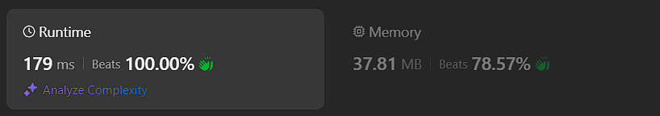
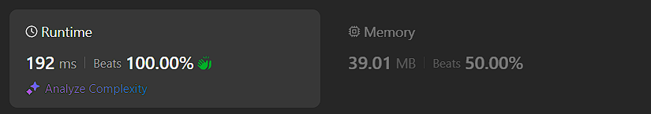
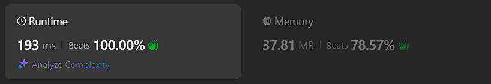
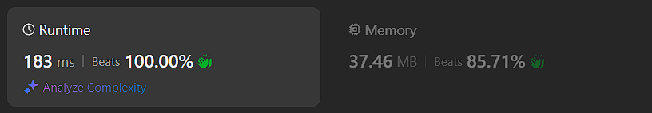

# Kotlin. Beats 100% (179 ms). Bitwise markers + sorting

**Author:** mobdev778
**Votes:** 2
**Link:** [https://leetcode.com/problems/sort-array-by-increasing-frequency/solutions/5521557/](https://leetcode.com/problems/sort-array-by-increasing-frequency/solutions/5521557/)

---



# Code

```
class Solution {
    fun frequencySort(nums: IntArray): IntArray {
        val f = IntArray(201) { 200 - it }
        for (n in nums) {
            f[n + 100] += 0x10000
        }

        Arrays.sort(f)

        var i = 0
        for (c in f) {
            var count = c shr 16
            while (count > 0) {
                nums[i++] = (200 - (c and 0xFFFF)) - 100
                count--
            }
        }

        return nums
    }
}
```

# Approach

This solution is quite difficult to understand at first glance, but I will try to explain.

We know that the range of values \u200B\u200Bin "nums" is not very large - each number from this array cannot be less than -100 and cannot be greater than +100.

Therefore, we can select in advance a range of 201 values \u200B\u200B(-100, 0, +100), with which we will count how many times we encountered a particular number.

But! We know that in Kotlin the number "Int" is 4 bytes. And since the frequencies will take us no more than 2 bytes, we can use a little trick.

We can write numbers into the "f" array, which will already contain all the necessary data for sorting - we can write the frequency of each number into the upper 2 bytes, and its "inverted" value into the lower 2 bytes. Here, "inverted" means that a large number turns into a small one and vice versa. This is done so that numbers with the same frequency are sorted in reverse order.

With such a transformation, the "f" array for "nums=[1,1,2,2,2,3,4] will be:

```
...
196: 0000 00C8
197: 0001 0060 (0x60 = 96 = 200 - (4) - 100)
198: 0001 0061 (0x61 = 97 = 200 - (3) - 100)
199: 0002 0063 (0x63 = 99 = 200 - (1) - 100)
200: 0003 0x62 (0x62 = 98 = 200 - (2) - 100)
```
As we can see, sorting is performed by two fields. The high 2 bytes have a larger priority - this is the frequency with which the number occurs (0001, 0002, 0003).
The low 2 bytes have a lower priority - this is the "inverted" value of the number.

After sorting, we can write the contents of the "f" array back to "nums" using the knowledge of the transformation.

We can transform the high 2 bytes into a regular number using a bitwise right shift: "it shr 16".
```
0x00010060 shr 16 = 0x0001
0x00020063 shr 16 = 0x0002
```

and transform the low 2 bytes by applying a mask that filters the lower 2 bytes (0xFFFF) and then performing the necessary subtractions.

# Alternative approaches

1) Custom comparable class "Counter"



```
class Solution {
    fun frequencySort(nums: IntArray): IntArray {
        val f = Array(201) { Counter(it - 100) }
        for (n in nums) {
            f[n + 100].count++
        }

        f.sort()

        var i = 0
        for (c in f) {
            while (c.count > 0) {
                nums[i++] = c.value
                c.count--
            }
        }

        return nums
    }

    class Counter(val value: Int) : Comparable<Counter> {
        @JvmField var count: Int = 0
        override fun compareTo(other: Counter): Int {
            if (count == 0 && other.count > 0) return 1
            if (other.count == 0 && count > 0) return -1

            val diff = count - other.count
            if (diff != 0) return diff
            return other.value - value
        }
    }
}
```

2) Bitwise math + "nums" in-place sorting



```
class Solution {
    fun frequencySort(nums: IntArray): IntArray {
        val f = IntArray(201)
        for (n in nums) {
            f[n + 100] += 0x10000
        }

        for (i in 0 until nums.size) {
            val n = nums[i]
            nums[i] = f[n + 100] or (200 - n)
        }

        nums.sort()

        for (i in 0 until nums.size) {
            nums[i] = 200 - (nums[i] and 0xFFFF)
        }

        return nums
    }
}
```

3) Custom QuickSort function



```
class Solution {
    fun frequencySort(nums: IntArray): IntArray {
        val f = IntArray(201)
        for (n in nums) {
            f[n + 100] += 0x10000
        }

        quickSort(nums, 0, nums.size - 1, f)

        return nums
    }

    fun quickSort(nums: IntArray, begin: Int, end: Int, f: IntArray){
        if (begin < end) {
            val partitionIndex = partition(nums, begin, end, f)
            quickSort(nums, begin, partitionIndex - 1, f)
            quickSort(nums, partitionIndex + 1, end, f)
        }
    }

    private fun partition(nums: IntArray, begin: Int, end: Int, f: IntArray): Int {
        val pivot = f[nums[end] + 100] or (200 - nums[end])
        var i = begin - 1
        for (j in begin until end) {
            if (f[nums[j] + 100] or (200 - nums[j]) <= pivot) {
                i++
                val t = nums[i]
                nums[i] = nums[j]
                nums[j] = t
            }
        }

        val t = nums[i + 1]
        nums[i + 1] = nums[end]
        nums[end] = t

        return i + 1
    }
}
```