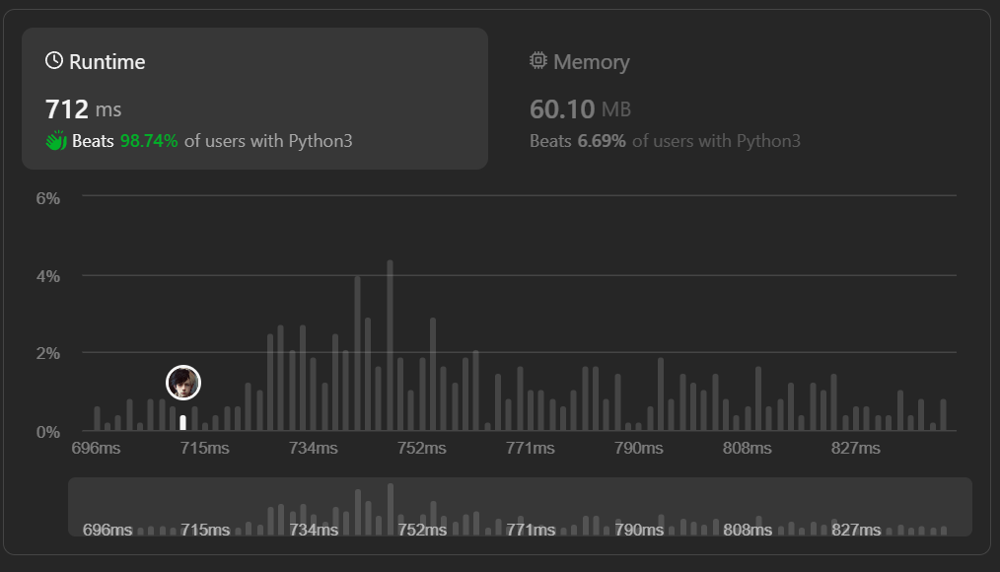

# ✅98.74%🔥Easy Solution🔥with explanation🔥

**Author:** MrAke
**Votes:** 84
**Link:** [https://leetcode.com/problems/widest-vertical-area-between-two-points-containing-no-points/solutions/4432715/](https://leetcode.com/problems/widest-vertical-area-between-two-points-containing-no-points/solutions/4432715/)

---



---
# Intuition
##### The problem asks for the widest vertical area between two points on a 2D plane. To find this, we can sort the given points based on their x-coordinates. After sorting, we can iterate through the sorted points and calculate the horizontal distance between consecutive points. The maximum of these distances will be the widest vertical area.
---

# Approach
 1. #### Sort the points based on their x-coordinates.
 2. #### Initialize a variable `max_width` to store the maximum width.
 3. #### Iterate through the sorted points starting from index 1.
 4. #### For each pair of consecutive points, calculate the width by subtracting the x-coordinate of the previous point from the x-coordinate of the current point.
 5. #### Update `max_width` with the maximum of its current value and the calculated width.
 6. #### After the iteration, `max_width` will contain the result.
---
# Complexity
- ### Time complexity:
##### $$O(n * log(n))$$ due to the sorting operation, where n is the number of points.
- ### Space complexity:
##### $$O(1)$$ as we use a constant amount of space for variables.
---
# Code

```python []
class Solution:
    def maxWidthOfVerticalArea(self, points: List[List[int]]) -> int:
        points.sort(key=lambda x: x[0])

        max_width = 0

        for i in range(1, len(points)):
            width = points[i][0] - points[i-1][0]
            max_width = max(max_width, width)

        return max_width
```
```C++ []
class Solution {
public:
    int maxWidthOfVerticalArea(std::vector<std::vector<int>>& points) {
        std::sort(points.begin(), points.end(), [](const auto& a, const auto& b) {
            return a[0] < b[0];
        });

        int max_width = 0;

        for (int i = 1; i < points.size(); ++i) {
            int width = points[i][0] - points[i - 1][0];
            max_width = std::max(max_width, width);
        }

        return max_width;
    }
};
```
```javascript []
var maxWidthOfVerticalArea = function(points) {
    points.sort((a, b) => a[0] - b[0]);

    let maxWidth = 0;

    for (let i = 1; i < points.length; i++) {
        let width = points[i][0] - points[i - 1][0];
        maxWidth = Math.max(maxWidth, width);
    }

    return maxWidth;
};

```
```java []
class Solution {
    public int maxWidthOfVerticalArea(int[][] points) {
        Arrays.sort(points, (a, b) -> Integer.compare(a[0], b[0]));

        int max_width = 0;

        for (int i = 1; i < points.length; i++) {
            int width = points[i][0] - points[i - 1][0];
            max_width = Math.max(max_width, width);
        }

        return max_width;
    }
}
```
```C# []
public class Solution {
    public int MaxWidthOfVerticalArea(int[][] points) {
        Array.Sort(points, (a, b) => a[0].CompareTo(b[0]));

        int maxWidth = 0;

        for (int i = 1; i < points.Length; i++) {
            int width = points[i][0] - points[i - 1][0];
            maxWidth = Math.Max(maxWidth, width);
        }

        return maxWidth;
    }
}
```
```PHP []
class Solution {
    function maxWidthOfVerticalArea($points) {
        usort($points, function ($a, $b) {
            return $a[0] - $b[0];
        });

        $maxWidth = 0;

        for ($i = 1; $i < count($points); $i++) {
            $width = $points[$i][0] - $points[$i - 1][0];
            $maxWidth = max($maxWidth, $width);
        }

        return $maxWidth;
    }
}

```
```ruby []
def max_width_of_vertical_area(points)
    points.sort! { |a, b| a[0] - b[0] }

    max_width = 0

    (1...points.length).each do |i|
        width = points[i][0] - points[i - 1][0]
        max_width = [max_width, width].max
    end

    max_width
end

```
---


