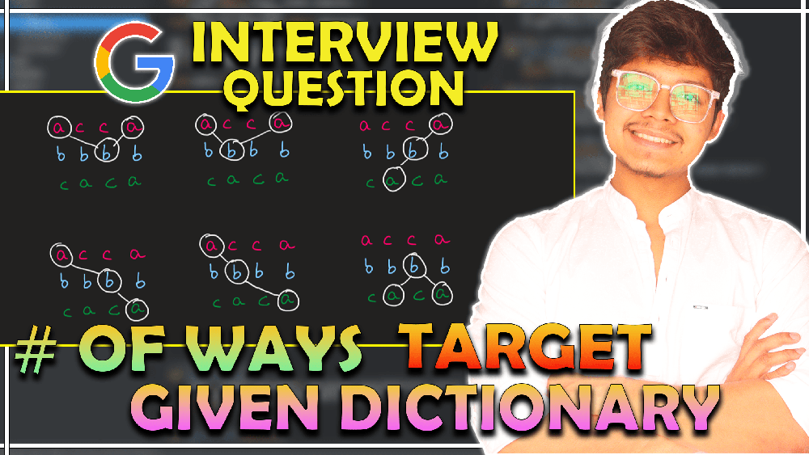
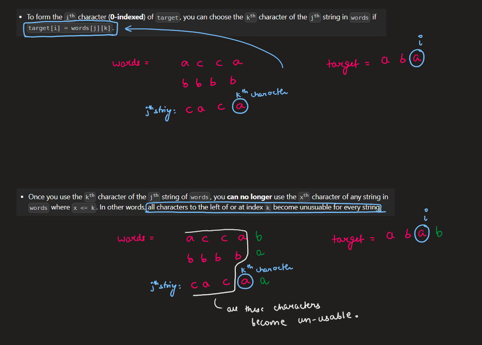
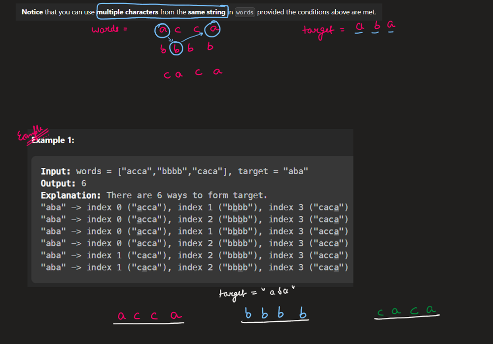
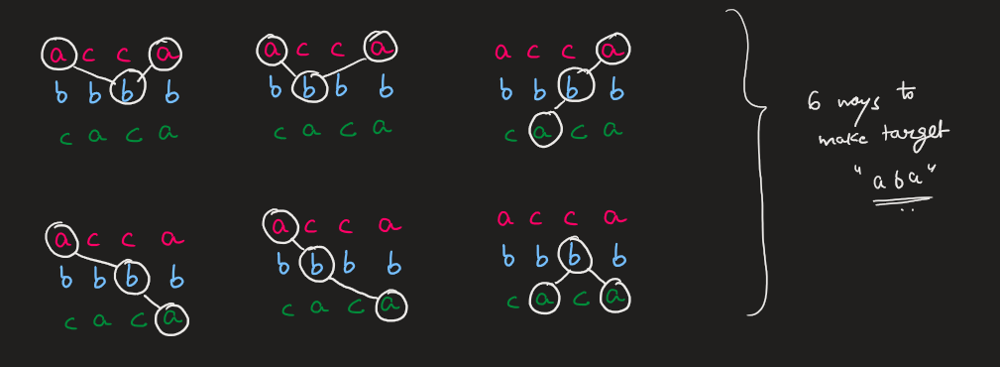
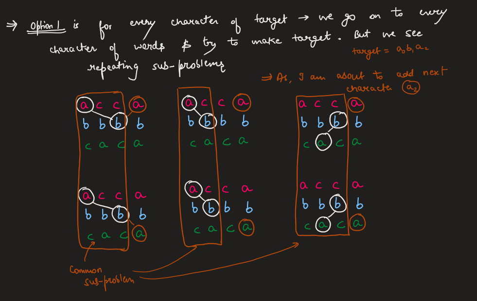
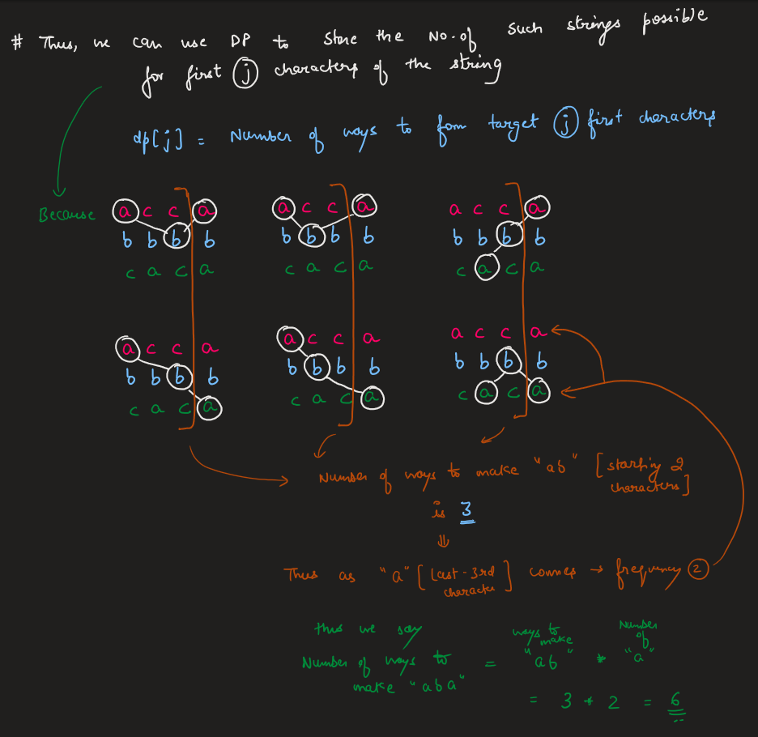
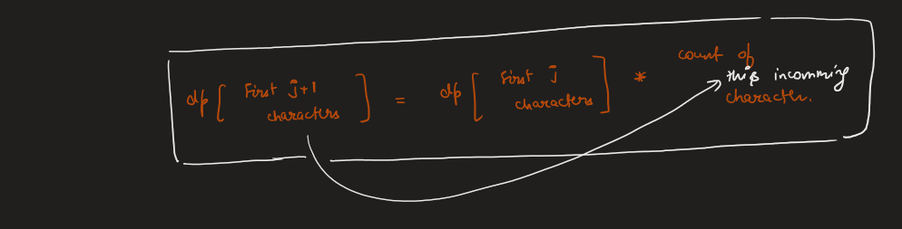
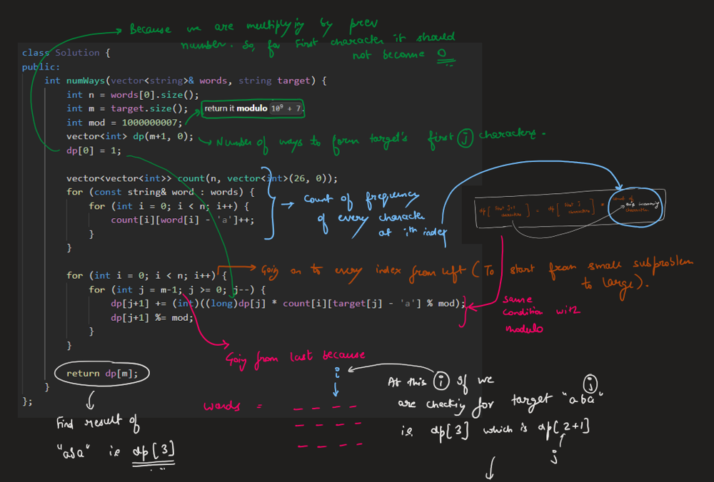
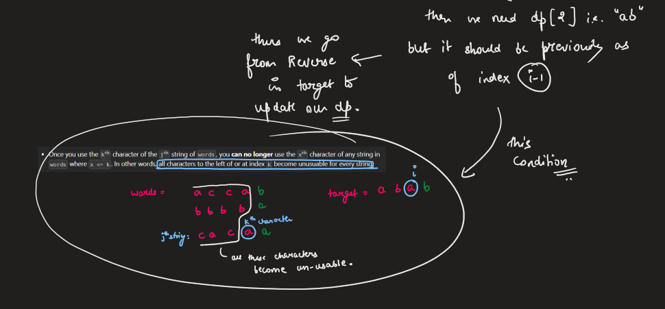
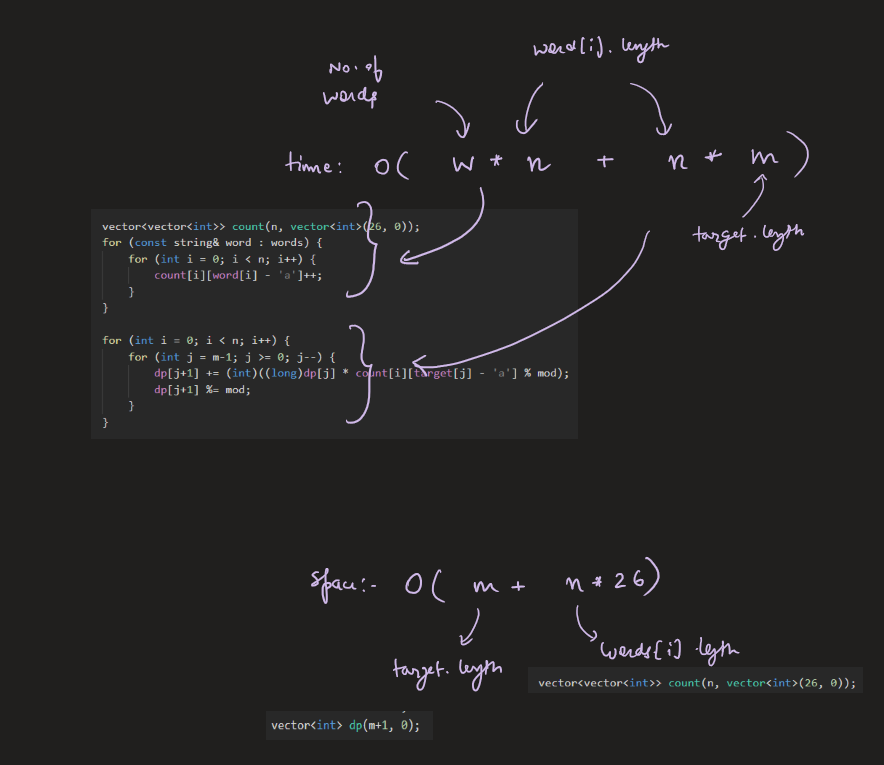

# Image Explanation🏆- [DP - Complete Intuition] - C++/Java/Python

**Author:** aryan_0077
**Votes:** 46
**Link:** [https://leetcode.com/problems/number-of-ways-to-form-a-target-string-given-a-dictionary/solutions/3421540/](https://leetcode.com/problems/number-of-ways-to-form-a-target-string-given-a-dictionary/solutions/3421540/)

---

# Video Solution (`Aryan Mittal`) - Link in LeetCode Profile
`Number of Ways to Form a Target String Given a Dictionary` by `Aryan Mittal`



# Approach & Intution











# Code
```C++ []
class Solution {
public:
    int numWays(vector<string>& words, string target) {
        int n = words[0].size();
        int m = target.size();
        int mod = 1000000007;
        vector<int> dp(m+1, 0);
        dp[0] = 1;
        
        vector<vector<int>> count(n, vector<int>(26, 0));
        for (const string& word : words) {
            for (int i = 0; i < n; i++) {
                count[i][word[i] - 'a']++;
            }
        }
        
        for (int i = 0; i < n; i++) {
            for (int j = m-1; j >= 0; j--) {
                dp[j+1] += (int)((long)dp[j] * count[i][target[j] - 'a'] % mod);
                dp[j+1] %= mod;
            }
        }
        
        return dp[m];
    }
};
```
```Java []
class Solution {
    public int numWays(String[] words, String target) {
        int n = words[0].length();
        int m = target.length();
        int mod = 1000000007;
        int[] dp = new int[m+1];
        dp[0] = 1;
        
        int[][] count = new int[n][26];
        for (String word : words) {
            for (int i = 0; i < n; i++) {
                count[i][word.charAt(i) - 'a']++;
            }
        }
        
        for (int i = 0; i < n; i++) {
            for (int j = m-1; j >= 0; j--) {
                dp[j+1] += (int)((long)dp[j] * count[i][target.charAt(j) - 'a'] % mod);
                dp[j+1] %= mod;
            }
        }
        
        return dp[m];
    }
}
```
```Python []
class Solution:
    def numWays(self, words: List[str], target: str) -> int:
        n = len(words[0])
        m = len(target)
        mod = 10**9 + 7
        dp = [0] * (m+1)
        dp[0] = 1
        
        count = [[0] * 26 for _ in range(n)]
        for i in range(n):
            for word in words:
                count[i][ord(word[i]) - ord('a')] += 1
        
        for i in range(n):
            for j in range(m-1, -1, -1):
                dp[j+1] += dp[j] * count[i][ord(target[j]) - ord('a')]
                dp[j+1] %= mod
        
        return dp[m]
```
